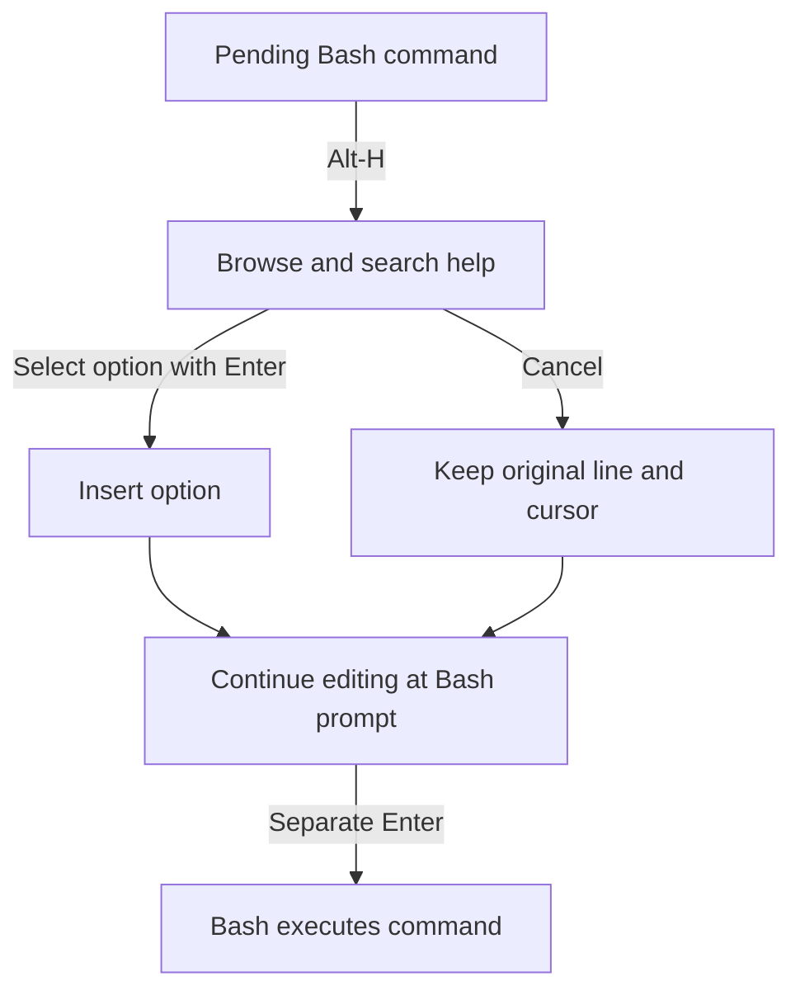

# CLI Interactive Help Menu

[](https://github.com/Usrnmna/CLI-InteractiveHelpMenu/actions/workflows/ci.yml)

**Local build · 0.4.0-alpha** · [Release history](CHANGELOG.md)

**Find the right option without leaving an unfinished Bash command.**

Press **Alt-H** to browse categorized help, search descriptions, and insert an
option into the line being edited. Continue typing its value or another option;
the pending command runs only after a separate **Enter at the Bash prompt**.
This Linux Bash prototype is intended for terminal users assembling commands
whose flags and argument syntax are difficult to remember.

[Get started](#get-started) · [Browser controls](#using-the-browser) ·
[Compatibility](#compatibility-and-execution-boundaries) · [All guides](docs/README.md)


Recorded from the local build with discovery off. The same rsync option stays selected as the explanation expands. After insertion, Bash resumes editing the pending command. [Static browser view](docs/assets/help-browser.png) ·
[Scrolled option list](docs/assets/ls-browser.png) ·
[Resulting command line](docs/assets/option-inserted.png) ·
[Capture method and limits](docs/assets/README.md)

## What it provides

- **Help while typing:** categories, description search, scrollable option lists,
  and argument placeholders in a keyboard-controlled terminal browser. Choose Simple, Detailed or Expanded for the selected option.
- **Literal option insertion:** replace a partial flag, preserve surrounding
  input, and return to editing. Cancellation retains the original line and cursor.
- **Value guidance:** see units, scale, counted subjects and accepted forms in
  Expanded. Search for units such as `bps`, `KiB/s` or `MHz` without changing the value you type.
- **Several help sources:** bundled and custom profiles, installed help output,
  local manuals, and explicit drivers for supported subcommand paths.
- **Editable help collections:** import a manual, scan installed commands, and
  correct options, categories, and routes through guided forms and previews.
- **Configurable operation:** launch and navigation keys, discovery modes,
  passive diagnostics, and per-user updates with backups and conflict review.

**Execution boundary:** selecting an option does not execute the pending command.
Default automatic discovery can separately invoke an installed program's help
route. Use `CLI_HELP_DISCOVERY=man` for manual-only discovery or `off` for static
profiles. [Discovery modes and limitations](docs/discovery-and-safety.md)

## Get started

### Requirements

- **Linux**, **Bash 4.4+**, and **Python 3.10+** with its standard-library `curses`
  module. The runtime requires no third-party Python packages.
- A UTF-8 locale, a terminal at least **60 columns × 16 rows**, and the standard
  Linux `stty` utility for resize detection.
- Optional: Linux `man-db` and local manual pages for manual discovery, installed
  manual imports, and bulk scans. Static profiles and text-file imports do not
  require `man`.

The project is an **alpha prototype**. Windows PowerShell and other shells do not
provide the Bash integration; Linux sessions under WSL are included in the
[recorded validation](docs/development.md#recorded-validation).

### Install for the current user

Obtain the source checkout:

```bash
git clone https://github.com/Usrnmna/CLI-InteractiveHelpMenu.git
cd CLI-InteractiveHelpMenu
```

From that directory, run as the account that will use the browser, without `sudo`:

```bash
bash install.sh
source "${XDG_DATA_HOME:-$HOME/.local/share}/cli-interactive-help/bash/interactive-help.bash"
```

Installation copies the runtime and adds a marked block to `.bashrc`, backing up
existing contents. New interactive Bash sessions load it automatically.
For a temporary session in an existing Bash shell, source
`"$PWD/bash/interactive-help.bash"` from the checkout. The
[terminal-pane setup](docs/usage.md#run-in-a-terminal-pane) gives the exact
launch command for an editor or app.

For a v0.4.0-alpha installer or archive, follow the [local build and checksum instructions](docs/releases.md#build-from-source). The earlier [v0.1.2-alpha prerelease](https://github.com/Usrnmna/CLI-InteractiveHelpMenu/releases/tag/v0.1.2-alpha) has published downloads and its own [installation examples](docs/release-notes-v0.1.2-alpha.md). The native launcher requires an adjacent Bash/Python runtime.

### Insert the first option

1. Type `rsync --ar` at the Bash prompt **without pressing Enter**.
2. Press **Alt-H**. The partial flag filters the bundled rsync profile.
3. With `--archive` selected in the options pane, press **Enter**.
4. Continue editing `rsync --archive ` at the prompt. The command remains pending.

This example uses a bundled static profile; an installed `rsync` is not required
to browse it. If Alt-H is unavailable, press Escape followed by `h`.

See [installation, custom paths, updates, and removal](docs/installation.md) for
`--no-rc`, startup configuration, and recovery procedures.

## Using the browser

Each menu opens in **Simple**, with short option summaries and spare rows available for browsing. Use the arrow keys to navigate. The sidebar shortens long category names and the header shows the selected title. Press **D** once for **Detailed** guidance and again for **Expanded** forms, examples and limits. Press **D** a third time to return to Simple. The selection and filter stay in place.

Use `/` to search and `[` or `]` to scroll a longer explanation. Enter applies a search. In the options pane, Enter inserts the selected spelling. Type any required value back at the prompt. Escape while entering a search restores the previous filter. Escape outside search or Ctrl-C returns to the original line and cursor.

See [browser controls and keybindings](docs/usage.md#browser-controls) for paging, pane focus, Vi mode and custom shortcuts.

### Understand the value before inserting it


[Open the full-size numerical guidance view](docs/assets/numerical-guidance.png)

For rsync `--bwlimit=`, a bare `5000` means 5000 KiB/s. Search for `KiB/s` or `bytes/second` to find it. In Expanded, scroll with `[` and `]` to read the accepted input spellings before typing a value at the Bash prompt. FFmpeg’s `-b:v` uses bits per second and can be found with `bps`. The browser inserts the selected flag and leaves value entry to you.

[Controls and unit search](docs/usage.md#browser-controls) · [The same FFmpeg option at 80×24 and 60×16](docs/superpowers/plans/2026-11-24-menu-detail-levels-verification.md) · [Numerical metadata and applicability](docs/numerical-value-contract.md)



## Compatibility and execution boundaries

The checkout includes 76 bundled command profiles. Ordinary profiles work without an installed target. Vendor/version-guarded profiles require executable identity verification in automatic discovery mode. The [bundled audit](docs/audit-history.md#bundled-menu-progress) records the manual editions, aliases and limits by family.

The [command compatibility matrix](docs/compatibility.md) lists maintained paths,
version constraints, verification limits, and **explicit activation instructions
for supplied drivers**. Those drivers are not enabled merely by installation.
[Supported invocation forms](docs/invocation-and-structured-arguments.md) include
bounded `sudo`/`env`/`command` chains, selected Python modules, and specific keyword
and stream-selector forms.

The browser accepts simple commands with balanced quoting. Pipelines,
redirection, shell substitutions, unsupported prefixes, and alias/function
resolution are outside its supported grammar. Subcommand support depends on
profiles and drivers. Automatic help invocations can have startup side effects;
timeouts and output limits do not provide a sandbox.

To prevent target-program invocations during browsing, select a mode before the
next help request:

```bash
export CLI_HELP_DISCOVERY=man
```

For commands that need discovery, manual-only lookup needs an installed executable and a usable local manual.
`CLI_HELP_DISCOVERY=off` restricts browsing to static profiles. Bulk manual scanning,
manual import, and review preview do not invoke target programs. The
[discovery and safety guide](docs/discovery-and-safety.md) explains all modes,
fixed routes, cache behavior, and remaining limitations.

## Build and refine a help collection

Import one manual or scan installed commands, inspect the generated report, and
correct entries through guided forms before activating the collection.
The reviewer can preview the actual browser and saves validated changes with
backups. JSON editing is optional.

- [Scan, review, and activate a first collection](docs/bulk-scan.md#first-collection-walkthrough)
- [Import a single manual or text file](docs/manual-import.md)
- [Edit options and categories with guided forms](docs/review.md)
- [Inspect collection consistency and recover saved backups](docs/collection-recovery.md)

## Updates and removal

From a separate new source directory, run `bash update.sh` to upgrade an existing
installation. Edited files and custom settings are preserved; conflicts retain
incoming copies and a full backup for [guided review](docs/update-review.md).

To check published releases, run `bash update-from-github.sh --check --prerelease`.
The alpha channel requires `--prerelease`. Omit `--check` to apply an upgrade;
equal versions are not reinstalled, and unpublished changes require a local-source
update. See [GitHub release updates](docs/github-updates.md) for verification and
conflict handling.

Run `bash uninstall.sh` to remove the default installation. Edited files and
custom collections are retained. The [installation guide](docs/installation.md)
covers custom destinations and existing shell sessions after removal.

## Further documentation

| Task | Guide |
| --- | --- |
| Customize controls, discovery, or startup loading | [Usage and keybindings](docs/usage.md) |
| Diagnose configuration and command recognition without probes | [Passive diagnostics](docs/diagnostics.md) |
| Add command help or enable nested routes | [Profiles and drivers](docs/profiles-and-drivers.md) |
| Check supported syntax, value forms, and bundles | [Invocation forms](docs/invocation-and-structured-arguments.md) and [argument syntax](docs/argument-syntax.md) |
| Choose packages or compare release scope | [Release guide](docs/releases.md) and [v0.4.0-alpha changes](CHANGELOG.md#version-040---alpha) |
| Understand the implementation or run checks | [Architecture and validation](docs/development.md) |
| Find the next development task and its completion criteria | [Project roadmap](ROADMAP.md) |

The [documentation index](docs/README.md) links the operating guides. The [audit history](docs/audit-history.md) traces the development and verification of the help content. [Terminal media capture](docs/assets/README.md) describes the
demonstrations, annotations, and regeneration procedure.
