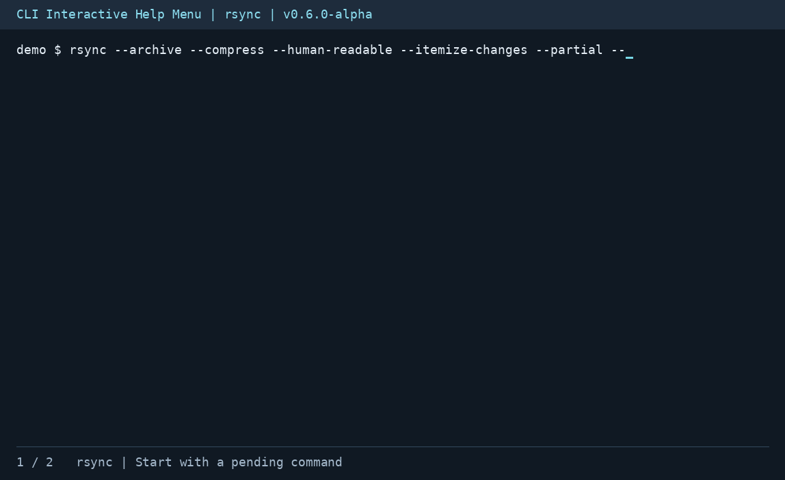
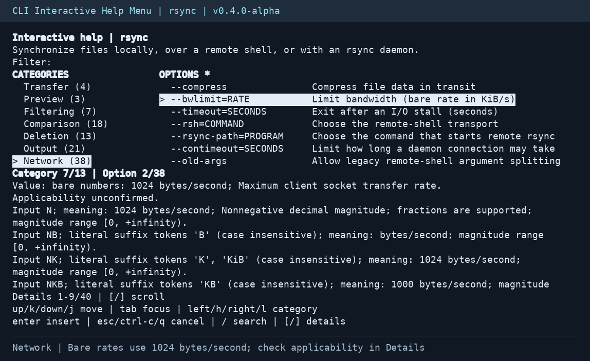
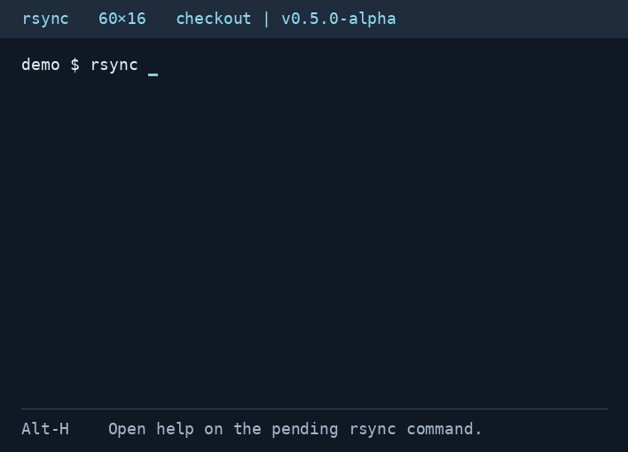
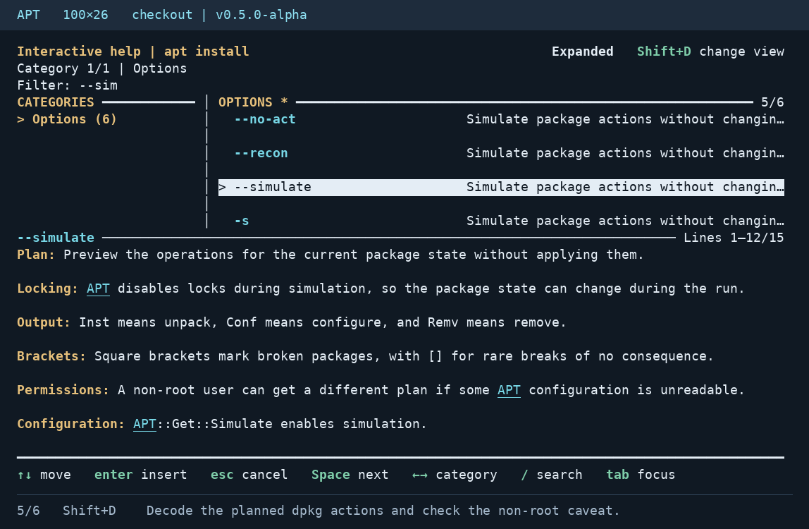
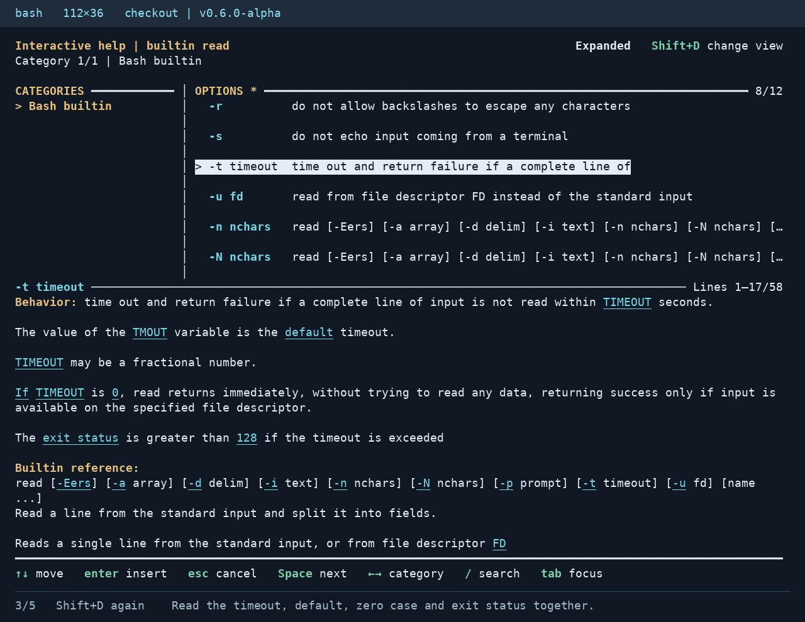
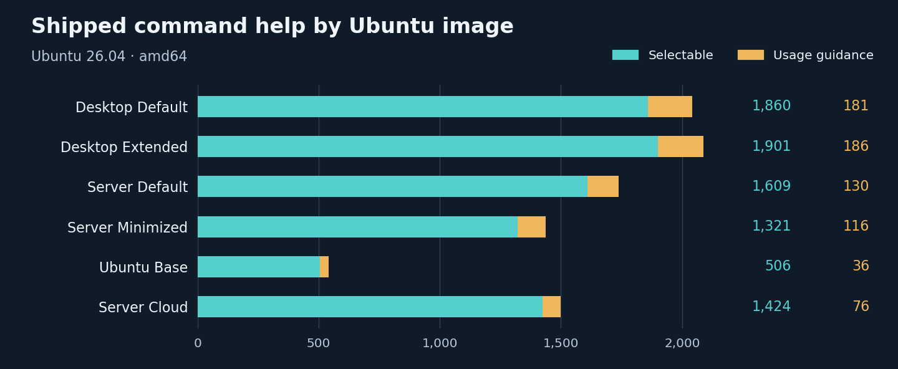
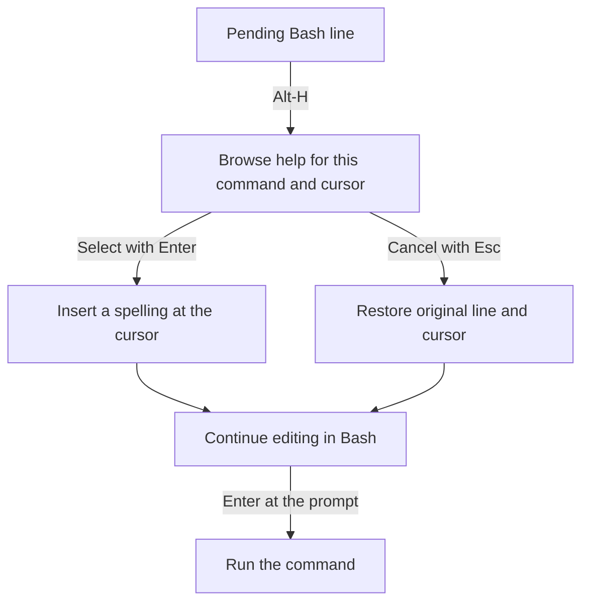
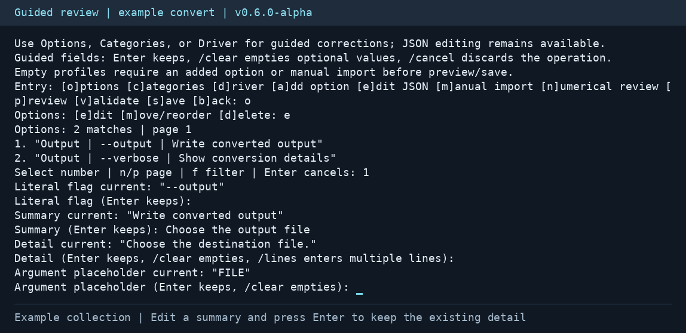

# CLI Interactive Help Menu

[](https://github.com/Usrnmna/CLI-InteractiveHelpMenu/actions/workflows/ci.yml)

Press **Alt-H** in an unfinished Bash command to find a flag, check what its value means, and insert it at the cursor. Keep typing, or press **Esc** to recover the original line and cursor. Bash runs the command when you press Enter **at the prompt**.

**Linux · Bash 4.4+ · Python 3.10+** · [v0.6.0-alpha candidate notes](docs/release-notes-v0.6.0-alpha.md)

[Get started](#get-started) · [Five live examples](#five-recorded-bash-scenarios) · [Ubuntu coverage](#ubuntu-command-coverage) · [Build a collection](#build-and-refine-a-help-collection) · [Documentation](docs/README.md)



*Follow the highlighted `rsync --bwlimit=RATE` through Simple, Detailed and Expanded, then insert the flag and type its value.* [Static menu](docs/assets/help-browser.png) · [Resulting command](docs/assets/option-inserted.png) · [Capture details](docs/assets/README.md)

## Get started

### Install for the current user

From the checkout you want to install, run the following as your own user. A new interactive Bash session picks up the binding automatically. The second command enables it immediately in the current shell.

```bash
bash install.sh
source "${XDG_DATA_HOME:-$HOME/.local/share}/cli-interactive-help/bash/interactive-help.bash"
```

To obtain the public checkout, use `git clone https://github.com/Usrnmna/CLI-InteractiveHelpMenu.git`. Run the install commands inside `CLI-InteractiveHelpMenu`. To try a checkout for one session, source `"$PWD/bash/interactive-help.bash"` directly. The installer backs up changes to `.bashrc` and supports `--no-rc` and custom prefixes. [Installation guide](docs/installation.md) · [Binary packages and checksums](docs/releases.md#verify-and-install)

### Insert the first option

1. Type `rsync --ar` and leave the cursor at the end.
2. Press **Alt-H**. The partial flag filters the bundled rsync menu to matching options.
3. Select **`--archive`** and press **Enter**. Bash returns to `rsync --archive `, ready for source and destination paths.

This example works from the bundled profile even without rsync installed. If your terminal intercepts Alt-H, press **Esc**, then **h**.

### Requirements

Linux, Bash 4.4+, Python 3.10+ with standard-library `curses`, a UTF-8 terminal of at least **60×16** cells, and `stty`. Local manual lookup and import can use Linux `man-db`. WSL Bash has recorded validation. PowerShell and other shells fall outside the Bash adapter’s scope. [Compatibility](docs/compatibility.md) · [Terminal-pane setup](docs/usage.md#run-in-a-terminal-pane)

## Using the browser

| While composing a command | Keys | Result |
| --- | --- | --- |
| Find an option or unit | **/**, type, **Enter** | Filter by spelling, description or value such as `KiB/s`. An arrow key moves the selection. |
| Read the selected option | **Shift+D** | Cycle Simple → Detailed → Expanded while keeping the same selection and filter. |
| Read more Details | **Space**, or **[** / **]** | Page overflowing text or scroll one line. Resizing rewraps the text around the reading position. |
| Choose or cancel | **Enter** on an option, or **Esc** | Insert the literal spelling at the cursor, or restore the edit. A quoted operand after the cursor stays in place. |

### Read the value before you insert it

A bare `5000` for rsync’s bandwidth limit means **5,000 KiB/s**. FFmpeg’s `-b:v` uses **bits per second**. Search by unit to find the right option. Expanded Details groups related input spellings with their meanings, including qualifications for individual tools and versions.



### Navigate a narrow terminal

The default split layout keeps categories and options side by side. For a dedicated screen per task at **60–79 columns**, set `export CLI_HELP_NARROW_MENU=1`. Use **→** for Categories → Options → Details and **←** to return. The split view resumes at 80 columns.

<details>
<summary>Watch the 60×16 rsync demo, including the two-second pause</summary>



Only a clipped, highlighted summary moves. Press **m** to toggle motion for the open menu. Use `unset CLI_HELP_NARROW_MENU` to restore the default layout.

</details>

[Controls and keybindings](docs/usage.md#browser-controls) · [Before-and-after resize snapshots](docs/terminal-resize-results.md)

## Five recorded Bash scenarios

Each walkthrough shows actual terminal cells, compares more than one option, and follows the edit back to Bash. Open a walkthrough for the full-size frames and all three detail levels.

| Terminal | Task | What to look for |
| --- | --- | --- |
| **APT · 100×26** | [Preview installing Graphviz](docs/menu-demo-storyboards.md#1-apt--preview-a-package-install) | Complete `apt ins` before a quoted operand. Inspect simulation, locking and verbose versions. |
| **Bash · 112×36** | [Give a prompt five seconds](docs/menu-demo-storyboards.md#2-bash--time-out-a-prompt) | Read `builtin read -t` and `-r` guidance, then enter the timeout at the prompt. |
| **Git · 80×24** | [List worktrees for a script](docs/menu-demo-storyboards.md#3-git--list-worktrees-for-a-script) | Discover why `-z` uses `--porcelain` and assemble both options. |
| **rsync · 60×16** | [Limit a transfer](docs/menu-demo-storyboards.md#4-rsync--read-a-clipped-bandwidth-limit) | Compare the bandwidth limit with an inactivity timeout in the narrow layout. |
| **FFmpeg · 120×30** | [Find a codec setting](docs/menu-demo-storyboards.md#5-ffmpeg--find-a-codec-setting-and-return-to-an-edit) | Page through 92 codec parameters, inspect `-trellis` and `-threads`, then cancel before a quoted filename. |

<details>
<summary>Compare the APT simulation and Bash timeout Details screens</summary>

**APT · simulation plan at 100×26**



**Bash · timed input at 112×36**



</details>

## Ubuntu command coverage

Across six audited Ubuntu 26.04 amd64 images, **2,189 of 2,385 distinct shipped names** offer a selectable option or keyword on at least one applicable invocation. The other **196** have command-specific usage or documentation guidance. The same command can appear in several images.



| Command family | Verified scope |
| --- | --- |
| Package managers | Five APT tools cover 112 command-to-verb routes on Resolute and 104 on Noble. dpkg actions preserve aliases and operand boundaries. |
| Bash builtins | 61 builtin names use fixed Bash help topics. Bare `echo` and `/usr/bin/echo` select their respective providers. |
| Optional packages | 100 ranked packages cover 119 selectable command rows on Resolute and 117 on Noble. Optional tools install separately. |
| Kernel companions | All eight inventoried paths in the audited versioned kernel tools package have selectable results. |

[Per-image counts and provider limits](docs/ubuntu-coverage-audit.md) · [Shipped, optional and kernel inventories](docs/ubuntu-command-coverage.md)

## Compatibility and execution boundaries

The browser uses 76 bundled profiles, custom profiles, installed help and manuals, explicit drivers, and edition-matched Ubuntu references. APT options follow the selected verb. A manual-light installation can use its packaged reference for an eligible command. Example drivers need explicit activation and some profiles require a matching executable identity. [Supported commands and driver setup](docs/compatibility.md#enable-the-drivers)



Automatic discovery may separately invoke an installed program’s fixed help route, which can have startup side effects. Use `export CLI_HELP_DISCOVERY=man` for manual-only lookup or `off` for static profiles. The parser supports simple commands with balanced quotes, bounded `sudo`, `env` and `command` prefixes, and selected subcommand routes. Pipelines, redirection, substitutions and alias/function resolution are outside the supported grammar. [Discovery modes](docs/discovery-and-safety.md) · [Invocation forms](docs/invocation-and-structured-arguments.md)

## Build and refine a help collection

Import a manual or scan installed commands. Review the generated options in a guided form, preview them in the browser, then save and activate the collection. The reviewer validates edits and keeps backups.



[First collection walkthrough](docs/bulk-scan.md#first-collection-walkthrough) · [Import one manual](docs/manual-import.md) · [Guided editor](docs/review.md) · [Inspect or recover a collection](docs/collection-recovery.md)

## Updates and removal

Run `bash update.sh` from a new source directory to update an installation. Edited files and settings are preserved, and conflicts retain incoming copies and a backup. Use `bash update-from-github.sh --check --prerelease` to check published alpha releases. Run `bash uninstall.sh` to remove the default installation while retaining edited files and custom collections. [GitHub updates](docs/github-updates.md) · [Conflict review](docs/update-review.md) · [Installation and removal](docs/installation.md)

## Further documentation

[All guides](docs/README.md) · [Passive diagnostics](docs/diagnostics.md) · [Profiles and drivers](docs/profiles-and-drivers.md) · [Architecture and validation](docs/development.md) · [Changelog](CHANGELOG.md) · [Roadmap](ROADMAP.md)
