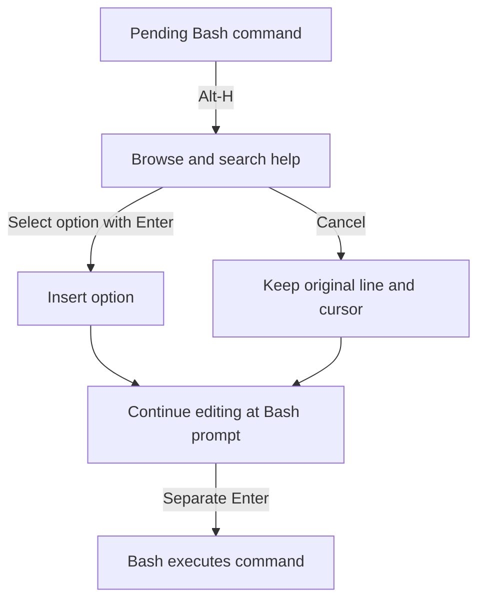

# CLI Interactive Help Menu

[](https://github.com/Usrnmna/CLI-InteractiveHelpMenu/actions/workflows/ci.yml)

**Find the right option without leaving an unfinished Bash command.**

Press **Alt-H** to browse categorized help, search descriptions, and insert an
option into the line being edited. Continue typing its value or another option;
the pending command runs only after a separate **Enter at the Bash prompt**.
This Linux Bash prototype is intended for terminal users assembling commands
whose flags and argument syntax are difficult to remember.

[Get started](#get-started) · [Browser controls](#using-the-browser) ·
[Compatibility](#compatibility-and-execution-boundaries) · [All guides](docs/README.md)


The 31-second demonstration uses real terminal output with static profiles and
discovery disabled. [Static browser view](docs/assets/help-browser.png) ·
[Scrolled option list](docs/assets/ls-browser.png) ·
[Resulting command line](docs/assets/option-inserted.png) ·
[Capture method and limits](docs/assets/README.md)

## What it provides

- **Help while typing:** categories, description search, scrollable option lists,
  and argument placeholders in a keyboard-controlled terminal browser.
- **Literal option insertion:** replace a partial flag, preserve surrounding
  input, and return to editing. Cancellation retains the original line and cursor.
- **Several help sources:** bundled and custom profiles, installed help output,
  local manuals, and explicit drivers for supported subcommand paths.
- **Editable help collections:** import a manual, scan installed commands, and
  correct options, categories, and routes through guided forms and previews.
- **Configurable operation:** launch and navigation keys, discovery modes,
  passive diagnostics, and per-user updates with backups and conflict review.

**Execution boundary:** selecting an option does not execute the pending command.
Default automatic discovery can separately invoke an installed program's help
route. Use `CLI_HELP_DISCOVERY=man` for manual-only discovery or `off` for static
profiles. [Discovery modes and limitations](docs/discovery-and-safety.md)

## Get started

### Requirements

- **Linux**, **Bash 4.4+**, and **Python 3.10+** with its standard-library `curses`
  module. The runtime requires no third-party Python packages.
- A UTF-8 locale, a terminal at least **60 columns × 16 rows**, and the standard
  Linux `stty` utility for resize detection.
- Optional: Linux `man-db` and local manual pages for manual discovery, installed
  manual imports, and bulk scans. Static profiles and text-file imports do not
  require `man`.

The project is an **alpha prototype**. Windows PowerShell and other shells do not
provide the Bash integration; Linux sessions under WSL are included in the
[recorded validation](docs/development.md#recorded-validation).

### Install for the current user

Obtain the source checkout:

```bash
git clone https://github.com/Usrnmna/CLI-InteractiveHelpMenu.git
cd CLI-InteractiveHelpMenu
```

From that directory, run as the account that will use the browser, without `sudo`:

```bash
bash install.sh
source "${XDG_DATA_HOME:-$HOME/.local/share}/cli-interactive-help/bash/interactive-help.bash"
```

Installation copies the runtime and adds a marked block to `.bashrc`, backing up
existing contents. New interactive Bash sessions load it automatically.
For a temporary session directly from the checkout, use
`source "$PWD/bash/interactive-help.bash"` instead of installing.

For versioned downloads, the published
[v0.1.2-alpha prerelease](https://github.com/Usrnmna/CLI-InteractiveHelpMenu/releases/tag/v0.1.2-alpha)
offers source archives and a Linux x86_64 installer. Follow the
[package selection and checksum instructions](docs/releases.md#verify-and-install)
before installation. The native launcher requires an adjacent Bash/Python runtime
and glibc 2.34+; source installation remains available for other Linux environments.
Checkout changes can extend beyond a release snapshot.

### Insert the first option

1. Type `rsync --ar` at the Bash prompt **without pressing Enter**.
2. Press **Alt-H**. The partial flag filters the bundled rsync profile.
3. With `--archive` selected in the options pane, press **Enter**.
4. Continue editing `rsync --archive ` at the prompt. The command remains pending.

This example uses a bundled static profile; an installed `rsync` is not required
to browse it. If Alt-H is unavailable, press Escape followed by `h`.

See [installation, custom paths, updates, and removal](docs/installation.md) for
`--no-rc`, startup configuration, and recovery procedures.

## Using the browser

| Default keys | Action |
| --- | --- |
| Up/Down, PageUp/PageDown, Home/End | Navigate the focused list |
| Left/Right | Change category |
| Tab | Switch between category and option panes |
| `/`, then Enter | Apply a search; press Enter again to insert a selected option |
| Ctrl-U | Clear the filter |
| Escape or Ctrl-C | Cancel and retain the original line and cursor |

Options requiring values display an argument placeholder. After insertion, type
the value at the prompt; attached forms leave the cursor next to the flag.
The [complete controls and configuration guide](docs/usage.md#browser-controls)
covers description scrolling, alternate keys, Vi keymaps, and terminal resizing.



## Compatibility and execution boundaries

Curated profiles cover subsets of Linux utilities, development tools, containers,
cloud CLIs, and embedded tooling. Ordinary static profiles work without installed
targets; vendor/version-guarded profiles require identity verification.
Generated help is inferred and can omit options or misidentify value requirements.

The [command compatibility matrix](docs/compatibility.md) lists maintained paths,
version constraints, verification limits, and **explicit activation instructions
for supplied drivers**. Those drivers are not enabled merely by installation.
[Supported invocation forms](docs/invocation-and-structured-arguments.md) include
bounded `sudo`/`env`/`command` chains, selected Python modules, and specific keyword
and stream-selector forms.

The browser accepts simple commands with balanced quoting. Pipelines,
redirection, shell substitutions, unsupported prefixes, and alias/function
resolution are outside its supported grammar. Subcommand support depends on
profiles and drivers. Automatic help invocations can have startup side effects;
timeouts and output limits do not provide a sandbox.

To prevent target-program invocations during browsing, select a mode before the
next help request:

```bash
export CLI_HELP_DISCOVERY=man
```

Manual-only discovery needs an installed executable and a usable local manual.
`CLI_HELP_DISCOVERY=off` restricts browsing to static profiles. Bulk manual scanning,
manual import, and review preview do not invoke target programs. The
[discovery and safety guide](docs/discovery-and-safety.md) explains all modes,
fixed routes, cache behavior, and remaining limitations.

## Build and refine a help collection

Import one manual or scan installed commands, inspect the generated report, and
correct entries through guided forms before activating the collection.
The reviewer can preview the actual browser and saves validated changes with
backups. JSON editing is optional.

- [Scan, review, and activate a first collection](docs/bulk-scan.md#first-collection-walkthrough)
- [Import a single manual or text file](docs/manual-import.md)
- [Edit options and categories with guided forms](docs/review.md)
- [Inspect collection consistency and recover saved backups](docs/collection-recovery.md)

## Updates and removal

From a separate new source directory, run `bash update.sh` to upgrade an existing
installation. Edited files and custom settings are preserved; conflicts retain
incoming copies and a full backup for [guided review](docs/update-review.md).

To check published releases, run `bash update-from-github.sh --check --prerelease`.
The alpha channel requires `--prerelease`. Omit `--check` to apply an upgrade;
equal versions are not reinstalled, and unpublished changes require a local-source
update. See [GitHub release updates](docs/github-updates.md) for verification and
conflict handling.

Run `bash uninstall.sh` to remove the default installation. Edited files and
custom collections are retained. The [installation guide](docs/installation.md)
covers custom destinations and existing shell sessions after removal.

## Further documentation

| Task | Guide |
| --- | --- |
| Customize controls, discovery, or startup loading | [Usage and keybindings](docs/usage.md) |
| Diagnose configuration and command recognition without probes | [Passive diagnostics](docs/diagnostics.md) |
| Add command help or enable nested routes | [Profiles and drivers](docs/profiles-and-drivers.md) |
| Check supported syntax, value forms, and bundles | [Invocation forms](docs/invocation-and-structured-arguments.md) and [argument syntax](docs/argument-syntax.md) |
| Choose packages or compare release scope | [Release guide](docs/releases.md) and [v0.1.2-alpha notes](docs/release-notes-v0.1.2-alpha.md) |
| Understand the implementation or run checks | [Architecture and validation](docs/development.md) |

The [documentation index](docs/README.md) links all operating guides and dated
validation reports. [Terminal media capture](docs/assets/README.md) describes the
demonstrations, annotations, and regeneration procedure.
