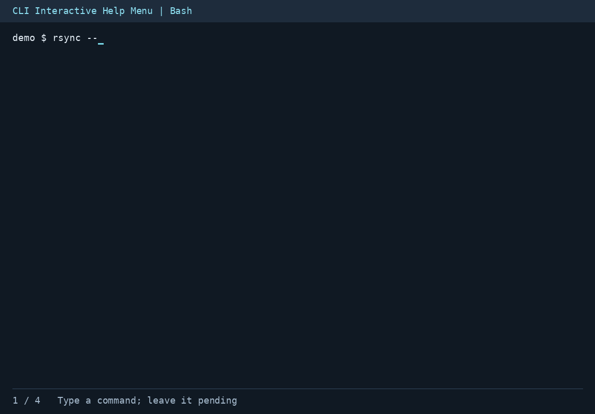
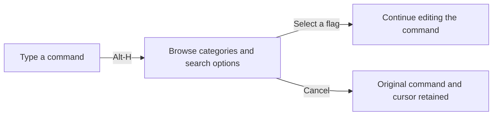
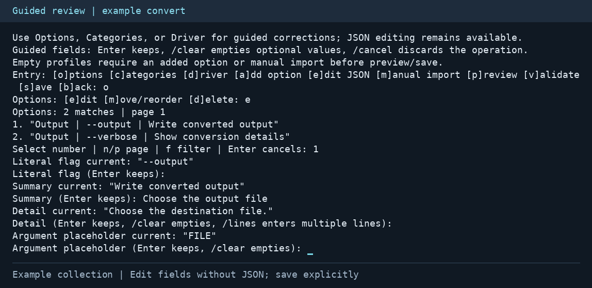

# CLI Interactive Help Menu

[](https://github.com/Usrnmna/CLI-InteractiveHelpMenu/actions/workflows/ci.yml)

**Browse command options while typing. Insert a flag. Keep control of execution.**

A Linux Bash prototype for terminal users who need option descriptions without
abandoning an unfinished command. **Alt-H** opens searchable, categorized help;
selecting an option returns to the command line with that flag inserted.
The pending command runs only after a separate, ordinary Enter at the Bash prompt.

[Get started](#get-started) · [Browser controls](docs/usage.md#browser-controls) ·
[Scan and review](#build-and-refine-a-help-collection) · [Documentation](docs/README.md)



**Alt-H → search → insert → continue editing.**
[Static browser view](docs/assets/help-browser.png) ·
[Final pending command](docs/assets/option-inserted.png)

## What it provides

| Capability | End-user result |
| --- | --- |
| **Help alongside command entry** | Search options, scroll categories, and read descriptions before selecting a flag |
| **Insertion without execution** | Continue editing arguments after selection; cancel to retain the original command and cursor |
| **Help for installed tools** | Discover options from help output and local manuals, with Git/Docker subcommand support and loadable drivers |
| **Reusable help collections** | Import a manual or scan installed commands in bulk, with a report of successes, failures, and review needs |
| **Guided corrections** | Edit options, categories, and driver settings through terminal forms, then preview and save with backups |
| **Configurable controls** | Customize the launch shortcut and browser navigation keys |
| **Verified release updates** | Check GitHub releases, preserve custom settings during upgrades, and resolve conflicts through guided review |



The browser includes curated help for `rsync`, GNU `grep`, GNU `ls`, GNU `tar`,
`git commit`, and `git log`. These profiles can be browsed even when the command
is not installed. Other commands use discovery or an added help collection.
Generated help is inferred and may require corrections.

The [third-party compatibility matrix](docs/compatibility.md) covers 34 executable
names, including Docker Compose, uv, npm, jq, kubectl, AWS CLI, Terraform,
ImageMagick, and backup tools. Included drivers enable the listed nested command
paths; the guide describes activation, live checks, and remaining syntax limits.

## Get started

Requirements:

- Linux, Bash **4.4+**, and Python **3.10+** with the standard-library `curses` module.
- A UTF-8 locale and a terminal at least **60 columns × 16 rows**.
- Linux `man-db` and local manual pages for manual-based discovery, importing
  installed pages, and bulk scanning. Text-file imports do not require `man`.

From the repository directory, install for the current user and load the browser:

```bash
bash install.sh
source "${XDG_DATA_HOME:-$HOME/.local/share}/cli-interactive-help/bash/interactive-help.bash"
```

1. Type `rsync --ar` without executing it.
2. Press **Alt-H**, browse to `--archive`, and press **Enter**.
3. Continue editing the resulting `rsync --archive ` command line.

Arrow keys navigate the menu; `/` searches; Escape or Ctrl-C cancels.
If Alt-H is unavailable, press Escape followed by `h`.
The installer adds a marked block to `.bashrc` and backs up existing contents.
Use `bash install.sh --no-rc` to skip startup registration, or `bash uninstall.sh`
to remove the default installation. Edited files and custom collections are retained.

To upgrade an existing installation, run `bash update.sh` from the new source
directory. Custom settings and edited files are preserved; conflicts include
incoming copies for manual merging and a full backup.
The [interactive update reviewer](docs/update-review.md) compares conflicts and
lets each file be kept, replaced, or merged, with backups before saving. Guided
editing accepts or rejects individual changed blocks without an external editor.

The [GitHub release updater](docs/github-updates.md) checks and verifies published
packages before upgrading. Run `bash update-from-github.sh --check` to inspect the
stable channel, or add `--prerelease` to include alpha releases. Run without
`--check` to upgrade; conflicts open the guided reviewer in an interactive terminal.

[Version 0.1.1 - Alpha packages](docs/releases.md) provide a verified installer,
a compiled Linux launcher, source/runtime archives, and SHA-256 checksums.

See [installation, updates, and removal](docs/installation.md) for custom paths
and recovery. [Browser controls](docs/usage.md) covers shortcuts, Vi keymaps,
configuration, and loading directly from a checkout without installing.

## Build and refine a help collection

The scanner reads installed manuals and produces editable help plus a report.
The reviewer provides guided corrections and a preview of the actual help menu.
Run these commands from the repository directory:

```bash
python3 cli_help/main.py --scan-installed --limit 100 \
  --output-dir "$HOME/.config/cli-help/scanned"

python3 cli_help/main.py --review-report \
  "$HOME/.config/cli-help/scanned/scan-report.json"
```

In a review entry, **o** edits options, **c** edits categories, and **d** edits
driver settings. **p** previews the menu and **s** saves validated changes with
backups. JSON editing is optional. Original scan findings remain available.



*Guided option editing in an example collection; changes require explicit saving.*

After inspecting a collection with successfully generated entries, activate it:

```bash
export CLI_HELP_PROFILES="$HOME/.config/cli-help/scanned/profiles"
export CLI_HELP_DRIVERS="$HOME/.config/cli-help/scanned/drivers"
python3 cli_help/main.py --check
```

- [Bulk scanning and report interpretation](docs/bulk-scan.md) covers filters,
  repeated scans, partial results, and activation.
- [Guided review and correction](docs/review.md) covers forms, preview, saving,
  and recovery.
- [Importing a single manual](docs/manual-import.md) supports installed pages,
  rendered text, and local manual files.

## Compatibility and execution boundaries

**Option selection never executes the pending command. Automatic discovery can
run a separate help invocation of the installed program.** Arbitrary programs
may have startup side effects. Discovery limits are not a sandbox.

To obtain dynamic help without invoking target programs:

```bash
export CLI_HELP_DISCOVERY=man
```

This mode uses the manual renderer and requires an installed executable with a
usable local manual. `CLI_HELP_DISCOVERY=off` restricts browsing to static profiles.
Bulk scanning and manual import do not invoke target programs; review preview
performs no help discovery.

The prototype supports simple commands with balanced quoting. Pipelines,
redirection, shell substitutions, wrappers such as `sudo`, and shell aliases or
functions are not resolved. Generated help can omit unusual option syntax;
subcommand support depends on available profiles and drivers.

[Discovery and execution boundaries](docs/discovery-and-safety.md) describes
these limits in full. [Recorded validation](docs/development.md#recorded-validation)
identifies the tested environment and remaining compatibility limits.

## Further documentation

| Purpose | Guide |
| --- | --- |
| Set up the browser and customize controls | [Usage and keybindings](docs/usage.md) |
| Add or maintain command compatibility | [Profiles and drivers](docs/profiles-and-drivers.md) |
| Enable third-party command paths and run compatibility checks | [Third-party compatibility matrix](docs/compatibility.md) |
| Understand discovery, caching, and safe insertion | [Discovery and safety](docs/discovery-and-safety.md) |
| Import, scan, and correct documentation | [Collection workflows](docs/README.md#help-collection-workflows) |
| Inspect the implementation or run tests | [Architecture and validation](docs/development.md) |

The [documentation index](docs/README.md) provides the complete topic map.
The [media capture guide](docs/assets/README.md) describes the demonstrations and
their regeneration.
