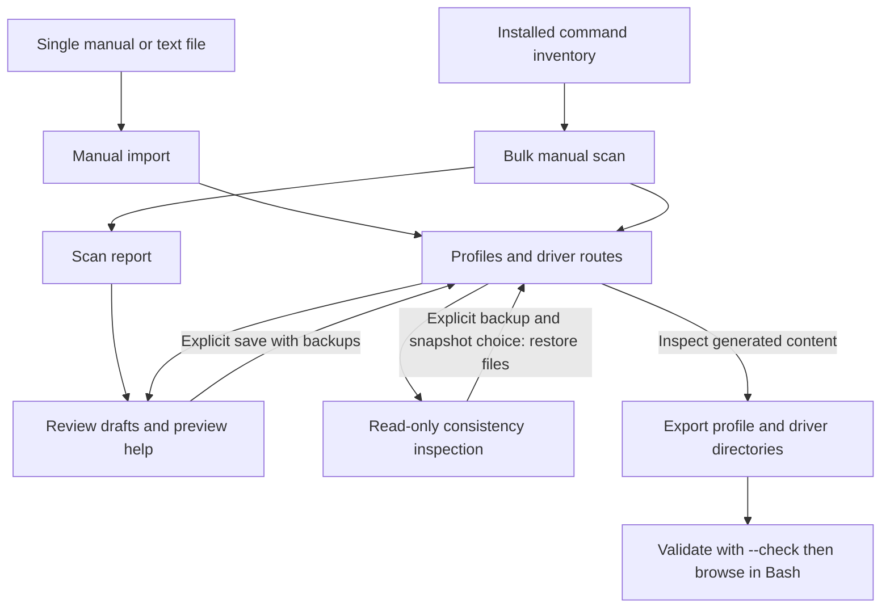

# Documentation index

[Project overview and quick start](../README.md)

The main README introduces the terminal workflow. The guides below provide
complete operating instructions, configuration references, and implementation
evidence. Shell command examples assume the repository root as the working
directory.

Start with [installation](installation.md), then try the
[first option insertion](usage.md#first-option-insertion). For additional commands,
check [driver activation and supported paths](compatibility.md#enable-the-drivers)
or [build a help collection](bulk-scan.md#first-collection-walkthrough).

The operating guides describe the local `0.6.0-alpha` checkout. The [release guide](releases.md#version-060---alpha) identifies the candidate being prepared and the [changelog](../CHANGELOG.md) records earlier versions.

The [five Bash scenarios](menu-demo-storyboards.md) show both layouts, three detail levels and the resulting command lines. The [resize review](terminal-resize-results.md) shows the accepted behavior at layout boundaries. [Release notes](release-notes-v0.6.0-alpha.md)

The [terminal gallery](assets/README.md) shows the candidate checkout. The [Ubuntu coverage audit](ubuntu-coverage-audit.md) lists shipped commands, builtin editions, kernel companions and ranked optional packages. The [audit history](audit-history.md) follows the development cycle from source review through repairs and terminal verification. The [visual and configuration review](media-and-configuration-review.md) records earlier captures and policy checks.

## Browser use

| Topic | Guide |
| --- | --- |
| Per-user installation, startup registration, updates, and removal | [Installation, updates, and removal](installation.md) |
| Compare update conflicts, choose file versions, and save with backups | [Interactive update review](update-review.md) |
| Download, verify, install, or build versioned packages | [Release artifacts and build procedure](releases.md) |
| Find the next version number and proposed changes for each release | [Version numbering and planned releases](versioning.md) |
| Historical release notes and installation examples for the published v0.1.2-alpha packages | [v0.1.2-alpha release notes](release-notes-v0.1.2-alpha.md) |
| Verify current source provenance, package lifecycles, and installed terminal behavior | [Local release candidate validation](release-candidate.md) |
| Check GitHub releases, verify downloads, and upgrade with guided conflict review | [Updating from GitHub releases](github-updates.md) |
| Requirements, loading, navigation, search, and custom shortcuts | [Setup, browser controls, and keybindings](usage.md) |
| Discovery modes, subcommands, cache settings, and insertion limits | [Discovery and execution boundaries](discovery-and-safety.md) |
| Passive runtime checks, redacted context explanations, and troubleshooting | [Passive diagnostics and troubleshooting](diagnostics.md) |
| Editable option definitions and loadable command adapters | [Help profiles and compatibility drivers](profiles-and-drivers.md) |
| Prefix chains, Python modules, keywords, joined selectors, and repeated groups | [Invocation and structured arguments](invocation-and-structured-arguments.md) |
| Declared value spellings, selected bundles, and protected attached payloads | [Explicit argument syntax](argument-syntax.md) |
| Third-party programs, driver activation, test tiers, and live results | [Third-party compatibility matrix](compatibility.md) |

## Help collection workflows

| Starting point | Guide |
| --- | --- |
| One installed manual, rendered text file, or local manual file | [Importing manual pages](manual-import.md) |
| A set of installed commands and their manuals | [Bulk scanning and report interpretation](bulk-scan.md) |
| Scan entries requiring corrections or verification | [Interactive review, guided forms, preview, and saving](review.md) |
| Read-only consistency checks and explicit snapshot-bound backup restoration | [Collection inspection and recovery](collection-recovery.md) |

Profiles contain the menu content; drivers define documentation routes and
command context. A single-manual import does not create a scan report.
Generated documentation remains subject to review of option coverage and argument
requirements. The [profile and driver reference](profiles-and-drivers.md)
defines both formats.

## Numerical guidance and verification

The [option-description regression review](regression-review.md) records the
October 2026 command-path and function coverage, terminal checks, parser repairs,
skips, and remaining gaps after the four display fixes.

| Question | Maintained explanation |
| --- | --- |
| Where are units, accepted forms and qualifications visible? | [Browser controls and value guidance](usage.md#browser-controls) |
| How is numerical meaning represented and validated? | [Numerical value contract and APIs](numerical-value-contract.md) |
| How does source documentation survive parsing and caching? | [Preservation rules](numerical-inventory/step4-preservation.md) and [parser/source-association repairs](numerical-inventory/parser-association-repairs.md) |
| How are metadata and review status retained during edits? | [Authoring rules](numerical-inventory/step6-authoring.md) |
| How are deficient additions detected? | [Coverage policy and contributor workflow](numerical-inventory/step7-enforcement.md) |
| What is complete, and what remains uncertain? | [Maintained debt resolution](numerical-inventory/debt-resolution.md) and [external diagnostic investigation](numerical-inventory/diagnostic-investigation.md) |
| Which native, local and hosted checks actually ran? | [Native/POSIX evidence](numerical-inventory/native-posix-verification.md) and [Ubuntu and Python test results](compatibility.md#ubuntu-and-python-test-results) |

Strict maintained completeness does not establish every external numerical fact.
The [October verification account](numerical-inventory/full-linux-verification.md)
retains the earlier WSL and hosted results.

## Development and evidence

Start with the [project roadmap](../ROADMAP.md#remaining-work) for remaining tasks, dependencies and acceptance criteria. Use the [bundled family table](audit-history.md#bundled-menu-progress) for manual inventories and the [discovery tier results](audit-history.md#discovered-command-help) for fixed source editions and terminal evidence.

| Contributor question | Guide |
| --- | --- |
| What happens between Alt-H and the return to Bash? | [Runtime data flow](runtime-architecture.md) |
| What enters a sandbox, source archive or Git diff? | [Repository configuration](development.md#repository-configuration) and [source package contents](releases.md#build-from-source) |
| How should a family audit be verified? | [Batch procedure](development.md#auditing-command-help) and [fixture provenance](../tests/fixtures/help/README.md) |
| Which improvements have been measured or proposed? | [Local test timing and selection](test-selection-plan.md) and [command menu performance](ffmpeg-menu-performance-plan.md) |

The family audits, verification accounts and release notes describe particular sources or runs. Versioned third-party documentation in fixtures is evidence for the parser and menu tests. Generated reports belong under `tests/reports/`; curated numerical review decisions in [the inventory](numerical-inventory/README.md) are maintained inputs.

Implementation accounts retain their original outcomes. Later corrections and
verification supersede only the findings explicitly identified in those accounts.
Current behavior belongs in operating/reference guides; dated counts and blocked
checks are not promises about an arbitrary checkout.

Numerical implementation history and acceptance criteria

- [Step 1: inventory and acceptance criteria](numerical-inventory/README.md)
- [Step 2: numerical contract](numerical-value-contract.md)
- [Step 3: description migration](numerical-inventory/step3-migration.md)
- [Step 4: preservation](numerical-inventory/step4-preservation.md)
- [Step 5: presentation and search](numerical-inventory/step5-presentation.md)
- [Step 6: authoring](numerical-inventory/step6-authoring.md)
- [Step 7: enforcement](numerical-inventory/step7-enforcement.md)
- [Step 8: integrated verification](numerical-inventory/step8-verification.md)
- [Step 9: repository configuration and handoff](numerical-inventory/step9-handoff.md)

- [Contribution guide](../.github/CONTRIBUTING.md) summarizes issue reports,
  pull requests, focused validation, and generated-file handling.
- [Review fixes and added command paths](review-fixes-2026-10-23.md) records
  metadata and resize corrections, ten driver additions, and fresh validation.
- [Source architecture and validation](development.md) covers module ownership,
  the Bash helper boundary, test procedures, and recorded compatibility results.
- [Help-format corpus provenance](../tests/fixtures/help/README.md) distinguishes
  representative fixtures from live command documentation.
- [Terminal media capture and regeneration](assets/README.md) describes the
  real-terminal demonstrations, annotations, optional tools, and capture checks.
- [Functional review dated 2026-10-23](functional-review-2026-10-23.md) records
  combined command workflows, terminal evidence, live results, and remaining gaps.

Local scan reports, caches, and review backups contain generated data or captured
command documentation. They are not maintained explanations of project behavior;
captured source text is retained as evidence rather than rewritten as project prose.
