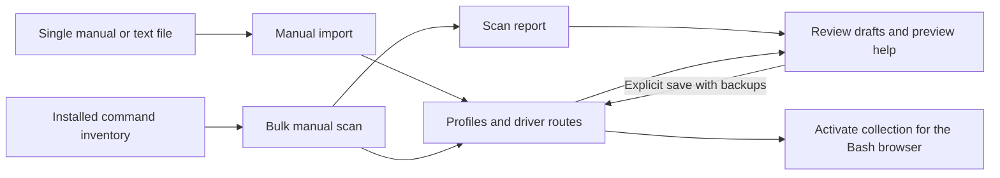

# Documentation index

[Project overview and quick start](../README.md)

The main README introduces the terminal workflow. The guides below provide
complete operating instructions, configuration references, and implementation
evidence. Shell command examples assume the repository root as the working
directory.

## Browser use

| Topic | Guide |
| --- | --- |
| Per-user installation, startup registration, updates, and removal | [Installation, updates, and removal](installation.md) |
| Compare update conflicts, choose file versions, and save with backups | [Interactive update review](update-review.md) |
| Download, verify, install, or build versioned packages | [Release artifacts and build procedure](releases.md) |
| Check GitHub releases, verify downloads, and upgrade with guided conflict review | [Updating from GitHub releases](github-updates.md) |
| Requirements, loading, navigation, search, and custom shortcuts | [Setup, browser controls, and keybindings](usage.md) |
| Discovery modes, subcommands, cache settings, and insertion limits | [Discovery and execution boundaries](discovery-and-safety.md) |
| Editable option definitions and loadable command adapters | [Help profiles and compatibility drivers](profiles-and-drivers.md) |
| Third-party programs, driver activation, test tiers, and live results | [Third-party compatibility matrix](compatibility.md) |

## Help collection workflows

| Starting point | Guide |
| --- | --- |
| One installed manual, rendered text file, or local manual file | [Importing manual pages](manual-import.md) |
| A set of installed commands and their manuals | [Bulk scanning and report interpretation](bulk-scan.md) |
| Scan entries requiring corrections or verification | [Interactive review, guided forms, preview, and saving](review.md) |

Profiles contain the menu content; drivers define documentation routes and
command context. A single-manual import does not create a scan report.
Generated documentation remains subject to review of option coverage and argument
requirements. The [profile and driver reference](profiles-and-drivers.md)
defines both formats.

## Development and evidence

- [Source architecture and validation](development.md) covers module ownership,
  the Bash helper boundary, test procedures, and recorded compatibility results.
- [Help-format corpus provenance](../tests/fixtures/help/README.md) distinguishes
  representative fixtures from live command documentation.

Local scan reports, caches, and review backups contain generated data or captured
command documentation. They are not maintained explanations of project behavior;
captured source text is retained as evidence rather than rewritten as project prose.
