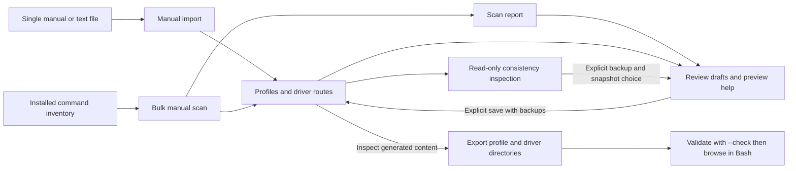

# Documentation index

[Project overview and quick start](../README.md)

The main README introduces the terminal workflow. The guides below provide
complete operating instructions, configuration references, and implementation
evidence. Shell command examples assume the repository root as the working
directory.

Start with [installation](installation.md), then try the
[first option insertion](usage.md#first-option-insertion). For additional commands,
check [driver activation and supported paths](compatibility.md#enable-the-drivers)
or [build a help collection](bulk-scan.md#first-collection-walkthrough).

The operating guides describe the current working tree. The
[versioned changelog](../CHANGELOG.md#version-012---alpha) and
[release notes](release-notes-v0.1.2-alpha.md) record the prerelease scope. The
[v0.1.2-alpha packages](releases.md#version-012---alpha) are a release snapshot;
[v0.1.1-alpha artifacts](releases.md#version-011---alpha) are historical packages.
Neither an equal version string nor a dated review establishes current checkout
contents. Dated reviews retain the results and limitations of their own runs.

## Browser use

| Topic | Guide |
| --- | --- |
| Per-user installation, startup registration, updates, and removal | [Installation, updates, and removal](installation.md) |
| Compare update conflicts, choose file versions, and save with backups | [Interactive update review](update-review.md) |
| Download, verify, install, or build versioned packages | [Release artifacts and build procedure](releases.md) |
| Changes, requirements, package selection, and limits for v0.1.2-alpha | [v0.1.2-alpha release notes](release-notes-v0.1.2-alpha.md) |
| Verify current source provenance, package lifecycles, and installed terminal behavior | [Local release candidate validation](release-candidate.md) |
| Check GitHub releases, verify downloads, and upgrade with guided conflict review | [Updating from GitHub releases](github-updates.md) |
| Requirements, loading, navigation, search, and custom shortcuts | [Setup, browser controls, and keybindings](usage.md) |
| Discovery modes, subcommands, cache settings, and insertion limits | [Discovery and execution boundaries](discovery-and-safety.md) |
| Passive runtime checks, redacted context explanations, and troubleshooting | [Passive diagnostics and troubleshooting](diagnostics.md) |
| Editable option definitions and loadable command adapters | [Help profiles and compatibility drivers](profiles-and-drivers.md) |
| Prefix chains, Python modules, keywords, joined selectors, and repeated groups | [Invocation and structured arguments](invocation-and-structured-arguments.md) |
| Declared value spellings, selected bundles, and protected attached payloads | [Explicit argument syntax](argument-syntax.md) |
| Third-party programs, driver activation, test tiers, and live results | [Third-party compatibility matrix](compatibility.md) |

## Help collection workflows

| Starting point | Guide |
| --- | --- |
| One installed manual, rendered text file, or local manual file | [Importing manual pages](manual-import.md) |
| A set of installed commands and their manuals | [Bulk scanning and report interpretation](bulk-scan.md) |
| Scan entries requiring corrections or verification | [Interactive review, guided forms, preview, and saving](review.md) |
| Read-only consistency checks and explicit snapshot-bound backup restoration | [Collection inspection and recovery](collection-recovery.md) |

Profiles contain the menu content; drivers define documentation routes and
command context. A single-manual import does not create a scan report.
Generated documentation remains subject to review of option coverage and argument
requirements. The [profile and driver reference](profiles-and-drivers.md)
defines both formats.

## Development and evidence

- [Numerical description implementation inventory](numerical-inventory/README.md)
  records Step 1 enumeration, review dispositions, and later acceptance criteria.
- [Numerical value contract and opt-in APIs](numerical-value-contract.md)
  defines Step 2 metadata, validation policies, diagnostics, and explanation formatting.
- [Bundled numerical description migration](numerical-inventory/step3-migration.md)
  records Step 3 corrections, source applicability, remaining investigations and focused checks.
- [Numerical documentation preservation](numerical-inventory/step4-preservation.md)
  defines Step 4 shared-source association, merge ownership, diagnostics and cache guarantees.
- [Numerical presentation and search](numerical-inventory/step5-presentation.md)
  explains Step 5 compact guidance, complete details, search and scoped layout verification.
- [Contribution guide](../.github/CONTRIBUTING.md) summarizes issue reports,
  pull requests, focused validation, and generated-file handling.
- [Review fixes and added command paths](review-fixes-2026-10-23.md) records
  metadata and resize corrections, ten driver additions, and fresh validation.
- [Source architecture and validation](development.md) covers module ownership,
  the Bash helper boundary, test procedures, and recorded compatibility results.
- [Help-format corpus provenance](../tests/fixtures/help/README.md) distinguishes
  representative fixtures from live command documentation.
- [Terminal media capture and regeneration](assets/README.md) describes the
  real-terminal demonstrations, annotations, optional tools, and capture checks.
- [Functional review dated 2026-10-23](functional-review-2026-10-23.md) records
  combined command workflows, terminal evidence, live results, and remaining gaps.

Local scan reports, caches, and review backups contain generated data or captured
command documentation. They are not maintained explanations of project behavior;
captured source text is retained as evidence rather than rewritten as project prose.
