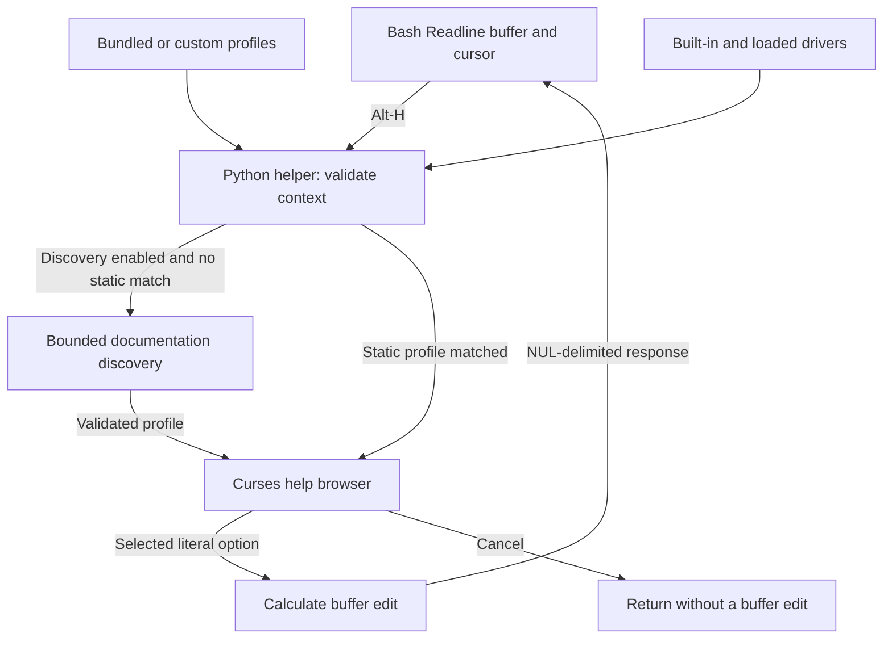

# Source architecture, validation, and compatibility evidence

[Project overview](../README.md) · [Documentation index](README.md)

Commands in this guide are run from the repository root unless stated otherwise.

## Runtime components and data flow

The Bash adapter opens a Python helper for each help request. The helper resolves
the command context, obtains a profile, and runs the terminal browser. Selection
produces an edit response; cancellation produces no edit response.



The adapter supplies `CLI_HELP_LINE` and `CLI_HELP_POINT` to the helper.
A successful selection returns `cursor\0line\0` on standard output; the adapter
accepts exactly two fields with a numeric cursor and updates `READLINE_POINT`
and `READLINE_LINE`. Curses attaches to the controlling terminal so browser
output does not mix with the edit response. This response does not accept or
execute the command line.

The [discovery and safety guide](discovery-and-safety.md) describes subprocess
execution, parsing, and caching. The
[collection workflow diagram](README.md#help-collection-workflows) covers the
separate import, scan, and review tools.

## Source layout and validation

The [terminal media capture guide](assets/README.md) describes the README images,
their execution checks, and the optional regeneration dependencies.

| Path | Responsibility |
| --- | --- |
| [install.sh](../install.sh), [uninstall.sh](../uninstall.sh), [scripts/installation.py](../scripts/installation.py) | Per-user runtime ownership and managed Bash startup registration/removal |
| [bash/interactive-help.bash](../bash/interactive-help.bash) | Readline shortcut and buffer update |
| [cli_help/core.py](../cli_help/core.py) | Profile validation, literal context parsing, insertion |
| [cli_help/command_paths.py](../cli_help/command_paths.py) | Explicit subcommand paths, global-option arity, fixed help routes |
| [cli_help/drivers.py](../cli_help/drivers.py) | Validated JSON driver loading and built-in route overlays |
| [cli_help/manual_import.py](../cli_help/manual_import.py) | Manual rendering, profile generation, and manual-only driver import |
| [cli_help/bulk_scan.py](../cli_help/bulk_scan.py) | Executable inventory, bulk manual imports, and checkpointed diagnostic reports |
| [cli_help/review.py](../cli_help/review.py) | Interactive scan review, draft editing, help preview, and backed-up saves |
| [cli_help/review_forms.py](../cli_help/review_forms.py) | Guided option, category, and driver forms with validation before draft updates |
| [cli_help/discovery.py](../cli_help/discovery.py) | Bounded help/man probes, parsing, merging, and cache |
| [cli_help/ui.py](../cli_help/ui.py) | Curses drawing, navigation, search, browser bindings |
| [cli_help/main.py](../cli_help/main.py) | Terminal attachment and Bash response protocol |
| [profiles/](../profiles/) | Editable command documentation |
| [config/keys.example.json](../config/keys.example.json) | Complete browser key configuration example |
| [config/drivers.example/](../config/drivers.example/) | Loadable pip and npm driver examples |
| [tests/](../tests/) | Core contracts and actual Bash pseudoterminal interactions |

Run validation from Linux or WSL:

```bash
bash tests/run.sh
```

The terminal tests launch isolated Bash sessions, feed real key sequences, and
inspect Readline buffers. A harmless shell function records whether the pending
command executes. Tests cover insertion, cancellation, scrolling, configuration,
UTF-8 cursor positions, search, and rejection of shell substitutions. Discovery
tests use isolated executables that record exact invocation arguments and
separate normal execution from help probes. They also exercise manual-only
lookup, parsing, source merging, timeout/output bounds, cache invalidation,
subcommand and global-option recognition, nested paths, and pending-argument
isolation. Docker fixtures record every call and flag any action dispatch.
These checks do not establish compatibility with every terminal emulator,
customized Readline configuration, command version, or help format.

## Repository configuration

[.gitattributes](../.gitattributes) keeps text checkouts in LF format for Linux
tools, including when Git runs on Windows. README media and compressed manuals
are binary and are not subject to line-ending conversion.
[.editorconfig](../.editorconfig) applies matching editor defaults while preserving
significant whitespace in Markdown and help-parser fixtures.

[.gitignore](../.gitignore) excludes local Python environments, caches, test
reports, review backups, collection locks, and local environment files. The
documented `generated-help/` output directory is also excluded. Generated
collections in other locations require an appropriate ignore rule or an output
path outside the checkout. Source, bundled profiles, example drivers, fixtures,
workflow configuration, and published README media remain eligible for tracking.
Ignore rules do not remove files already tracked by Git.

## Continuous integration

The [Linux tests and documentation workflow](../.github/workflows/ci.yml) runs on
pushes, pull requests, and manual dispatch. Each Ubuntu 24.04 test job runs the
complete `bash tests/run.sh` suite, including Bash syntax, configuration validation,
and all Python tests with real Bash pseudoterminal interactions. The matrix covers
Python 3.10 and 3.12. The tests use the Python standard library; media-generation
dependencies and optional live-program compatibility probes are not required.

A separate job uses [Lychee](https://github.com/lycheeverse/lychee-action) to check
Markdown links throughout the repository, including local files, images, heading
anchors, and external HTTP(S) URLs. [lychee.toml](../lychee.toml) excludes generated
reports, dependency directories, and this workflow's own page/badge endpoints,
which can be unavailable before the first published run. Other broken links fail
the job after bounded retries; network outages can also cause failures. Results
appear in the Actions job summary.

With Lychee 0.24.2 installed, the same check can run locally:

```bash
lychee --config lychee.toml --no-progress '**/*.md'
```

Add `--offline` to check local links and anchors without contacting external sites.
The workflow uses read-only repository permissions and pins actions to commit
IDs. The README badge reports this entire workflow; it is not a claim that a
GitHub-hosted run has already completed. Forks should update the badge URLs and
the exact workflow exclusion in `lychee.toml` to their own repository name.

Installation and removal are included in the same full suite. Their isolated-home
and real-terminal checks are described in the
[installation guide](installation.md#recovery-and-validation).

## Recorded validation

The recorded functional validation was completed on 2026-10-17 using Ubuntu 24.04
under WSL with Bash 5.2.21 and Python 3.12.3.
All 227 tests passed, including 27 real Bash pseudoterminal tests, 18 bulk-scan
tests, 20 review tests, 18 guided-editing tests, 21 installation tests, and 2,000
deterministic generated cases within the mutation tests. The review,
guided-editing, and installation tests each
include one of the pseudoterminal tests.
The suite includes command-format fixtures, deterministic mutation
tests, driver loading, manual imports, and process-boundary checks in addition
to the Bash tests. Bash syntax,
static profiles, keybindings, and discovery configuration validation also passed.
Live discovery was checked against installed `cp` help and its manual, and
against `sed` in man-only mode. Subcommand discovery was checked against installed
`git-commit` and `git-branch` manuals; a live manual-derived
`git -C ... branch` insertion check passed.
Docker routes were verified with instrumented executable fixtures, including
real Bash insertion and cancellation. Live Docker validation was unavailable
because Docker's WSL integration was not enabled. The CI matrix additionally
checks Python 3.10; this does not establish compatibility with every Bash and
Python version within the stated requirements.

## Extended tests and live compatibility reports

The default suite is offline and requires no FFmpeg, VLC, GCC, npm, or pip
installation. Its hand-authored format corpus and expected results are in
[the help-format corpus](../tests/fixtures/help/README.md), including provenance and limits.
It exercises each parsed flag's insertion, required arguments, aliases, source
merging, and rejection of unsupported syntax. Executable fixtures record exact
probe arguments and create markers if an action route is dispatched.

Additional tests cover 2,000 deterministic generated cases: 1,200 malformed-help
mutations, 500 Unicode/midline buffer edits, and 300 driver-schema mutations.
Seeds and case indices appear in failing subtests. Other cases cover large
manuals, long overstrike runs, example sections, empty quoted arguments,
malformed and concurrently written caches, output boundaries, invalid UTF-8,
stderr help, signal exits, closed pipes, and surviving child-process attempts.
Manual-import tests cover malformed input, size limits, missing renderers,
fixed renderer arguments, repeated imports, route merging, explicit replacement,
custom filenames, import locking, and imported-profile selection in real Bash.
Live rendering also succeeded for an installed `git-commit` page and the local
roff fixture in both plain and gzip-compressed form.

Bulk-scan tests cover inventory precedence, aliases, invalid filenames, filters,
limits, partial/manual-only results, missing and oversized manuals, timeouts,
interruption recovery, explicit replacement, partial writes, collection locks,
driver arity preservation, CLI exit policy, and target-execution marker checks.
A bounded live scan inventoried 1,040 `/usr/bin` executable names and selected
seven: `cp`, `ffmpeg`, `gcc`, `git`, `npm`, `pip`, and `sed`. Five profile/driver
pairs were generated; GCC exceeded the source limit and npm supplied no usable
option declarations. Four generated profiles were marked for review, including
wrapped-prose false positives. This establishes report classification and
loadable output for those installed manuals, not exhaustive program compatibility.
A separate bounded scan generated Git root, `add`, and `am` profiles. All eight
generated profiles across both scans loaded and passed literal insertion checks
without invoking target commands or additional help discovery.

Review tests cover missing-profile creation, draft cancellation, manual imports,
invalid flags and routes, command identity, global-option arity, stale-file
rejection, symlink escapes, backup preservation, partial saves, editor errors,
terminal-control escaping, and report evidence retention. A real Bash
pseudoterminal test edits JSON, filters the queue, previews and cancels the
browser, saves a corrected driver, and discards an unsaved option. Instrumented
target executables remain uninvoked throughout that workflow.
A read-only smoke check also opened the existing live report containing 1,040
records, listed its six unresolved entries, and validated all five generated
profile/driver drafts without modifying the collection.
Guided-editing tests additionally cover retention and clearing of existing
values, multiline details, option/category movement and deletion, filtered
selection, invalid boolean and position inputs, duplicate flags and categories,
global-option conflicts, and cancellation at each option-editing stage. A second
review pseudoterminal workflow corrects options, categories, globals, and routes
without an editor, then previews and saves the result. The resulting profile
passes literal insertion checks while the instrumented target remains uninvoked.

For an opt-in report against programs installed on the current Linux machine:

```bash
python3 tests/live_compatibility.py --report tests/reports/live-programs.json
python3 tests/live_compatibility.py --drivers config/drivers.example \
  --case 'pip install' --case 'npm install' --case 'npm run' \
  --report tests/reports/live-drivers.json
```

The report distinguishes `passed`, `failed`, `skipped` (missing executable), and
`unsupported` (the default npm root case has no declarations). A failed case
returns a nonzero exit status. `--require-all` additionally treats skipped and
unsupported cases as failures. `--case` can be repeated for new driver paths.
No packages are installed; only fixed help/manual requests and in-memory buffer
edits run. Live reports are ignored by version control because availability and
versions vary by machine.

Live checks on Ubuntu 24.04 found usable FFmpeg, GCC, and pip options. The example
drivers also found options for `pip install`, `npm install`, and `npm run`.
VLC was absent and is covered only by the offline representative fixture. The GCC
manual exceeded the 512 KiB source limit; GCC help-output fallback passed. Local
npm subcommand manuals omitted option tables, so the dedicated help-output route
supplied those options. These results establish parsing and literal insertion,
not command execution, compilation, package installation, or media playback.

The shell integration uses the documented
[Bash `bind -x` interface](https://tiswww.case.edu/php/chet/bash/bashref.html#Bash-Builtins)
in the maintainer-hosted GNU Bash reference manual.
