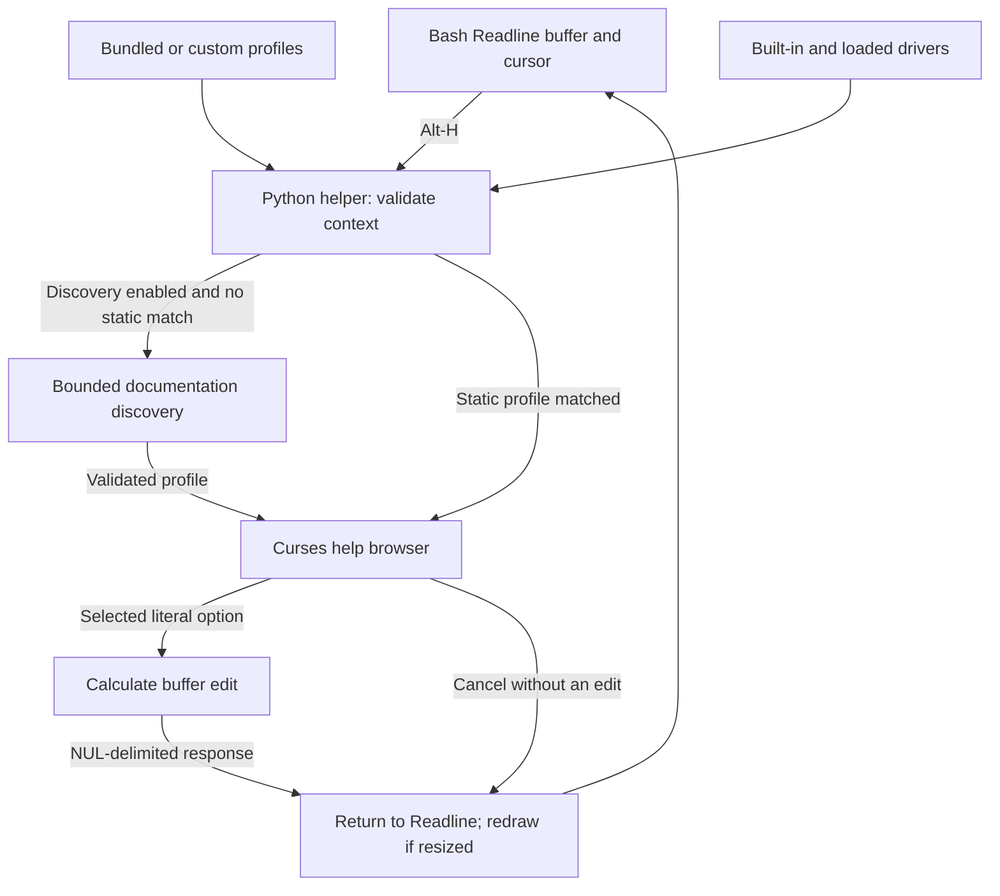

# Source architecture, validation, and compatibility evidence

[Project overview](../README.md) · [Documentation index](README.md)

Commands in this guide are run from the repository root unless stated otherwise.

## Runtime components and data flow

The Bash adapter opens a Python helper for each help request. The helper resolves
the command context, obtains a profile, and runs the terminal browser. Selection
produces an edit response; cancellation produces no edit response.



The adapter supplies `CLI_HELP_LINE` and `CLI_HELP_POINT` to the helper.
A successful selection returns `cursor\0line\0` on standard output; the adapter
accepts exactly two fields with a numeric cursor and updates `READLINE_POINT`
and `READLINE_LINE`. Curses attaches to the controlling terminal so browser
output does not mix with the edit response. This response does not accept or
execute the command line.

The [discovery and safety guide](discovery-and-safety.md) describes subprocess
execution, parsing, and caching. The
[collection workflow diagram](README.md#help-collection-workflows) covers the
separate import, scan, and review tools.

## Source layout and validation

The [terminal media capture guide](assets/README.md) describes the README images,
their execution checks, and the optional regeneration dependencies.

| Path | Responsibility |
| --- | --- |
| [install.sh](../install.sh), [update.sh](../update.sh), [uninstall.sh](../uninstall.sh), [scripts/installation.py](../scripts/installation.py) | Per-user runtime ownership, updates preserving local edits, and managed Bash startup registration/removal |
| [review-update.sh](../review-update.sh), [scripts/update_review.py](../scripts/update_review.py) | Update conflict comparison, explicit file choices, retained merge drafts, and backed-up saves |
| [scripts/guided_merge.py](../scripts/guided_merge.py) | Byte-preserving acceptance or rejection of changed line blocks |
| [update-from-github.sh](../update-from-github.sh), [scripts/release_update.py](../scripts/release_update.py) | GitHub release selection, bounded verified downloads, safe extraction, managed upgrades, and guided review routing |
| [native/cli_help.c](../native/cli_help.c), [scripts/build_release.py](../scripts/build_release.py) | Native convenience launcher and versioned installer/archive/checksum generation |
| [bash/interactive-help.bash](../bash/interactive-help.bash) | Readline shortcut and buffer update |
| [cli_help/core.py](../cli_help/core.py) | Profile validation, literal context parsing, insertion |
| [cli_help/invocation.py](../cli_help/invocation.py) | Bounded prefix grammar and immutable Python module routes with original token offsets |
| [cli_help/command_paths.py](../cli_help/command_paths.py) | Explicit subcommand paths, global-option arity, fixed help routes |
| [cli_help/drivers.py](../cli_help/drivers.py) | Validated JSON driver loading and built-in route overlays |
| [cli_help/manual_import.py](../cli_help/manual_import.py) | Manual rendering, profile generation, and manual-only driver import |
| [cli_help/bulk_scan.py](../cli_help/bulk_scan.py) | Executable inventory, bulk manual imports, and checkpointed diagnostic reports |
| [cli_help/review.py](../cli_help/review.py) | Interactive scan review, draft editing, help preview, and backed-up saves |
| [cli_help/review_forms.py](../cli_help/review_forms.py) | Guided option, category, and driver forms with validation before draft updates |
| [cli_help/discovery.py](../cli_help/discovery.py) | Bounded help/man probes, parsing, merging, and cache |
| [cli_help/ui.py](../cli_help/ui.py) | Curses drawing, navigation, search, browser bindings |
| [cli_help/main.py](../cli_help/main.py) | Terminal attachment and Bash response protocol |
| [profiles/](../profiles/) | Editable command documentation |
| [config/keys.example.json](../config/keys.example.json) | Complete browser key configuration example |
| [config/drivers.example/](../config/drivers.example/) | Loadable third-party compatibility drivers |
| [tests/](../tests/) | Core contracts and actual Bash pseudoterminal interactions |
| [tools/capture_readme_media.py](../tools/capture_readme_media.py) | Actual PTY captures, public terminal media, and local capture provenance |

Run validation from Linux x86_64 or WSL with Bash, Python 3.10 or newer, GCC,
and tmux installed. GCC and tmux are test dependencies; installed runtime
packages require neither:

```bash
bash tests/run.sh
```

The [complete expansion validation report](compatibility-expansion-validation.md)
records the current matrix, full-suite results, live versions, missing dependencies,
and the distinction between deterministic edits and live documentation evidence.

GitHub Actions runs the deterministic suite on Python 3.10 and 3.12 and retains
the suite log and documentation-link report for 14 days, including failed runs.
The Bash pipeline preserves the suite's exit status when recording its log.
Only those report files are uploaded; isolated tool homes and downloaded binaries
are excluded. Dependabot groups minor and patch updates for CI actions and
documentation-media dependencies; major updates remain separate.

The terminal tests launch isolated Bash sessions, feed real key sequences, and
inspect Readline buffers. A harmless shell function records whether the pending
command executes. Tests cover insertion, cancellation, scrolling, configuration,
UTF-8 cursor positions, search, and rejection of shell substitutions. Discovery
tests use isolated executables that record exact invocation arguments and
separate normal execution from help probes. They also exercise manual-only
lookup, parsing, source merging, timeout/output bounds, cache invalidation,
subcommand and global-option recognition, nested paths, and pending-argument
isolation. Docker fixtures record every call and flag any action dispatch.
These checks do not establish compatibility with every terminal emulator,
customized Readline configuration, command version, or help format.

## Rendered-screen regressions

[test_terminal_screen.py](../tests/test_terminal_screen.py) launches isolated
tmux servers and interactive Bash sessions with `TERM=tmux-256color`. It checks
rendered cells, cursor coordinates, alternate-screen state, and numbered
scrollback lines. Buffer snapshots are taken after screen comparisons because
a `bind -x` snapshot callback can itself redraw the command. The harmless
`rsync` fixture records unintended command execution.

```bash
python3 -m unittest discover -s tests -p 'test_terminal_screen.py' -v
```

The tests cover top and bottom placement, short and wrapped input, Escape and
Ctrl-C cancellation, repeated opening, insertion across the right margin,
resizing below the minimum size and back, and Ctrl-L recovery after shrinking
a wrapped command. The tests skip explicitly when Linux or tmux is unavailable;
CI installs tmux so this coverage runs in the Linux matrix.

The wrapped-command shrink/reopen regression is an ordinary passing test after
the adapter's resize recovery. The callback compares `stty size` before and after
the browser. A Readline macro dispatches the callback and a conditional redraw;
`clear-screen` runs after the shell callback returns, when Readline owns the
display. It is bound directly, so a custom Ctrl-L assignment does not alter
recovery. The internal sequences `\e[988~` and `\e[989~` are checked for conflicts
before binding and removed during unbinding. The configured public shortcut is
still replaced explicitly. No terminal-input injection, signal handler, or
native Readline extension is used.

Setup separately requires successful menu interaction, preserved history,
correct pending input, and no execution. Additional cases exercise Unicode,
midline selection, Ctrl-C, custom bindings, and reopening after a shrink.
An unchanged terminal retains its previous viewport; a resize redraw places
the command at the top. Ctrl-L remains a separately tested manual recovery.

An ordinary Bash resize control also reproduces duplicated rows. Terminal
traces are consistent with stale Readline display geometry, but the exact
upstream cause and behavior on other Bash/tmux versions remain unverified.
Sending SIGWINCH to Bash after the widget or invoking an external no-op command
did not resolve the issue in isolated diagnostic configurations. The adapter
now applies the Readline recovery described above. The
[display recovery instructions](usage.md#terminal-resizing-and-display-recovery)
describe automatic and manual recovery; other terminal environments remain
subject to their own validation.

## Repository configuration

[.gitattributes](../.gitattributes) keeps text checkouts in LF format for Linux
tools, including when Git runs on Windows. README media and compressed manuals
are binary and are not subject to line-ending conversion.
[.editorconfig](../.editorconfig) applies matching editor defaults while preserving
significant whitespace in Markdown and help-parser fixtures.

[.gitignore](../.gitignore) excludes local Python environments, caches, test
reports, review backups, collection locks, and local environment files. The
documented `generated-help/` output directory is also excluded. Generated
collections in other locations require an appropriate ignore rule or an output
path outside the checkout. Source, bundled profiles, example drivers, fixtures,
workflow configuration, and published README media remain eligible for tracking.
Ignore rules do not remove files already tracked by Git.
Environment-file templates ending in `.example`, `.sample`, or `.template`
remain eligible for tracking, including names such as `.env.development.example`.
Ignored caches and reports can contain local machine paths and downloaded tools;
they are also excluded from documentation link scans and source packages.

[Dependabot configuration](../.github/dependabot.yml) checks GitHub Actions and
the optional [media requirements](../tools/requirements-media.txt) weekly.
It does not add application runtime dependencies or publish updates. The
configuration follows GitHub's
[Dependabot options reference](https://docs.github.com/en/code-security/reference/supply-chain-security/dependabot-options-reference).

## Continuous integration

The [Linux tests and documentation workflow](../.github/workflows/ci.yml) runs on
pushes, pull requests, and manual dispatch. Each Ubuntu 24.04 test job runs the
complete `bash tests/run.sh` suite, including Bash syntax, configuration validation,
and all Python tests with real Bash pseudoterminal interactions. The matrix covers
Python 3.10 and 3.12. The tests use the Python standard library, tmux for rendered
terminal state, and GCC for native release-package tests; media-generation dependencies and optional
live-program compatibility probes are not required.

A separate job uses [Lychee](https://github.com/lycheeverse/lychee-action) to check
Markdown links throughout the repository, including local files, images, heading
anchors, and external HTTP(S) URLs. [lychee.toml](../lychee.toml) excludes generated
reports and dependency directories. Workflow and badge endpoints are checked
alongside other external links. Broken links fail
the job after bounded retries; network outages can also cause failures. Results
appear in the Actions job summary. Cache, build, and generated-collection
directories are excluded alongside local reports; maintained Markdown and public
media references remain checked.

With Lychee 0.24.2 installed, the same check can run locally:

```bash
lychee --config lychee.toml --no-progress '**/*.md'
```

Add `--offline` to check local links and anchors without contacting external sites.
The workflow uses read-only repository permissions and pins actions to commit
IDs. The README badge reports this entire workflow; it is not a claim that a
GitHub-hosted run has already completed for the working tree. Forks should update
the badge URLs to their own repository name and publish the workflow before
expecting its linked page and badge to resolve.

Installation, updates, and removal are included in the same full suite. Their isolated-home
and real-terminal checks are described in the
[installation guide](installation.md#recovery-and-validation).
Conflict review checks are described in the [update review guide](update-review.md#validation).
Release-updater checks and its machine-readable installation completion record
are described in the [GitHub update guide](github-updates.md#maintainer-interface-and-validation).

## Recorded validation

Functional validation uses Ubuntu 24.04 under WSL with Bash 5.2.21 and
Python 3.12.3. The full suite covers real Bash pseudoterminal interactions,
discovery, drivers, manual import, bulk scans, review forms, installation,
updates, conflict review, native release packaging, and verified release updates.
Deterministic mutation and merge cases are included. Bash syntax, static profiles,
keybindings, and the supplied third-party driver collection are also validated.

The [expanded compatibility matrix](compatibility.md#recorded-validation) records
the dated live results and remaining limits. Docker CLI and Compose help were
checked using extracted Ubuntu packages; the tests required no running Docker
daemon. A real Bash test also verifies AWS suffix-help routing, cancellation,
and insertion with instrumented executables that record any action dispatch.
The CI matrix additionally runs Python 3.10; local Python 3.12 results do not
establish a GitHub CI result or compatibility with every supported version.

## Extended tests and live compatibility reports

The configuration and documentation refresh on 2026-10-23 ran the complete
Linux suite through `tests/functional_review.py --suite documentation-refresh`:
438 tests, with 437 passed and one Windows-only probe test skipped. All eight
preflights passed, and release-input fingerprints remained stable throughout
the run. The environment used Python 3.12.3, Bash 5.2.21, tmux 3.4, and GCC 13.3.0.
Runtime and fixtures match this suite; separate media, link, and package checks
cover the final documentation and capture-tool inputs.

The same refresh checked 55 Bash examples for syntax, parsed three JSON examples,
exercised manual import and configuration in a temporary home, and verified
24 ignore-rule cases. All 19 maintained Markdown documents and six Mermaid
diagrams rendered locally. All four terminal assets were regenerated; unchanged
views retain identical bytes. This local verification does not establish a
GitHub-hosted run or a fresh live third-party compatibility result. Local reports
are retained under `tests/reports/documentation-refresh-2026-10-23/` and media
provenance under `tests/reports/readme-media/`; neither is a source-package input.

The default suite is offline and requires no third-party compatibility target
installation. It validates the full supplied driver collection and all three
compatibility tiers. GCC is required to compile and test the release launcher. Its hand-authored format corpus and expected results are in
[the help-format corpus](../tests/fixtures/help/README.md), including provenance and limits.
It exercises each parsed flag's insertion, required arguments, aliases, source
merging, and rejection of unsupported syntax. Executable fixtures record exact
probe arguments and create markers if an action route is dispatched.

Additional tests cover 2,000 deterministic generated cases: 1,200 malformed-help
mutations, 500 Unicode/midline buffer edits, and 300 driver-schema mutations.
Seeds and case indices appear in failing subtests. Other cases cover large
manuals, long overstrike runs, example sections, empty quoted arguments,
malformed and concurrently written caches, output boundaries, invalid UTF-8,
stderr help, signal exits, closed pipes, and surviving child-process attempts.
Manual-import tests cover malformed input, size limits, missing renderers,
fixed renderer arguments, repeated imports, route merging, explicit replacement,
custom filenames, import locking, and imported-profile selection in real Bash.
Live rendering also succeeded for an installed `git-commit` page and the local
roff fixture in both plain and gzip-compressed form.

Bulk-scan tests cover inventory precedence, aliases, invalid filenames, filters,
limits, partial/manual-only results, missing and oversized manuals, timeouts,
interruption recovery, explicit replacement, partial writes, collection locks,
driver arity preservation, CLI exit policy, and target-execution marker checks.
A bounded live scan inventoried 1,040 `/usr/bin` executable names and selected
seven: `cp`, `ffmpeg`, `gcc`, `git`, `npm`, `pip`, and `sed`. Five profile/driver
pairs were generated; GCC exceeded the source limit and npm supplied no usable
option declarations. Four generated profiles were marked for review, including
wrapped-prose false positives. This establishes report classification and
loadable output for those installed manuals, not exhaustive program compatibility.
A separate bounded scan generated Git root, `add`, and `am` profiles. All eight
generated profiles across both scans loaded and passed literal insertion checks
without invoking target commands or additional help discovery.

Review tests cover missing-profile creation, draft cancellation, manual imports,
invalid flags and routes, command identity, global-option arity, stale-file
rejection, symlink escapes, backup preservation, partial saves, editor errors,
terminal-control escaping, and report evidence retention. A real Bash
pseudoterminal test edits JSON, filters the queue, previews and cancels the
browser, saves a corrected driver, and discards an unsaved option. Instrumented
target executables remain uninvoked throughout that workflow.
A read-only smoke check also opened the existing live report containing 1,040
records, listed its six unresolved entries, and validated all five generated
profile/driver drafts without modifying the collection.
Guided-editing tests additionally cover retention and clearing of existing
values, multiline details, option/category movement and deletion, filtered
selection, invalid boolean and position inputs, duplicate flags and categories,
global-option conflicts, and cancellation at each option-editing stage. A second
review pseudoterminal workflow corrects options, categories, globals, and routes
without an editor, then previews and saves the result. The resulting profile
passes literal insertion checks while the instrumented target remains uninvoked.

The [third-party compatibility guide](compatibility.md) contains the complete
129-path matrix, driver activation, environment preparation, report interpretation,
and recorded validation limits. A default live run now covers all three tiers
and loads the supplied drivers automatically:

```bash
python3 tests/live_compatibility.py --report tests/reports/live-programs.json
python3 tests/live_compatibility.py --tier essential --report tests/reports/essential.json
```

Reports distinguish passed, failed, skipped, and explicitly unsupported cases.
They record versions, selected executable paths, sources, warnings, platform,
Python version, and totals. Known `--case` selections retain sentinel assertions.
Every discovered flag receives an exact insertion check; selected argument counts
and excluded syntax are checked independently. Only fixed help, manual, and
version requests run. Missing targets and unsupported npm root help do not become
passes. `--require-all` makes both statuses fail the invocation.

The expanded offline corpus includes bounded captured excerpts alongside
hand-authored specimens. Regressions cover alias alignment, negation shorthand,
printed defaults, typed values, multiple required values, partially optional
placeholders, exact suffix-help routes, driver packaging, and report policy.
Earlier five-program results are superseded by the expanded matrix evidence;
no compilation, package installation, cloud operation, backup, or media processing
is performed by the live harness.

The shell integration uses the documented
[Bash `bind -x` interface](https://tiswww.case.edu/php/chet/bash/bashref.html#Bash-Builtins)
in the maintainer-hosted GNU Bash reference manual.
