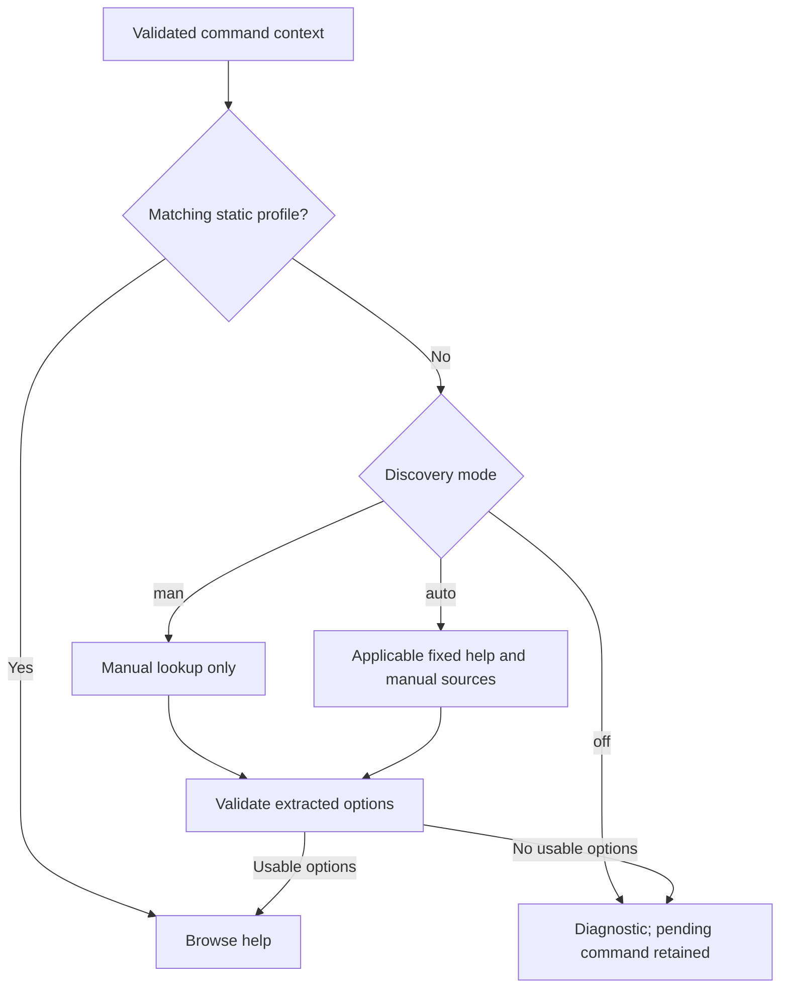

# Discovery, subcommands, and execution boundaries

[Project overview](../README.md) · [Documentation index](README.md)

Commands in this guide are run from the repository root unless stated otherwise.

## Profile selection



The diagram summarizes source selection. Cache reuse can satisfy a discovery
request without a new subprocess. Static-profile matching, fixed driver routes,
and cache behavior are described in the sections below.

## Automatic help discovery

Discovery runs only when no custom or bundled profile matches the resolved
command path. It resolves the executable using the shell environment's `PATH`
or the literal executable path. Generic top-level discovery collects two sources;
a loaded driver can override these routes:

1. The resolved executable with **exactly one argument: `--help`**.
2. Its manual page through `man`, searching sections 1 and 8 with paging and
   hyphenation disabled.

Pending arguments, filenames, and option values are never passed to either
source. A line such as `cp private-source private-destination --v` causes
the separate probe `/usr/bin/cp --help`, not a copy operation. Selecting an item
still only changes `READLINE_LINE` and `READLINE_POINT`.

Each source has a default two-second timeout and a 512 KiB combined output limit.
Sources run without a shell, with stdin closed, in a temporary working directory.
The environment retains `PATH`, `HOME`, and `MANPATH`, with fixed plain-text
locale and pager settings; pending input and shell startup hooks are excluded.
Ordinary child processes in the probe's process group are terminated on timeout,
overflow, cancellation, and completion. One failed source does not prevent use
of the other source. The initial uncached lookup may take up to approximately
four seconds before the browser opens.

**Automatic discovery may execute the target program's help invocation.**
Arbitrary executables may ignore help requests, read configuration, or have startup
side effects. The process limits are not an operating-system sandbox. To obtain
documentation without invoking target programs, select man-only discovery:

```bash
export CLI_HELP_DISCOVERY=man
```

The available modes are `auto` (default, help output plus manual pages), `man`
(manual pages only), and `off` (custom and bundled profiles only). Man-only mode
requires an installed executable and a usable local manual page. It invokes the
manual renderer, but never invokes the target executable.

The parser recognizes common GNU-style flags, short/long aliases, multiline
descriptions, required `=VALUE` and uppercase argument placeholders, and optional
`[=VALUE]` forms. Lowercase argument types in separate declaration columns and
brace-delimited choice sets are also recognized. Documentation headings become
categories. Man descriptions are
merged with help-output descriptions, and every extracted option includes a
source label. ANSI styling and manual-page overstrikes are removed. Only literal
validated flags can be inserted; descriptions and examples cannot become shell
code. Argument requirements and categories are inferred, not authoritative.
Unusual formatting, non-GNU flag syntax, and undocumented options may be missed.
Bracketed option groups in npm subcommand help are recognized within an explicit
options section. Usage and example sections are excluded. Multiword and
structured FFmpeg argument placeholders are retained when a separate description
column identifies the declaration. Unsupported joined syntax, such as GCC
`-Wl,<options>` and FFmpeg `-c:v`, is omitted rather than truncated into a different
flag. CR, CRLF, and LF help output is normalized.

Automatic subcommand discovery uses the built-in Git and Docker drivers and any
loaded [JSON compatibility drivers](profiles-and-drivers.md#loadable-compatibility-drivers).
Other programs retain top-level discovery unless an explicit subcommand profile
exists. Arbitrary positional words are not inferred as executable subcommands.
Aliases, shell functions, and builtins are not discovery sources;
executable resolution uses `PATH`, which may differ from a same-named shell alias
or function.

If no usable options are found, a diagnostic is displayed and the pending input
is preserved. A custom JSON profile can supply the missing documentation.

## Context-aware subcommand help

The command path is resolved from complete words before the cursor. Recognized
global options and their values are skipped when locating that path; they are
never forwarded to a help process. Cursor positions before a subcommand use
root help. Help for a resolved subcommand does not fall back to root options.

| Pending context | Dedicated discovery requests in `auto` mode |
| --- | --- |
| `git -C private-repo commit --` | `man git-commit` |
| `git -c user.name=private branch --` | `man git-branch` |
| `docker -H private-host run --` | `docker help run`, `man docker-run` |
| `docker --context private container run --` | `docker help container run`, `man docker-container-run` |

These examples abbreviate the fixed man-renderer flags. Git subcommand discovery
uses direct manual lookups, avoiding action handlers and configured Git help
viewers. A local manual page is therefore required for dynamic Git subcommand
help. Docker requests use its dedicated help command; neither `docker run` nor
`docker exec` is launched by discovery. The routes follow the documented
[Git manual naming](https://git-scm.com/docs/user-manual) and Docker's
[help-command implementation](https://github.com/docker/cli/blob/master/cli/cobra.go).
Program startup and configured plugin metadata handling remain subject to the
help-invocation limitations above; `CLI_HELP_DISCOVERY=man` avoids invoking Docker.

The built-in registry in [command_paths.py](../cli_help/command_paths.py) defines recognized paths
and global-option arity. It includes Git commands such as `commit`, `log`,
`branch`, `checkout`, `diff`, and `status`; Docker commands such as `run`, `exec`,
`ps`, and `inspect`; and selected nested paths under `container`, `image`,
`network`, `volume`, `context`, and `system`. The registry is a bounded set,
not automatic enumeration of all installed subcommands. Git aliases, Docker
Compose/Buildx plugin paths, and unknown paths require an explicit driver or JSON
profile. New drivers can be loaded without editing the built-in registry.

Recognized Git globals include `-C`, `-c`, `--git-dir`, `--work-tree`,
`--namespace`, `--config-env`, and pager/pathspec flags. Docker globals include
`--context`/`-c`, `--host`/`-H`, `--config`, `--log-level`/`-l`, TLS settings,
and `--debug`/`-D`. Long `--name=value` and attached short-option values are
accepted. An unknown global option, missing global value, or unknown adapted
command path produces a diagnostic before discovery.

Static profiles take precedence for the exact resolved path, including after
recognized global options. The bundled `git commit` and `git log` profiles remain
active without probes. Explicit inspection with `--discover git commit` obtains
the generated manual-based profile. An optional custom profile can replace a
bundled definition. A root profile does not mask a more specific subcommand.

For Docker `run`, `create`, and `exec` (including `container` forms), insertion is
allowed only before the image or container positional argument. For example,
`docker run --name demo --` accepts Docker options, while
`docker run alpine echo --` is rejected because that position belongs to the
container command. Unknown preceding flags and short-option bundles are rejected
in these contexts because their value arity is ambiguous. Help metadata may be
queried before this argument-position check; only the fixed help route is used.

## Cache and inspection

Generated profiles are stored under `$XDG_CACHE_HOME/cli-interactive-help`, or
`~/.cache/cli-interactive-help` when `XDG_CACHE_HOME` is unset. The default lifetime
is 24 hours. The cache key includes the full command path, fixed help route,
manual name, selected executable path and file identity, manual renderer
identity, discovery mode, timeout, and `MANPATH`.
Executable changes invalidate the lookup. Manual-page changes are picked up at
expiration or explicit refresh. Failed or missing sources are recorded in the
profile; a successful partial profile is cached to avoid repeated probes.

```bash
export CLI_HELP_DISCOVERY_TIMEOUT=3    # Seconds per source; allowed range: 0.05-30.
export CLI_HELP_CACHE_TTL=3600         # Seconds; zero disables caching.
export CLI_HELP_CACHE_DIR="$HOME/.cache/custom-cli-help"

python3 cli_help/main.py --discover cp
python3 cli_help/main.py --discover cp --refresh
python3 cli_help/main.py --discover git commit
python3 cli_help/main.py --discover docker run --refresh
python3 cli_help/main.py --discover docker container run
```

`--discover` prints the generated profile and source diagnostics as JSON. It
accepts only the executable and a supported documentation path, without pending
options or values. It performs discovery even when a static profile exists, which permits inspection
without modifying that profile. `--refresh` bypasses the read cache and replaces
the generated entry after success. `--list-commands` lists only static profiles;
it does not enumerate or probe all installed programs. `--check` validates
configuration without running discovery.

Cache writes are atomic. Expired, malformed, oversized, or schema-invalid cache
entries are ignored. Unavailable cache storage does not prevent discovery.

## Insertion behavior and prototype limits

The current option token is replaced as a whole, including text after a cursor
position inside that token. Other arguments, quoting, and whitespace are
preserved. Insertion at an empty argument adds the selected option at the cursor.
Bash's `bind -x` interface exposes character offsets in a UTF-8 locale. The
helper uses those offsets when editing and returning the cursor position.

This prototype accepts single simple commands with balanced quotes and ordinary
backslash escapes. It rejects pipelines, redirection, compound commands,
multiline input, shell substitutions, unclosed quotes, insertion into positional
arguments or `--option=value` tokens, and option insertion after `--`. A known
option that requires a separate value must receive that value before another
option can be inserted. Unknown options and combined short flags are not fully
parsed for argument arity.

Command aliases, wrappers such as `sudo` and `env`, leading environment
assignments, and arbitrary shell grammar are not resolved. Absolute executable
paths are matched by basename. Git and Docker paths support the recognized
global options above. Other static command/subcommand definitions use the
longest contiguous literal path.

The browser does not execute the command under construction, source completion
scripts, or evaluate profile content. Help discovery follows the separate,
bounded invocation rules above. The Bash adapter launches the configured Python
helper and accepts only a complete two-field edit response. Cancellation and
helper errors leave the pending buffer unchanged. The browser temporarily uses
the terminal's alternate screen; terminal state is restored on normal exit and
handled errors.
