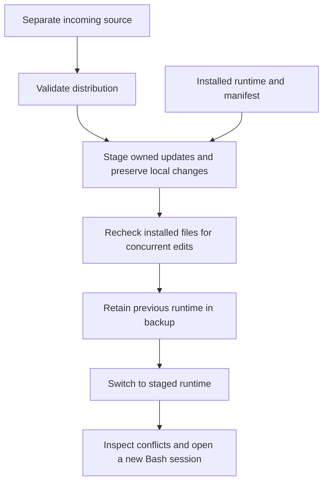

# Installing, updating, and removing Bash integration

[Project overview](../README.md) · [Documentation index](README.md)

The installer provides a per-user runtime copy and optional Bash startup
registration. Linux, Bash 4.4+, Python 3.10+ with `curses`, and a UTF-8 terminal
are required. Run the scripts as the account that will use the browser, without
`sudo`. No packages are downloaded or installed by these scripts.
Automatic resize recovery also uses the standard Linux `stty` utility.

These procedures describe the current checkout. The
[v0.1.2-alpha packages](releases.md#version-012---alpha) provide a versioned
prerelease snapshot; the [v0.1.1-alpha packages](releases.md#version-011---alpha)
are historical upgrade fixtures. A checkout or [local candidate](release-candidate.md)
can contain later changes without a new version string. Compare source manifests
when exact contents matter; preparation alone does not publish an upgrade.

## Installation

From an extracted source directory or Git checkout:

```bash
bash install.sh
```

The default destination is `$XDG_DATA_HOME/cli-interactive-help`, or
`~/.local/share/cli-interactive-help` when `XDG_DATA_HOME` is unset or empty.
The installer copies the runtime, bundled profiles, example configurations,
and the installation/update/removal scripts. Tests, documentation media, local caches,
and generated reports are not copied. The source directory can be moved or
removed afterward.

By default, installation appends one marked block to `~/.bashrc`. Existing bytes
are preserved, and an existing rc file is backed up as
`.bashrc.cli-help-backup-<unique-id>` before replacement. The block loads the
adapter only in interactive Bash sessions. Other shell startup files are not
edited, and existing startup code is not evaluated by the installer.

Open a new interactive Bash session, or run the source command printed by the
installer. For the default destination:

```bash
source "${XDG_DATA_HOME:-$HOME/.local/share}/cli-interactive-help/bash/interactive-help.bash"
```

Type `rsync --ar`, press Alt-H, and select `--archive`. Selection edits the
pending line; it does not execute it. The [usage guide](usage.md) covers controls,
keybindings, and discovery modes. Startup registration uses those same settings;
export custom `CLI_HELP_*` values before the managed block when configuring them
in `.bashrc`.

## Custom locations and manual loading

```bash
bash install.sh --prefix "$HOME/apps/cli-help" --rc-file "$HOME/.bashrc.custom"
bash install.sh --prefix "$HOME/apps/cli-help-manual" --no-rc
```

`--prefix` selects the runtime directory. `--rc-file` selects the exact startup
file to edit; Bash must already be configured to read that file. `--no-rc` copies
the runtime without modifying startup files. It cannot be combined with
`--rc-file`. `CLI_HELP_PYTHON` can select the Python executable used by the
installation wrappers, as it does for the browser.

Paths containing spaces, apostrophes, and shell metacharacters are quoted as
literal paths. Control characters, a filesystem-root or home-directory target,
destinations overlapping the source checkout, and a startup file inside the
installation directory are rejected. Symlinked destinations, rc files, and path
components are refused; pass a real path through `--prefix` or `--rc-file` when
using a dotfiles arrangement. A relative `XDG_DATA_HOME` is rejected.

Repeating installation with identical source files, destination, and startup
settings is a no-op. Existing unmanaged directories are never overwritten.
Use the [update workflow](#updating-an-existing-installation) to upgrade without
removal. Keep custom profiles, drivers, and keybindings in separate configuration
directories, as described in the
[profile and driver reference](profiles-and-drivers.md).

Collection commands remain available through the installed helper:

```bash
python3 "${XDG_DATA_HOME:-$HOME/.local/share}/cli-interactive-help/cli_help/main.py" --check
```

Other documentation examples use `cli_help/main.py` relative to the source
checkout. Substitute the installed helper's absolute path when the source
checkout is no longer present.

## Updating an existing installation

The [GitHub release updater](github-updates.md) can select, download, verify, and
apply a published package automatically. It uses the same preservation and backup
rules described below and opens the guided reviewer when conflicts remain.
The local-source update path remains available for unpublished changes and
offline distribution.

Obtain the new source in a directory separate from the installation, then run:

```bash
bash update.sh
```

For a custom installation directory:

```bash
bash update.sh --prefix "$HOME/apps/cli-help"
```

The default destination follows the same `XDG_DATA_HOME` rules as installation.
The updater does not download source or contact GitHub. For an existing Git
checkout, `git pull --ff-only` obtains new commits before running `bash update.sh`.
An extracted new source archive also works. Running the updater from inside the
installed runtime is refused because that directory is not a separate incoming
distribution. Existing installations created before `update.sh` was introduced
are supported by running the script from the new source.

The original startup path and `--no-rc` choice remain recorded. Update does not
read, evaluate, or rewrite any startup file, including edited registration blocks.
The `--rc-file` and `--no-rc` options apply only to installation. External
keybindings, profiles, drivers, caches, and `CLI_HELP_*` settings are untouched.
Open a new interactive Bash session after upgrading to load the updated adapter.

| Installed path | Update behavior |
| --- | --- |
| Managed regular file matching its previous content hash | Replaced with the incoming version; existing permissions retained |
| Edited, deleted, symlinked, or replaced managed path | Preserved and reported for manual adjustment |
| New distribution path with no existing file | Added and recorded in the ownership manifest |
| New distribution path occupied by an unmanaged file | Preserved without claiming ownership; reported as a conflict |
| Obsolete managed file with unchanged contents | Removed from the runtime and retained in the backup |
| Obsolete edited file | Preserved with its previous ownership hash |
| Additional files or directories | Copied unchanged, including symbolic links without following them |

Validation checks the incoming distribution before replacement. It does not
execute locally edited installed Python files or validate the final combination
of preserved edits and incoming code. Preserved code or profile changes may be
incompatible with the new runtime; reported conflicts require inspection.
Special files such as sockets and FIFOs cause the update to stop before copying.

Each applied update prints a sibling directory named
`<installation-directory>.update-backup-<unique-id>` containing:

- `previous/`: the complete previous runtime, including edited and extra files.
- `incoming/`: the complete validated distribution for comparison and manual merging.
- `report.json`: the planned replaced, added, removed, adopted, and preserved paths, with
  reasons for preserved conflicts.

An unchanged installation produces no backup. A repeated update with unresolved
conflicts produces another report and backup. Backups are retained until removed
explicitly and require space for the old runtime plus incoming files. Staging also
temporarily requires a copy of the installed directory. Backups can contain local
configuration; their enclosing directory is created with owner-only permissions.

Exit status `0` means an update or no-op completed without conflicts. Status `2`
means an update completed with preserved conflicts requiring manual merging
(argument usage errors also return `2`, accompanied by argparse usage text).
Status `1` indicates a validation or filesystem failure. A backup report records
the planned changes; its presence alone does not prove the runtime switch completed.

Use the [interactive update reviewer](update-review.md) to compare local and
incoming files, keep local changes, accept incoming files or deletions, or edit
merged versions. The updater prints a ready-to-run review command. Review saves
include full runtime backups and recorded decisions.

For manual handling of each reported path, compare the installed file with `incoming/<path>`.
Merge needed changes into the installed file, or copy the incoming version after
retaining any required edits. Deleted files remain deleted until restored
explicitly. Preserved paths keep their old ownership hashes, so uninstall retains
them. After replacing a previously managed conflict with the exact incoming copy,
rerun the updater to recognize it and adopt the new ownership hash. A merged file
that differs from the incoming distribution remains a local customization and
continues to be reported. Unmanaged collisions are never adopted automatically;
move the conflicting file elsewhere before retrying if the new distribution path
is needed. Metadata should not be edited merely to suppress a warning.



## Update recovery

Close help menus and avoid editing the installed directory during an update.
The updater checks file contents, types, and permissions again before switching;
detected concurrent edits abort the operation. This check is not a filesystem
lock against unrelated writers. Directory replacement has a short interval when
the install path is absent, so help requests should wait until update completes.

Ordinary failures while switching to the staged runtime restore `previous/` to
the original destination. Failed validation or staging leaves the installation
unchanged. A forced termination, power loss, or failed rollback can leave the
destination missing. After confirming no installation process is running, inspect
the printed backup directory and the destination:

1. If the destination is absent and `previous/` exists, move `previous/` back to
   the exact original installation path.
2. If both exist and rollback is needed, move the current runtime to a separate
   saved location, then move `previous/` back to the original path.
3. Remove a stale `.install.lock` only after confirming that no installer,
   updater, or uninstaller is active. Retry from the new source if appropriate.

Do not source or uninstall the backup directly: its manifest and startup block
refer to the original path. Relative symbolic links also retain their original
text and may point somewhere different until the directory is restored. Leftover
`.cli-help-stage-*` directories from forced termination can be inspected and
removed after recovery. Updates do not provide a power-loss-durable transaction
or automatic recovery after forced termination.

## Uninstallation

From the source checkout, remove the default installation with:

```bash
bash uninstall.sh
```

For a custom destination, use `bash uninstall.sh --prefix /absolute/install/path`.
The installed uninstaller also works independently of the source checkout:

```bash
bash "${XDG_DATA_HOME:-$HOME/.local/share}/cli-interactive-help/uninstall.sh"
```

The uninstaller reads its manifest to locate the startup file used at installation
time. It removes the unchanged managed block, preserving surrounding startup
content and creating another backup when the rc file changes. It then removes
only manifest-listed regular files whose contents still match the installation
hashes. Edited files, symlinks, extra files, and nonempty directories are retained
and reported. Runtime-generated bytecode can therefore leave a directory behind.
Custom configuration, discovery caches, imported collections, and rc backups
outside the installation are retained.
After removal, a retained directory no longer has an installation manifest.
Move its retained files to a separate location before reinstalling at that path.

Existing shells retain their loaded functions and binding. Run `cli_help_unbind`
in those shells or start a new session. Removal does not restore a third-party
keybinding previously replaced by the adapter; see [keybinding behavior](usage.md#configurable-keybindings).

## Recovery and validation

An edited, incomplete, or duplicated managed startup block prevents automatic
removal. Inspect its contents, restore the original block or remove just that
block, and rerun uninstall. A missing startup file or already removed block does
not prevent runtime removal. Invalid installation metadata is refused before
deleting files; it is not a substitute for a system security boundary.

Operations use an exclusive `<installation-directory>.install.lock` beside the
destination. After an interrupted process, confirm no installer, updater, or uninstaller
is running before removing that lock. Startup replacement is atomic per file,
but the installation directory and startup file are not one filesystem
transaction. Inspect both after a power loss or forced termination. Ordinary
startup-write failures roll back a newly copied payload, retaining any changed
files. The `.cli-help-install.json` manifest records ownership and startup
settings and must remain with the installed runtime.

The installation tests use temporary homes and cover repeated setup, custom and
XDG paths, literal path quoting, startup-byte and mode preservation, rollback,
modified files, symlinks, malformed metadata, locks, and actual Bash insertion
without command execution. Run them from the source checkout:

```bash
python3 -m unittest discover -s tests -p 'test_installation.py' -v
python3 -m unittest discover -s tests -p 'test_update.py' -v
python3 -m unittest discover -s tests -p 'test_update_review.py' -v
bash tests/run.sh
```

Update tests additionally cover legacy manifests, additions and obsolete files,
deleted or edited paths, unmanaged collisions, incoming validation, concurrent
edits, read-only files, stale Python bytecode, copy and switch failures, backup
contents, repeated updates, and real Bash
option insertion after an upgrade without executing the pending command.
