# Five Bash menu demonstrations

These five recordings show the development checkout running in real interactive Bash sessions. Each uses a different terminal width and height. In the starting lines below, `▏` marks the Readline cursor. Enter in a menu returns to editing. Each recording ends with the command still pending.

| Package | User’s task | Capability shown | Capture |
| --- | --- | --- | --- |
| apt | Preview installing Graphviz | Complete a verb at the cursor, then use verb-specific options | Six PNGs |
| bash | Give a prompt a five-second timeout | Read installed builtin help and supply a required argument | Four PNGs |
| git | Prepare a machine-readable worktree listing | Follow a nested command and discover a prerequisite | Six PNGs |
| rsync | Limit a transfer over a slow connection | Reveal clipped text without shifting the option name | Timed GIF and three PNGs |
| ffmpeg | Find the last entry in a large codec menu | Page through a category and cancel back to an unfinished edit | Six PNGs |

The recorder drove the Alt-H shortcut from Bash on Ubuntu 26.04.1 LTS, using Bash 5.3.9 and tmux. The runtime is based on commit `32fcec7`. The APT recording also includes the manual-backed simulation guidance. Each three-level comparison keeps the same option selected and uses Shift+D to advance. APT and Bash used installed-provider discovery. Git, rsync and FFmpeg used the bundled profiles. The menu images show the full pane. Prompt stills crop the empty rows below the cursor. Keystroke captions sit outside the terminal.

## 1. APT · preview a package install

Start at 100×26 with `apt ins▏ 'graphviz'`.

1. **Before.** Show the incomplete verb, cursor and quoted operand.
2. **Complete the verb.** Press Alt-H, highlight the literal keyword `install`, and capture its selection. Press Enter in the menu.
3. **Inspect the install options.** At the returned cursor before the quoted name, type `--sim` and a separating space. Move left one character to leave `apt install --sim▏ 'graphviz'`. Reopen with Alt-H and highlight `--simulate`. Keep the `apt install` title in frame. Advance through Detailed and Expanded. Detailed explains how the plan is computed with locking disabled. Expanded decodes the simulated dpkg actions and square brackets, then explains how configuration permissions can affect the result. The install entry in apt(8) points to apt-get(8), which documents the simulation flags. [Captured apt(8) manual](../tests/fixtures/ubuntu-coverage/resolute-apt.txt) · [Captured apt-get(8) manual](../tests/fixtures/ubuntu-coverage/resolute-apt-get.txt)
4. **After.** Accept the option. Show `apt install --simulate ▏'graphviz'`. Frame the same portion of the prompt as in step 1 so the preserved quotes are easy to compare.

| Pending edit | Select the verb | Returned line |
| --- | --- | --- |
|  | 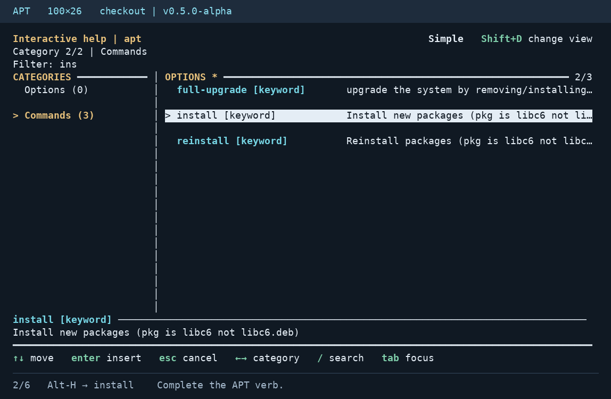 | 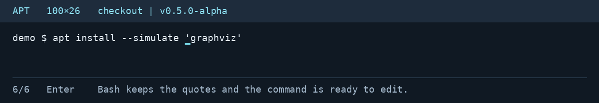 |

| Simple · `--simulate` | Detailed | Expanded |
| --- | --- | --- |
| 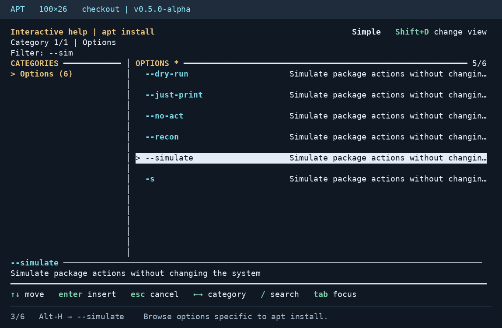 | 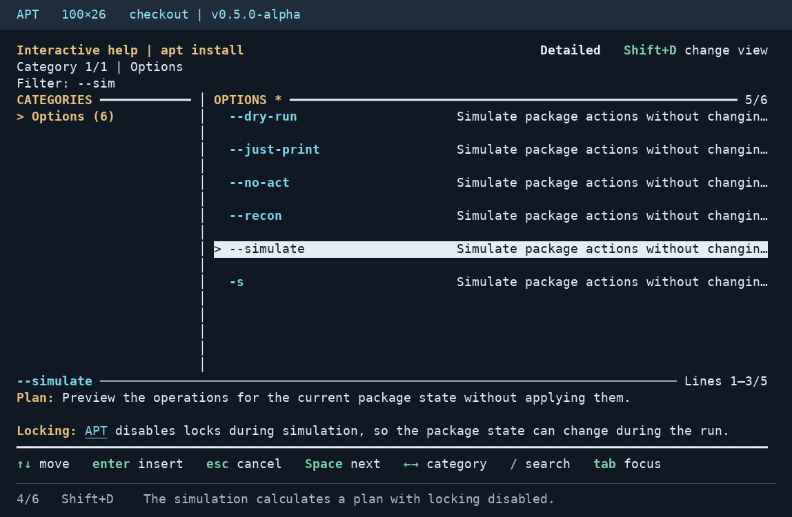 | 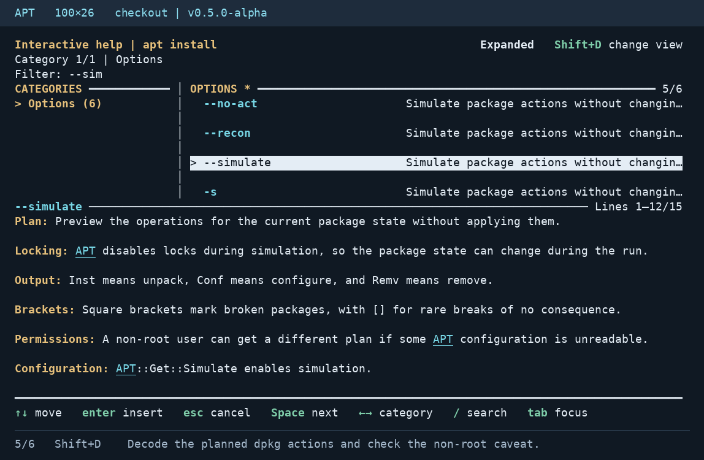 |

## 2. Bash · time out a prompt

Start at 112×36 with `builtin read ▏`. The explicit `builtin` selects Bash’s own help topic.

1. **Find the argument.** Press Alt-H and highlight `-t timeout`. Include the `builtin read` title and the adjacent declarations, such as `-d delim`, so the argument notation is visible.
2. **Understand the timeout.** Press Shift+D for the selected option’s behavior, then Shift+D again for Expanded. The first page shows the default, fractional timeouts, the zero case and the exit status, followed by the builtin reference.
3. **Supply the value.** Accept `-t`. In Bash, type `5 reply`. End on `builtin read -t 5 reply▏` and caption which text the menu inserted and which text was typed.

| Simple · `-t timeout` | Detailed | Expanded |
| --- | --- | --- |
|  | 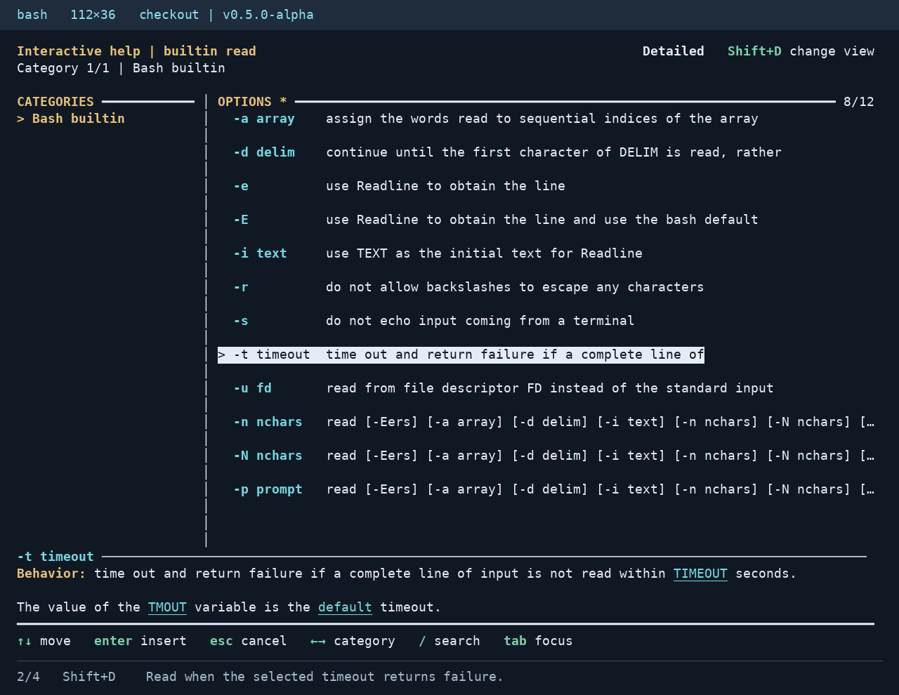 | 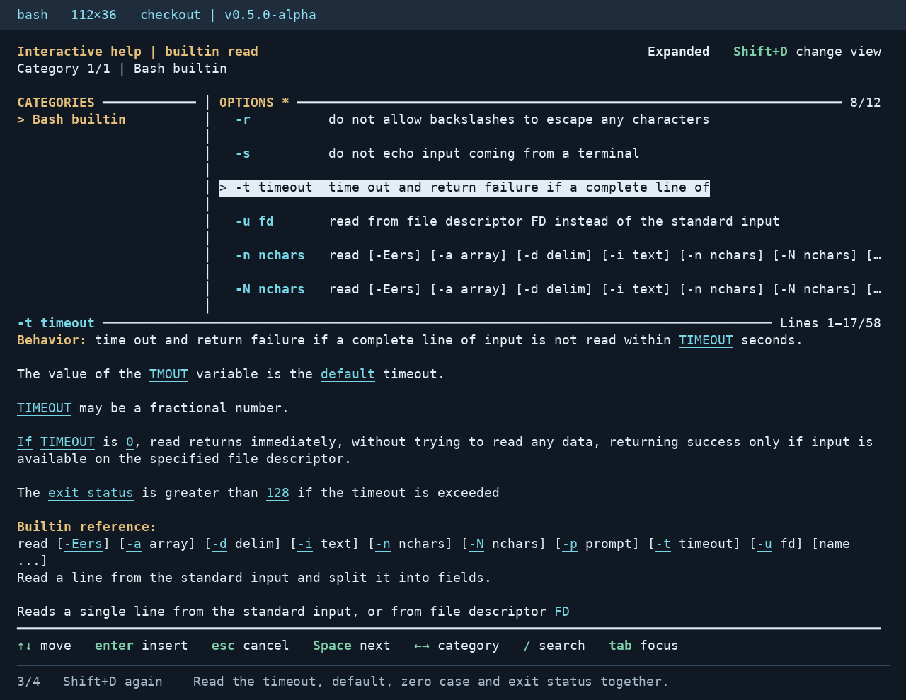 |

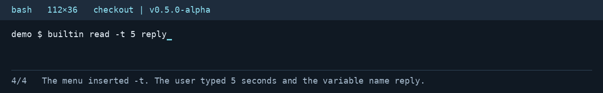

## 3. Git · list worktrees for a script

Start at 80×24 with `git worktree list ▏`. The goal is stable output even when a worktree path contains a newline.

1. **Scope.** Press Alt-H. Show the `git worktree list` title and `--porcelain`, the first option in this seven-entry menu.
2. **Discover the dependency.** Move down to `-z`. Press Shift+D for the `--porcelain` prerequisite, then again for Expanded and the note about newlines in paths.
3. **Choose the prerequisite.** Move up to `--porcelain` and accept. Show it on the pending line. Reopen the same menu with Alt-H.
4. **Finish.** Select `-z` and accept. Show `git worktree list --porcelain -z ▏`. Use this prompt as the final frame because the resulting NUL characters would be invisible in a terminal listing.

| Open the nested menu | Insert --porcelain | Add -z |
| --- | --- | --- |
| 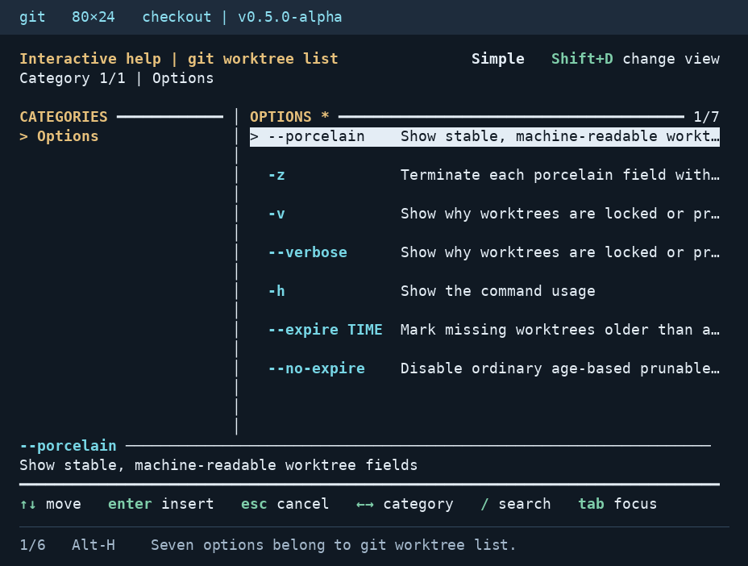 | 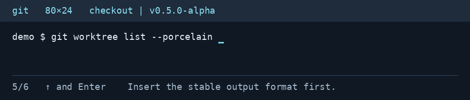 | 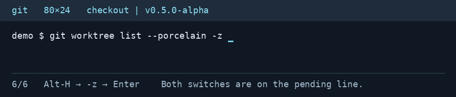 |

| Simple · `-z` | Detailed | Expanded |
| --- | --- | --- |
| 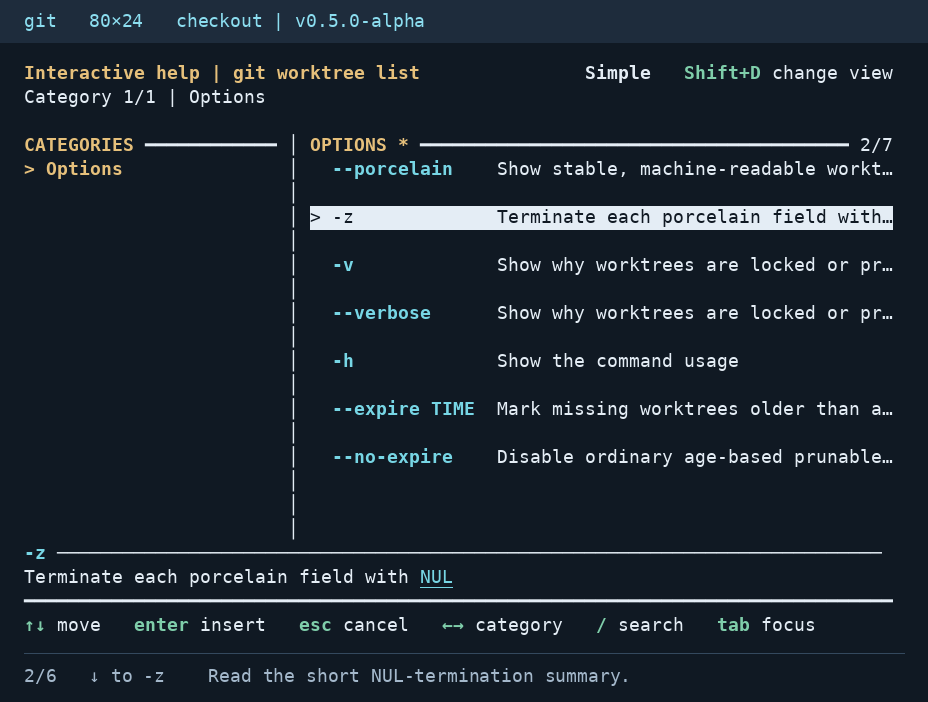 |  | 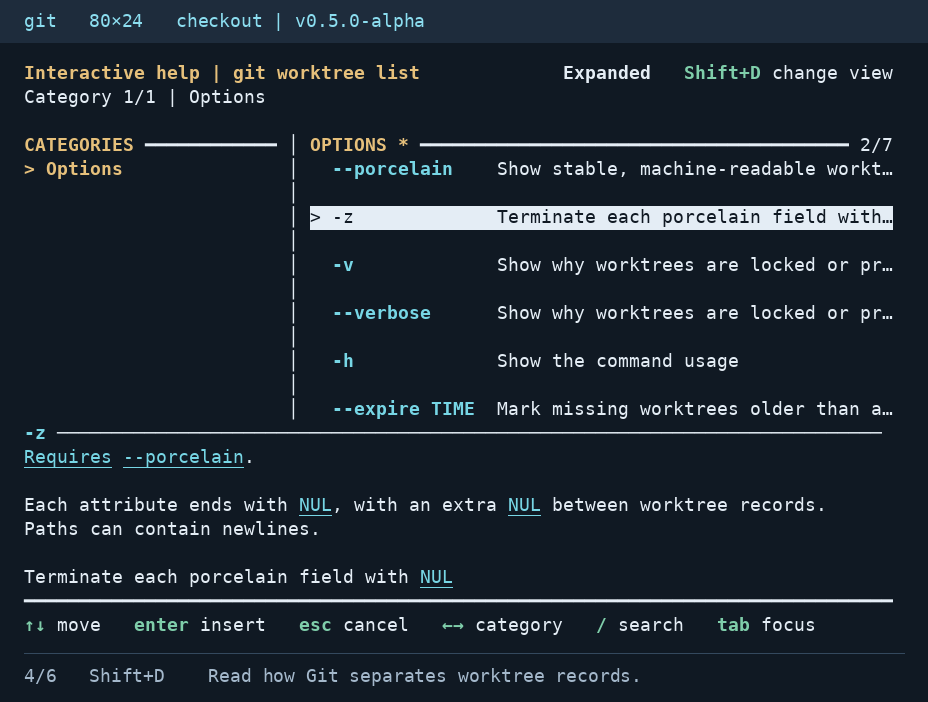 |

## 4. rsync · read a clipped bandwidth limit

Use 60×16 with `CLI_HELP_NARROW_MENU=1` and default summary scrolling. Start with `rsync ▏`. Keep the terminal size, crop and option row fixed throughout the moving portion.

1. **Locate.** Open with Alt-H, move down six categories to Network, press → for Options, and move down once to `--bwlimit=RATE`. Show the clipped summary and its neighboring rows.
2. **Pause.** Hold the opening frame for the full two seconds after highlighting the option. Keep the entire option row visible.
3. **Reveal.** Record the actual app at normal speed as only the highlighted summary moves and reveals “KiB/s)”. Hold the final text briefly. Keep the declaration, highlight marker and neighboring rows in view as stationary references.
4. **Compare levels.** Press → to open Details in Simple. Press Shift+D for the average rate and rounding rules. Press it again for the bare-number unit and input form.
5. **Apply.** Press Enter in Expanded to insert `--bwlimit=`. Type `5000 'project files/' backup/` at the prompt. End on `rsync --bwlimit=5000 'project files/' backup/▏`. The bare value represents 5000 KiB/s.

| Simple · `--bwlimit=RATE` | Detailed | Expanded |
| --- | --- | --- |
| 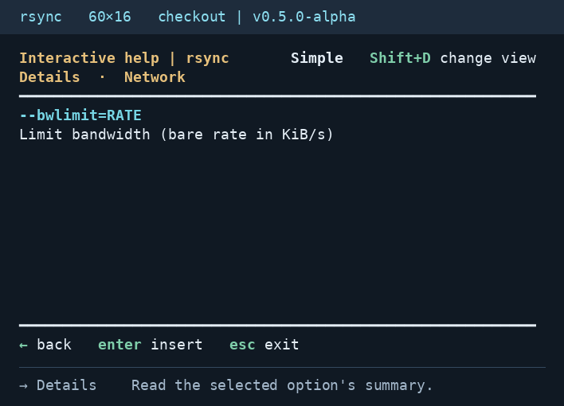 | 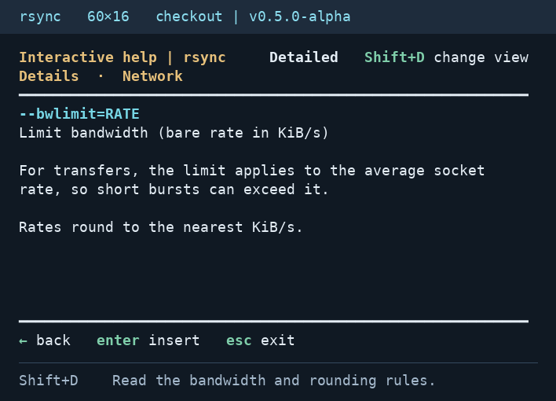 | 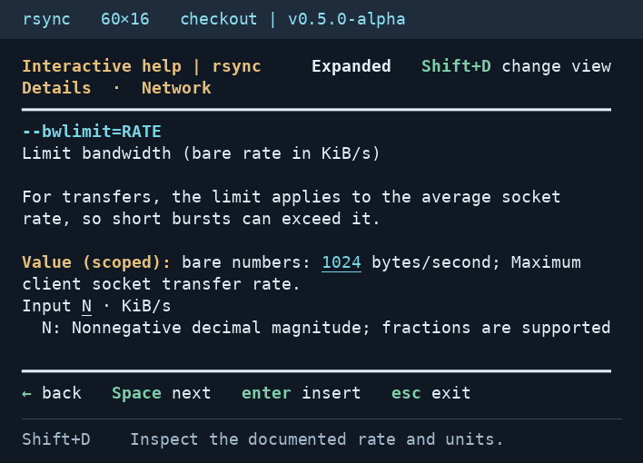 |

## 5. FFmpeg · find a codec setting and return to an edit

Start at 120×30 with `ffmpeg ▏ 'review clip.mp4'`. The cursor is between the two spaces. This scenario ends by cancelling the menu.

1. **Orient.** Press Alt-H and move right 13 categories to Codec parameters. Capture the first selection, `-alpha_mode`, alongside the 1/92 counter.
2. **Page.** Press PageDown once. Show the new highlighted option and counter. Record the actual name shown at this size, since the jump depends on available rows.
3. **Reach the end.** Press End. Capture `-trellis` and 92/92. Press Shift+D to read where the option belongs and press it again for the numerical guidance. Check that the counter stays at 92/92.
4. **Restore.** Press Esc. Show the original line and cursor immediately before the existing space and quoted filename. Use the caption “Esc returns to the edit” and retain the quoted name in the crop.

| First of 92 | PageDown to 13 | Return to Bash |
| --- | --- | --- |
| 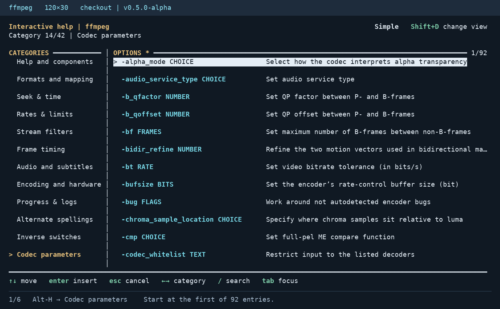 |  |  |

| Simple · `-trellis` | Detailed | Expanded |
| --- | --- | --- |
| 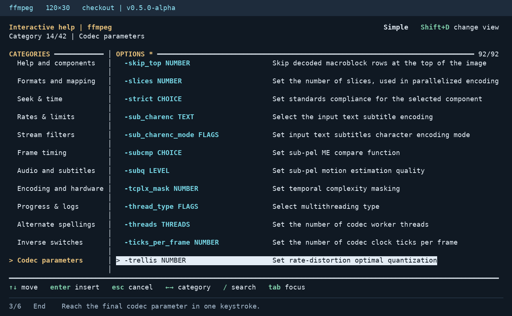 | 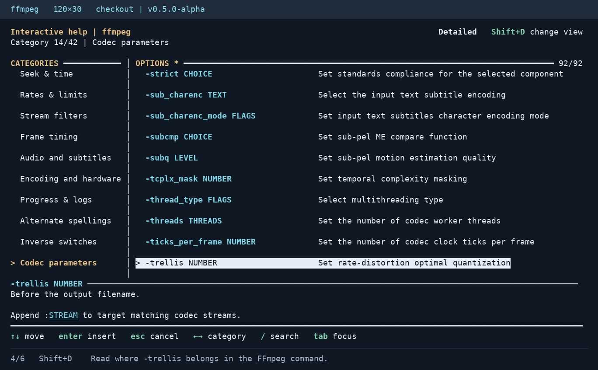 | 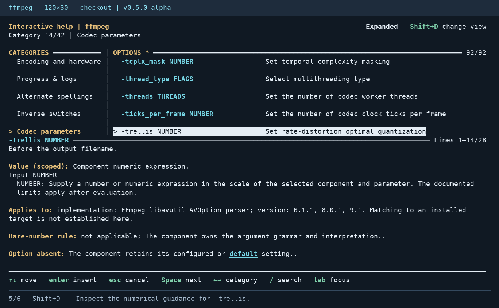 |

## Capture and verification

The Ubuntu packages installed during recording were APT `3.2.1ubuntu0.1`, Bash `5.3-2ubuntu1`, Git `1:2.53.0-1ubuntu1.1`, rsync `3.4.1+ds1-7ubuntu0.3`, FFmpeg `7:8.0.1-3ubuntu2` and tmux `3.6a-2ubuntu0.2`.

The [scenario recorder](../tools/capture_scenario_demos.py) checks terminal dimensions, selected text, the returned Readline buffer and its cursor offset. In the recorded rsync session, the first change to the selected summary was observed at 2.005 seconds. The encoded GIF holds the opening highlight for exactly 2.000 seconds. The declaration and neighboring rows stay fixed through all six summary states.

With tmux installed and the [media environment](assets/README.md#regeneration) active, run `python tools/capture_scenario_demos.py` from the checkout. Pass one package name to repeat only that scenario. Original terminal text, cursor positions and animation timings are saved under `tests/reports/scenario-demos/`.
