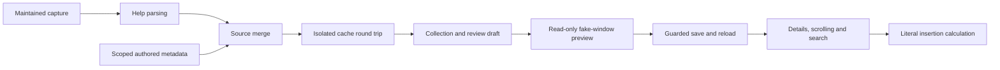

# Integrated numerical behavior verification

This account records the Step 8 verification snapshot. The later
[maintained debt resolution](debt-resolution.md) supplies current strict-success
and migration evidence; native acceptance gaps recorded here remain open.

[Inventory and acceptance criteria](README.md) · [Contract](../numerical-value-contract.md) · [Prospective coverage](step7-enforcement.md)

## Scope and evidence

Step 8 verifies the passive numerical-documentation paths implemented in
Steps 1–7. The starting checkout is `ec6130a463301fa050b5e11470494ab1c5e3d349`.
The initial working tree was clean. Current enumeration and both coverage modes
were run before changes; historical counts and test reports were not treated as
current proof.

The new [integration tests](../../tests/test_numerical_integration.py) exercise
these actual owners in sequence:



Every bundled profile already containing optional numerical metadata is selected
automatically for a merge/cache/authoring/preview/save/reload/explanation/insertion
round trip. At this baseline these are 56 profiles and 175 option records, plus
three positional contracts. New optional fields enter that selection without
extending a command list. No test asserts these historical totals as constants.

Real numerical expectations reuse the separate
[migration reference facts](../../tests/fixtures/value-semantics/migration-evidence.json)
and [GNU preservation expectations](../../tests/fixtures/value-semantics/preservation-evidence.json).
They retain the sources, release locators and qualifications described in the
[migration account](step3-migration.md) and [preservation rules](step4-preservation.md).
This pass compares current behavior with those reviewed facts. It does not
claim new retrieval of every upstream source or installed-version verification.
Synthetic conflicts, unknown applicability and invalid edits assert no new
command facts. Raw captures remain unchanged.

## Demonstrated defect and bounded correction

The new integration test reproduced two related failures in the starting merger:

1. Source A supplies scalar numerical metadata for one operand. Source B wins
   with a two-operand declaration and no metadata. A's scalar declaration
   incorrectly remains active for the two-operand result.
2. Source A declares two operands without metadata. Source B declares one
   operand with scalar metadata. B's metadata incorrectly attaches to A's
   two-operand result.

The shared structural validator accepts some scalar declarations with either
arity; structural validity alone does not establish their source association.
The failing cases survived cache storage, review, preview, save and reload,
making the misleading declaration available in browser guidance.

The repair is restricted to `discovery.merge_profiles`: active and incoming
metadata must belong to a source with the selected operand count. Mismatches use
the existing inactive-alternative and nonfatal review-diagnostic mechanisms.
Definitions and provenance are retained. A winning source can still supply its
own compatible composite contract. Existing declaration precedence, operand
grammar, option inventory, source selection and probe permissions are unchanged.
Both negative cases fail without the repair; a positive two-operand composite
case protects against discarding appropriate metadata.
Unselected incoming metadata also retains its original argument declaration in
the existing alternative record. A separate failing assertion demonstrated that
this recovery context was previously absent after an incoming-arity mismatch.

The existing cache generation advances from 11 to 12 so ordinary lookups bypass
old interpreted profiles. Cache keys, TTL, refresh, module/vendor identity guards
and process policy are unchanged. Old files are left intact. No cache directory
was purged and no new probe was introduced.

## Acceptance matrix

Each existing acceptance criterion in [review.json](review.json) has a
`step8_verification` record containing entry class, owners, evidence, exact tests,
expected behavior, result, scope, limitations and follow-up. The generated
`tests/reports/numerical-inventory/step8-verification.json` joins those records to
the test outcomes and independent source comparisons. The following table is a
human-readable index; pass results apply only to their stated passive scope.

| Criteria | Observed boundary | Result and limitation |
| --- | --- | --- |
| S1-01 | Independent source/profile/route census and explicit dispositions | Passed; fixture coverage is not installed-program completeness |
| S1-02 | New identities and changed observations cannot inherit review | Passed using disposable growth mutations |
| S1-03 | Missing, stale, duplicate, conflicting and orphaned reviews | Passed; deliberate curated policy edits still require substantive review |
| S1-04 | Deterministic, passive enumeration and input preservation | Passed under process/network/probe tripwires |
| S1-05 | Explicit, bounded output destinations | Passed; ordinary gate operation writes no report unless selected |
| AC-01 | Inventories, routes, grammar declarations and insertion | Passed in source comparisons and passive buffer tests |
| AC-02 | Navigation, cancellation, cursor and surrounding buffer | Passive checks passed; native Bash/Readline acceptance blocked |
| AC-03 | Pending values, examples and untrusted targets remain unexecuted | Passed for selected repository paths; native process fixtures excluded |
| AC-04 | Numerical meaning, units, scale, accepted forms and factual evidence | Representative reference checks passed; complete migration deferred |
| AC-05 | Composite, positional and delegated meanings | Passed for supplied contracts and reviewed examples; opaque external grammars remain unresolved |
| AC-06 | Provenance, applicability and uncertainty | Passed for retained declarations and unknown matches; no installed-version matching claim |
| AC-07 | Shared prose, merge ownership, references and caches | Passed for maintained specimens, synthetic conflicts and revision invalidation; arbitrary formats unverified |
| AC-08 | Visible/reachable details, search, Unicode, narrow sizes and resize | Fake-window checks passed; native terminal acceptance blocked |
| AC-09 | Authoring preservation, stale claims and save failures | Passed for controlled workflows; native POSIX restoration remains blocked |
| AC-10 | Automatic prospective enforcement and exact deferrals | Passed; strict maintained completeness intentionally remains unmet |

Numerical reference checks distinguish seconds/milliseconds, bits/bytes,
decimal/binary prefixes, literal esptool tokens and chip variants, explicit-unit
Go durations, count subjects, indices, levels, percentages, timestamps,
expressions, composites and delegated values. Zero, negative, unlimited,
omitted-operand and absent-option meanings remain separate. Passing structural
or formatter checks does not establish the truth of an upstream assertion.

## Integrated observations

- Captured rsync prose and existing scoped metadata survive merge, cache,
  collection, review, preview and reload. Units, suffix tokens, special meanings,
  placeholders and version qualifications remain searchable and reachable through
  details scrolling at minimum and larger fake-window dimensions.
- GNU coreutils 9.4 captures exercise nine preserved shared-documentation
  associations across `df`, `du`, `head`, `tail` and `sort`, including explicit
  short aliases. Unrelated final options do not acquire those numerical rules.
  This is captured-prose preservation, not structured numerical enrichment.
- Shared-definition collisions retain source-scoped alternatives. Their inactive
  claims remain recoverable through explicit definition references and do not
  become active explanations or search matches.
- Unknown applicability variants remain qualified. Identity/arity disagreement
  does not become active guidance through an authoring or cache round trip.
- A potentially invalidating saved edit retains inactive evidence and an early
  review indication. An exact custom-profile match bypasses discovery, so an old
  generated cache cannot override that custom profile. Generated cache contents
  do not automatically track arbitrary external manual or authored-file edits.
- Malformed optional metadata remains nonfatal in preview. Invalid edits cannot
  overwrite the valid saved profile or cache. Existing cancellation, concurrency,
  backup and per-file atomic-save tests remain applicable; a profile/driver/report
  save is not one filesystem transaction.
- Mocked cold/warm discovery uses only the reviewed fixed request in the test.
  Changing the generation identity produces a miss without deleting old files.
  No actual executable, manual renderer or external editor runs.

## Coverage and unresolved debt

The census remains 76 profiles, 96 categories, 942 option/keyword records,
463 value-bearing records, 327 explicit named paths, 356 input files and 6,159
review identities. There are 22 shared definitions and three positional groups.
Aliases are separate records; definitions, components, paths, matrix expectations
and parsed observations overlap and must not be summed as option coverage.
Regeneration is the source of current totals.

The prospective gate passes with the unchanged exact legacy-debt baseline.
Strict mode intentionally returns failure for 360 incomplete records and 414
diagnostics: 304 option/keyword records lack optional metadata, 47 source-derived
records retain investigations, and nine source-derived definitions overlap their
consumers. The missing contracts include ordinary text/path values and named
enumerations; they are not 304 proven missing physical units. Individual
exceptions remain empty. No baseline row, applicability or evidence status was
expanded or promoted during verification.

Full maintained completeness needs those exact contracts and evidence gaps
resolved under separate migration authorization, followed by strict-mode success
and removal of resolved debt records. Heuristics remain secondary review signals.
External observations, synthetic specimens and matrix sentinels do not acquire
verified static contracts merely by being enumerated.

## Reproduction and environment limits

The final passive run exercised 379 tests across 22 selected modules: 362 passed,
17 platform-dependent cases were skipped, and no failures remained. All 12 new
integration tests passed. Of the 15 scoped acceptance records, 12 passed, two
retain blocked native-terminal acceptance and one retains deferred complete
numerical migration. These outcomes do not turn skips or debt into passes.
Independent comparisons preserved all 76 profiles, 208 fixture files other than
the revised fixture guide, and 11 tracked historical release files. Only the
reviewed discovery-owner and fixture-guide source fingerprints changed.

Run the new passive integration cases from the repository root:

```bash
python -X utf8 -B -m unittest discover -s tests -p test_numerical_integration.py -v
python -B scripts/inventory_numerical_descriptions.py --check --summary
python -B scripts/inventory_numerical_descriptions.py --check --output tests/reports/numerical-inventory/inventory.json --summary
python -B scripts/check_numerical_coverage.py --output tests/reports/numerical-inventory/coverage.json --summary
python -B scripts/check_numerical_coverage.py --mode strict --summary
```

At the Step 8 snapshot, the final command exited 1 for explicit migration debt;
the subsequent debt-resolution follow-up now passes it. Existing
focused contract, migration, preservation, presentation, authoring and enforcement
tests remain discoverable through normal unittest discovery. The local Step 8
report records the exact broader passive selections, exclusions and outcomes.
The general Linux runner includes terminal/process/package-related tests and
must not be run blindly under a no-target/no-install verification scope.

Local verification uses Windows and Python 3.13. Process launch, target probes
and network entry points are blocked during passive tests. Real temporary cache
and collection files are confined to selected ignored disposable directories.
Windows test-only inherited permissions accommodate mode-0700 directory access;
production permissions are unchanged. The Bash fixture import stand-in refuses
construction, and native process fixtures remain excluded.

Fresh environment checks found Git for Windows Bash unable to create a signal
pipe (Win32 error 5), and WSL enumeration failed with
`Wsl/EnumerateDistros/Service/E_ACCESSDENIED`. No native Linux/WSL suite, real
terminal/Readline, native POSIX restoration, installed-target, package or hosted-CI
result is established. These limits are separate from portable test success.

## Handoff

Step 8 is complete within the reported passive verification and documentation
scope. Native acceptance and full maintained numerical completeness remain
explicitly blocked or deferred. The next plan step is Step 9, the final repository
configuration review and local handoff; it is not performed here. No additional
production migration, command-specific enrichment, compatibility expansion,
release work or configuration overhaul is included.
