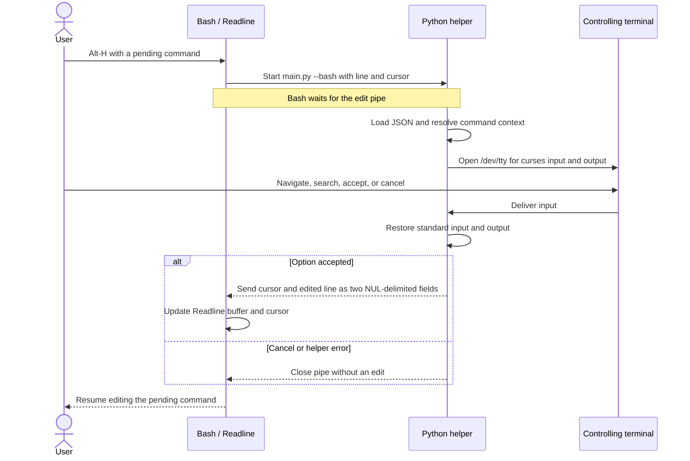
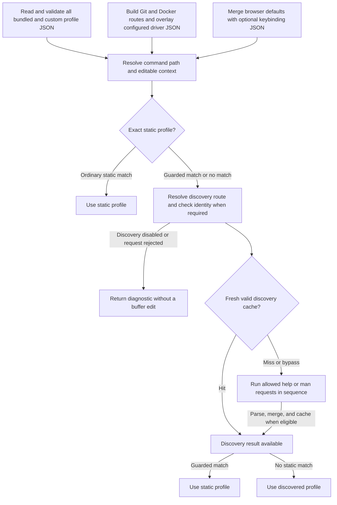
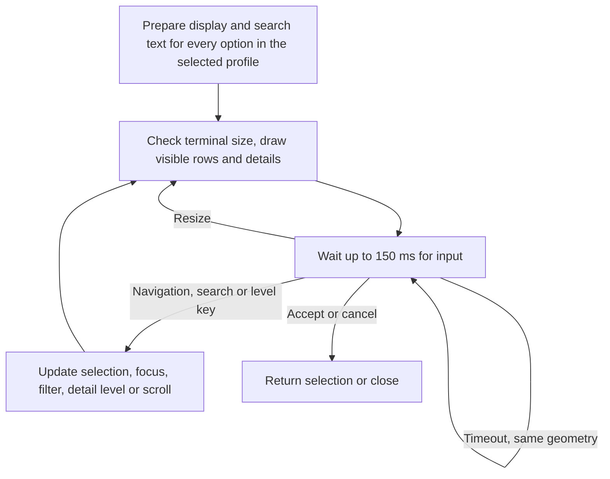

# Terminal runtime and JSON reference files

[Development guide](development.md) · [Help profiles and drivers](profiles-and-drivers.md)

## 1. One Alt-H request

The interactive shell owns the pending line. The key binding starts a fresh
Python process for each request and passes `CLI_HELP_LINE` and `CLI_HELP_POINT`.
Curses draws and reads keys through the controlling terminal while the helper
reserves its original stdout for `cursor\0line\0`. Bash applies an edit only
when it reads two fields and the cursor is numeric.
Enter in the menu inserts an option. A subsequent Enter in Bash
can execute the resulting line. Bash checks the terminal size before and after
the helper and requests a Readline redraw if it changed. The optional native
`cli-help` command uses `execvp` to replace its own process with Python for
runtime modes. The Alt-H binding invokes Python directly.
[Bash adapter](../bash/interactive-help.bash#L13) · [Python entry point](../cli_help/main.py#L65) · [Native launcher](../native/cli_help.c#L14)

## 2. Which reference files are read

| Data | How the helper accesses it |
| --- | --- |
| `profiles/*.json` and optional `CLI_HELP_PROFILES/*.json` | Reads UTF-8 files in sorted order, validates every profile and retains the effective collection in memory. Custom files replace bundled entries by exact `command` tuple. Duplicate tuples in one directory fail validation. |
| Optional `CLI_HELP_DRIVERS/*.json` | Reads and validates the configured directory and overlays routes by executable and subcommand. Drivers supply fixed documentation requests and argument-boundary rules. The shipped `config/drivers.example/` collection requires activation. |
| Optional `CLI_HELP_CONFIG` | Reads one JSON file and merges its key bindings with the defaults in `ui.py`. |
| Discovery cache | Looks up one JSON file by the hash of the resolved command, route, executable identity and discovery settings. It validates the stored identity, age and profile. Successful discovery can write a cache file using atomic replacement. |

Static profiles supply the displayed menu. A profile with an identity guard,
such as `yq eval`, requires successful discovery first and then displays its
curated rows. For an unprofiled command, fresh cache hits reuse parsed help.
The helper checks the remaining argument boundaries before opening the browser.
The default lifetime is 24 hours, and each entry is limited to 2 MiB. A cache
entry lives under `$XDG_CACHE_HOME/cli-interactive-help`, with `~/.cache` as the
default XDG cache root. `CLI_HELP_CACHE_DIR` overrides the location.
`CLI_HELP_CACHE_TTL=0` disables discovery caching. A cache hit still incurs
the initial profile load. Guarded-tool checks and auto-mode Python module
fingerprints can run before cache lookup. Replacing an
executable usually changes the cache key. The key tracks the `man` executable
and `MANPATH`, so a manual page edited in place may need expiry or an explicit
`--discover ... --refresh`. Discovery subprocesses receive fixed documentation
arguments without the pending line's operands or option values.
[Profile loader](../cli_help/core.py#L157) · [Context resolver](../cli_help/core.py#L224) · [Driver loader](../cli_help/drivers.py#L115) · [Discovery and cache](../cli_help/discovery.py#L1574)

## 3. Work while the menu is open

The browser keeps derived display, detail and search text for the selected
profile in memory until the helper exits. Search uses original prose and evidence
alongside unit aliases. The display omits citations. Each new browser starts
in Simple. Changing the level retains the filter and selected option while
reallocating space between the list and its explanation. The browser redraws the visible
window and recomputes filter matches and detail wrapping in the draw path.
The timeout lets it detect resizes when Bash process substitution prevents
delivery of the resize signal. A timeout at the same terminal size reuses the visible frame and its page capacity. The browser runs on the helper's main thread. When the helper exits,
its profile objects and formatted text are released, and the discovery cache
can survive on disk for the next request.
[Browser and input loop](../cli_help/ui.py) · [Option presentation](../cli_help/presentation.py) · [Unit aliases](../cli_help/menu_units.py)

## Adding support

| Addition | Extension point |
| --- | --- |
| Command or subcommand | Use a profile keyed by the exact command path for curated entries. Use a driver route for fixed help requests or command-specific option arity. A conventional root `--help` can use generic discovery. Validate with `--check` and verify insertion, search and Details in a PTY. |
| Command version or variant | Use version-matched help or manual evidence. Record version-specific applicability in the profile when the syntax can be represented safely. The static-profile key has no general version or OS selector. Incompatible variants under the same name may require an explicit identity guard and fixed probe, as with Mike Farah `yq` v4. Verify both the intended variant and one that must be rejected. |
| Utility on another Linux distribution | Reuse profile and driver formats. Compare installed help, manual output and option spelling. Test the terminal path on that distribution before claiming support. |
| New operating system or shell | The runtime target is Linux, including Bash under WSL. Evaluate terminal and cursor handling, Bash/Readline integration, discovery process groups and manual renderer flags, plus installation and packaging. The Linux native launcher depends on `/proc/self/exe`. Treat platform support as a separate compatibility effort. |

[Profile and driver authoring](profiles-and-drivers.md) · [Compatibility evidence](compatibility.md) · [Installation requirements](installation.md)

## Local performance baseline

On November 23, 2026, local tests on Ubuntu 26.04.1, Bash 5.3 and Python 3.14
used 12 launches per case with a 100 × 24 PTY, warm filesystem reads, bundled
profiles and built-in drivers.
Latency runs from sending Alt-H to receipt of the first menu title. RSS is the
Python helper's resident memory sampled at first display. Discovery uses the
repository's small synthetic help and manual fixtures, so its timings are
specific to that fixture.

| Request | Median latency | Observed range | Median RSS |
| --- | ---: | ---: | ---: |
| Static `rsync --ar` | 190 ms | 187–197 ms | 40.4 MiB |
| Static `ffmpeg` with no filter | 684 ms | 677–710 ms | 46.1 MiB |
| Fixture discovery, cache miss | 194 ms | 192–198 ms | 40.3 MiB |
| Fixture discovery, cache hit | 153 ms | 150–159 ms | 40.2 MiB |

The checkout had 76 bundled profile files totaling 6.25 MB. A separate
12-run CPU probe measured 76 ms median to load and validate them all, under
1 ms for either static context lookup, and 37 ms for the `rsync` browser
constructor versus 526 ms for `ffmpeg` with its 1,759 rows. Every sampled helper
had one thread. In one idle `ffmpeg` window, the helper registered 20 voluntary
context switches and one 10 ms CPU accounting tick over 3.05 seconds.
These observations establish a local baseline. They leave terminal redraw
latency during rapid interaction, cold filesystem startup and other platforms
unmeasured. [PTY harness](../tests/test_bash_pty.py#L21) · [Discovery fixtures](../tests/test_discovery.py)

## Optimization candidates

The redraw loop checks geometry on each timeout and redraws after input or a resize. The loader validates every bundled and custom profile. It checks a whole printable field in one call and examines individual characters when it needs to distinguish allowed tabs and newlines from other controls. Ordinary discovery
cache hits made zero probes in the measured fixture. The guarded yq route
retained its required identity probe. Worker pools and serial prose reuse were
evaluated and deferred. [Measurements and decisions](menu-cost-measurements.md#decisions) · [Prose-reuse experiment](serial-prose-reuse-experiment.md)

For future comparisons, record first display, key-to-redraw latency, idle CPU,
peak memory and probe counts on equivalent inputs. Exercise small and large
menus, ordinary and guarded discovery, resize, cancellation, insertion and
search. [Terminal tests](../tests/test_terminal_screen.py) · [Discovery tests](../tests/test_discovery.py)
