# Phase 2 terminal resize results

All six cases ran in live, keyboard-driven Bash/tmux sessions on Ubuntu 26.04.1 LTS. The checkout was clean at `b578e05` before capture. The accepted compact header was present throughout. Each pair shows the same operation across a resize. A–E retained their operational state within the checks below. F exposed a visible redraw defect after returning to Bash.

The images show complete terminal panes. Captions sit outside the pane. The replay used Bash 5.3.9, Ubuntu tmux `3.6a-2ubuntu0.2` and `TERM=tmux-256color`. APT used installed discovery. The rsync, Git and FFmpeg sessions used the bundled profiles. Terminal text, event timestamps, cursor coordinates, layout settings and per-case observations are retained in the [capture record](assets/resize-review/phase2/terminal-cells.json). Seven focused clock, resize and Readline regression tests passed on the host. Physical terminal-emulator drag and flicker remain unmeasured.

## A · Editing a search

At 80 columns the split view showed `Search: aste`. At 79 the guided menu kept the partial query, the selected match and the Enter/apply and Esc/restore hints. Finishing `asterisk` and pressing Enter selected `--purge` under the applied filter. In a separate pass Esc restored `--pur`. Both returned to `apt install --pur▏ 'graphviz'`. A split-layout control stayed split at 79 and a monochrome guided replay retained the same text.

| Before | After |
| --- | --- |
| 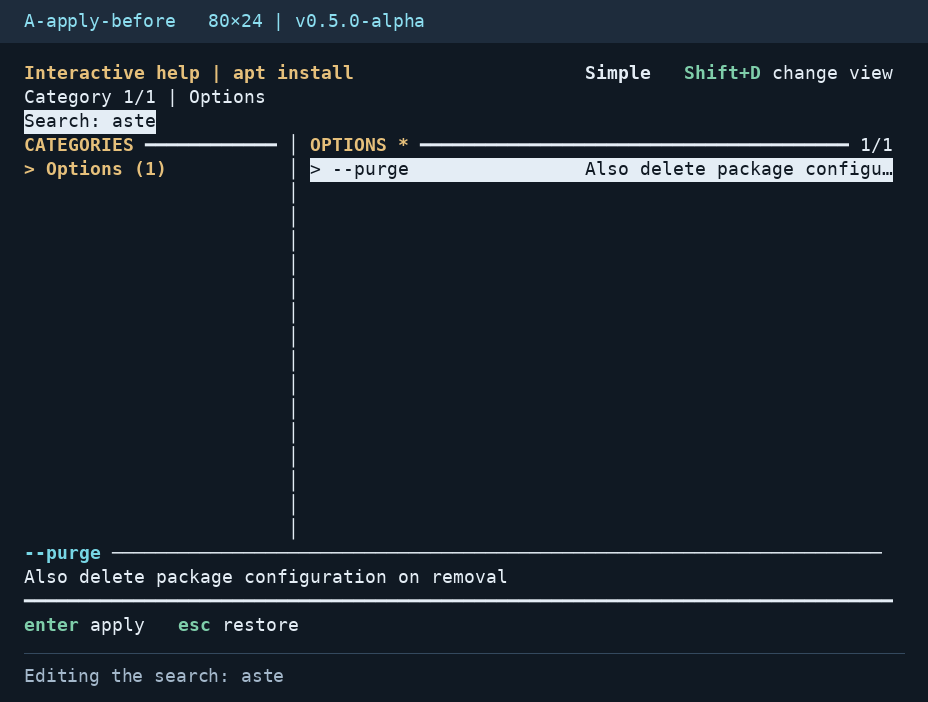 | 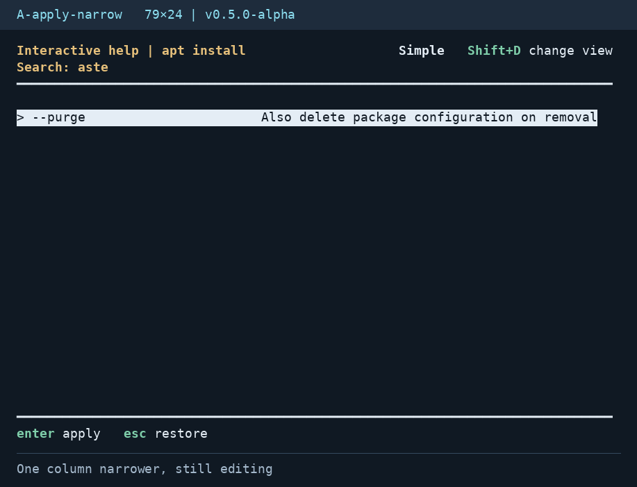 |

[Applied filter](assets/resize-review/phase2/A-apply-result.png) · [Restored filter](assets/resize-review/phase2/A-restore-result.png) · [Split control at 79 columns](assets/resize-review/phase2/A-control-narrow.png) · [Monochrome at 79 columns](assets/resize-review/phase2/A-mono-narrow.png)

**Review:** Is the difference between editing a search and browsing its results clear at 79 columns?

## B · Reading a long explanation

In the split layout, shrinking from 160×40 to 60×16 changed the suffix table from three columns to one. The viewport retained row 6. Its first text changed from the end of a qualification (“supported”) to the first input (“Input N · KiB/s”). At 80 columns, reducing height from 24 to 16 retained both row 8 and its text, “Input NB · B/s”. All 13 input/unit pairs were in order. All 63 narrow lines and all 60 lines at 80×16 matched independent fresh opens, including the final explanation.

In the guided layout, shrinking from the wide split view opened **Options**, with `--bwlimit=RATE` still selected at 2/38 in Expanded. Pressing → opened Details at the beginning. All seven pages matched a fresh narrow session.

| Before | After |
| --- | --- |
|  | 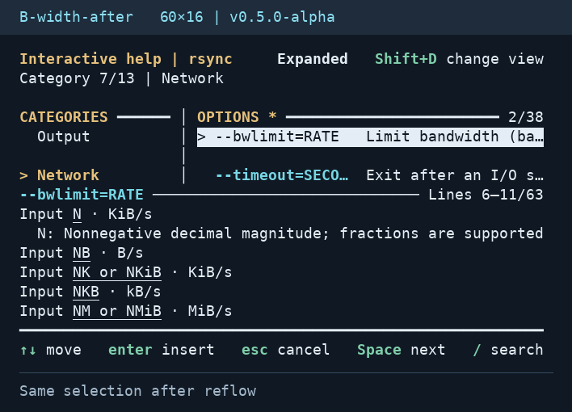 |

[80×24](assets/resize-review/phase2/B-height-before.png) · [80×16](assets/resize-review/phase2/B-height-after.png) · [Final suffix and rounding rule](assets/resize-review/phase2/B-width-suffix.png) · [Bottom of Details](assets/resize-review/phase2/B-width-last.png) · [Guided Options after shrink](assets/resize-review/phase2/B-guided-narrow.png) · [Guided Details after →](assets/resize-review/phase2/B-guided-read.png) · [Restored width](assets/resize-review/phase2/B-width-return.png)

**Review:** Should a reader partway through Details land directly in narrow Details with the same phrase visible?

## C · Resizing a moving summary

One session widened 0.271 seconds after highlighting the clipped bandwidth summary. Another widened after motion had begun. In both, the entire summary fit at 160×24 and the frame stayed still for the 2.25-second observation. After shrinking to 60×16 again, the first movement was observed at 2.016 and 2.005 seconds respectively. Other rows and the option name stayed fixed. With the keyboard motion toggle off, the clipped text stayed still through the 3.55-second return observation.

| Before | After |
| --- | --- |
| 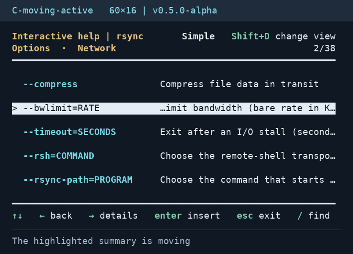 |  |

[Opening hold](assets/resize-review/phase2/C-pause-before.png) · [Clipped again](assets/resize-review/phase2/C-moving-again.png) · [Motion disabled](assets/resize-review/phase2/C-pause-before.png)

**Review:** Keep the fresh two-second pause when a resize clips the same selection again?

## D · Navigating a long option list

PageDown selected `-color_primaries` at 13/92 in the 120×30 codec menu. End selected `-trellis` at 92/92. At 79×24, the selected row and its count stayed visible in Options. The second Details page reached “Argument required.” Growing restored the split view. Up selected `-ticks_per_frame` at 91/92 and Down returned to `-trellis`.

| Before | After |
| --- | --- |
| 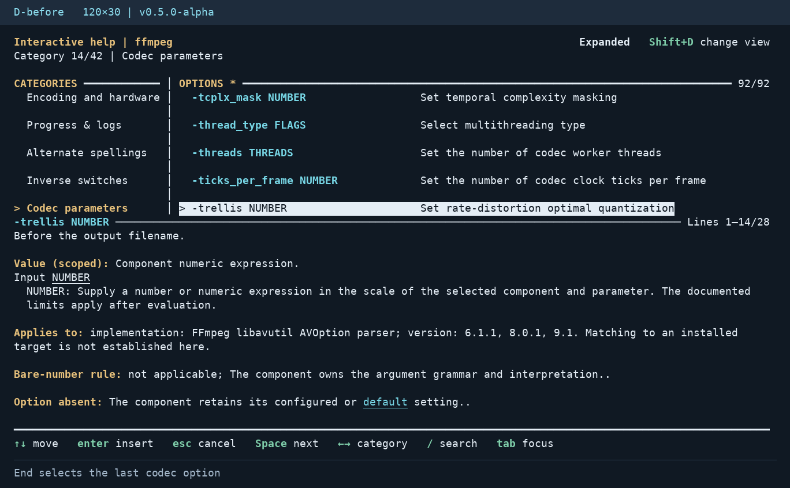 |  |

[PageDown](assets/resize-review/phase2/D-page.png) · [Open Details](assets/resize-review/phase2/D-details.png) · [Final explanation](assets/resize-review/phase2/D-last.png) · [Return to 120×30](assets/resize-review/phase2/D-return.png)

**Review:** Is the last option easy to relocate when Details moves off the list screen?

## E · Crossing the minimum size

At 59×16 and 60×15 the menu displayed the minimum-size instruction with Escape available. Enter and Down while undersized left the menu open. Growing back to 60×16 restored the original selected `--patch` frame cell for cell. Escape while undersized restored the quoted command and cursor. Queuing widths 80 → 79 → 60 → 80 at height 24 without delays produced the same final cells as the starting 80×24 frame. This checks the settled frame after the burst.

| Before | After |
| --- | --- |
| 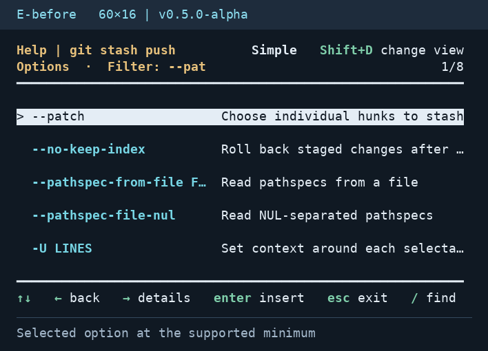 | 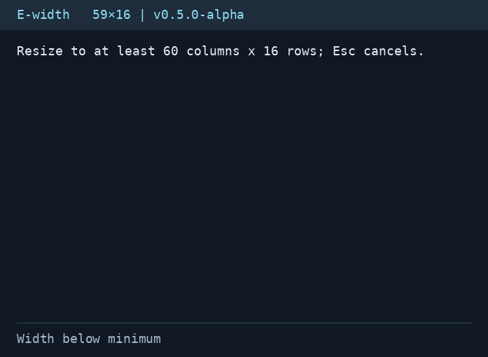 |

[Height-only warning](assets/resize-review/phase2/E-height.png) · [Recovered menu](assets/resize-review/phase2/E-width-back.png) · [Escape below minimum](assets/resize-review/phase2/E-cancel.png) · [Before resize burst](assets/resize-review/phase2/E-burst-before.png) · [Settled burst result](assets/resize-review/phase2/E-burst-after.png)

**Review:** Does the warning give enough information to recover the menu or leave it?

## F · Returning to a wrapped Bash edit

After a shrink to 60×16, Esc and Ctrl-C each restored the original Unicode command at character offset 108. Enter inserted `--archive` once before the quoted destination and placed the cursor at 114. Each exit produced one visible prompt and retained all 80 scrollback markers. Reopening worked and the execution marker stayed clear.

**Visible defect.** After Esc or Ctrl-C, growing the Bash prompt from 60 to 80 columns left a duplicate tail of the command above the prompt. The cells still showed it after reopening and cancelling. The extra text was on screen only. The Readline buffer was exact. This reproduced with and without querying the buffer before the resize. The Enter run showed a clean prompt. Plain Bash at its ordinary bottom-of-screen prompt was also clean. Moving plain Bash’s prompt to the top with Ctrl-L before growing reproduced the same stray row.

| Before | After |
| --- | --- |
|  |  |

[Menu before shrink](assets/resize-review/phase2/F-esc-open.png) · [Menu after shrink](assets/resize-review/phase2/F-esc-small.png) · [Ctrl-C result](assets/resize-review/phase2/F-esc-grow.png) · [Inserted option](assets/resize-review/phase2/F-insert-exit.png) · [Plain Bash bottom control](assets/resize-review/phase2/F-plain-grow.png) · [Plain Bash top control](assets/resize-review/phase2/F-plain-top-grow.png) · [After reopening and cancelling](assets/resize-review/phase2/F-esc-grow.png)

**Review:** Should the next development batch investigate recovery from the duplicate tail, given that plain Bash can reproduce it at the top of the screen?

[Phase plan and maintainer decision record](terminal-resize-review.md#phase-3--review-the-frames-and-choose-development-work)

## B and F follow-up

The maintainer accepted A, C, D and E. All 36 frames from those cases matched their original terminal cells on replay. The maintainer accepted B as shown and closed F with Ctrl-L recovery at the Bash prompt. The follow-up record identifies the base commit, runtime hashes, dimensions, cursor positions and captured cells. [Terminal cells and control results](assets/resize-review/bf/terminal-cells.json)

**B · Reading position.** With rsync’s bandwidth Details scrolled so the top left column ends a sentence with “supported”, shrinking from 160×40 to 60×16 keeps “fractions are supported” on the first text row. Guided navigation opens directly in Details. The split layout keeps the phrase in its Details pane. Growing back restores the same wide cells and line range (6–24 of 41). On the separate 80×24 → 80×16 height change, “Input NB · B/s” stayed at the top. All 55 lines at the destination matched a fresh open, including 13 input forms and one shared zero rule.

| Previous at 60×16 | Revised at 60×16 |
| --- | --- |
| 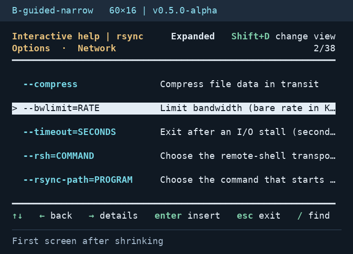 | 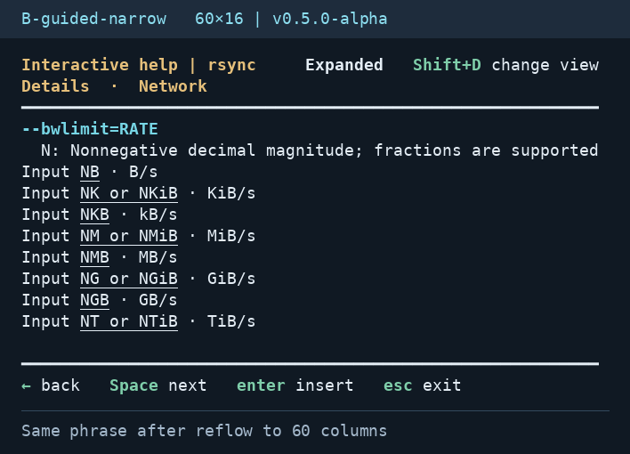 |

[Guided starting phrase at 160×40](assets/resize-review/bf/B-guided-reading.png) · [Split starting phrase](assets/resize-review/bf/B-split-reading.png) · [Previous split result](assets/resize-review/phase2/B-width-after.png) · [Revised split result](assets/resize-review/bf/B-split-narrow.png)

**Shared value rules.** Expanded Details gives each unit its own label and states a shared special value once within its applicable forms. For rsync, 12 bare and suffixed forms share the zero rule. The one-byte offset expression keeps its own grammar. For Go’s two timeout spellings, six suffix forms share a zero rule. The literal spellings and compound duration are still listed. This formatting also applies to custom profiles, positional groups and component values. Distinct meanings and version variants keep separate explanations.

| Previous rsync rules at 160×40 | Grouped rules at 160×40 |
| --- | --- |
| 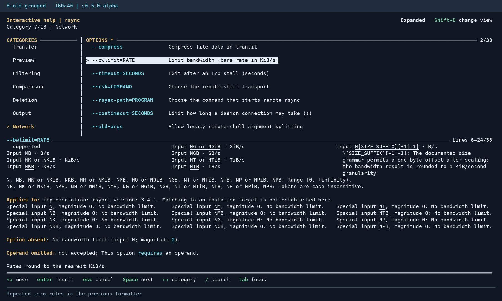 | 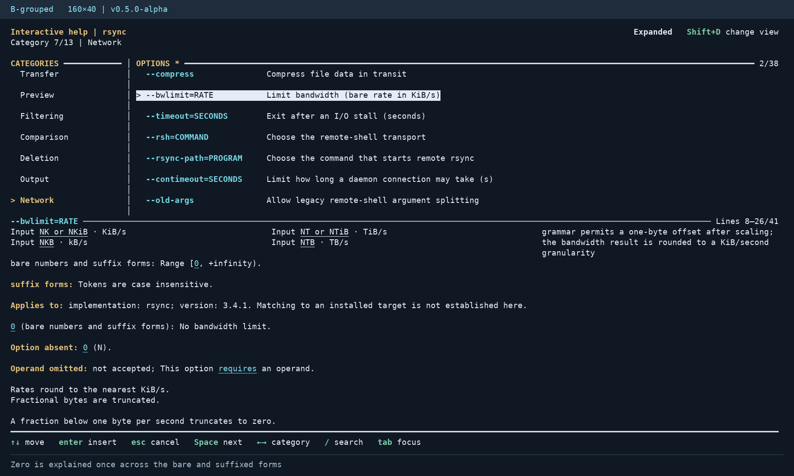 |

### F recovery

Widening a top-positioned prompt with the cursor before the quoted destination reproduced the duplicate row after Esc, after Ctrl-C, and in Bash with the menu adapter absent. The width-only control also reproduced it. A height-only change, a bottom-positioned prompt, a cursor at the end, and the Enter insertion each left a clean viewport. The captures isolate the display behavior to a case plain Bash and tmux can reproduce. They do not identify which implementation draws the stale row.

At the Bash prompt, the default Ctrl-L binding redrew the pending command once. All eight controls retained the exact buffer, cursor offset and all 80 scrollback markers after the redraw. The execution marker stayed clear. In the pair below, the caret is at character 108 both times.

| Before Ctrl-L at 80×24 | After Ctrl-L at 80×24 |
| --- | --- |
| 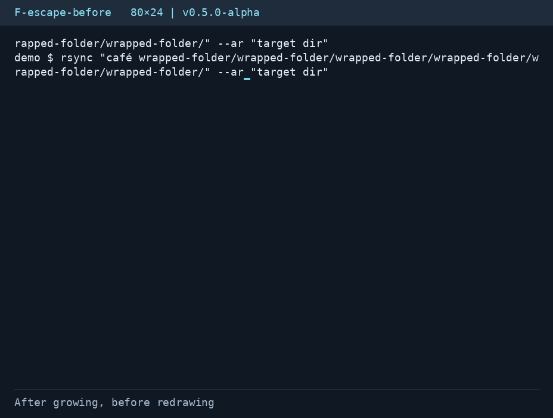 | 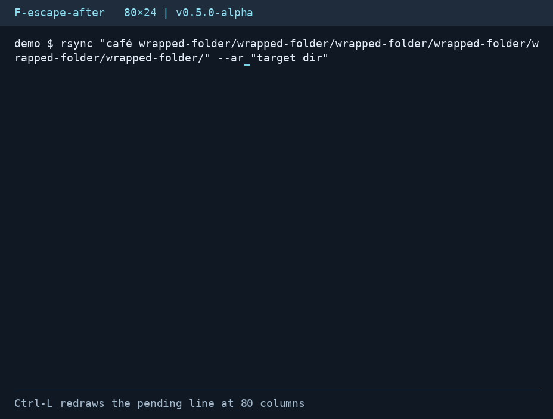 |

[Plain Bash before Ctrl-L](assets/resize-review/bf/F-plain-before.png) · [Plain Bash after Ctrl-L](assets/resize-review/bf/F-plain-after.png)

**Verification.** On host, noble310 and noble312, 121 focused tests passed per target. After the final-page adjustment, 10 focused checks per target passed, including the new end-of-page and cross-command regressions. A separate rendering pass prepared Expanded text for all 76 bundled profiles, including 4,096 options with value declarations. Both collection checks and the strict numerical gate passed with 4,426 of 4,426 required records complete. The [Phase 4 record](terminal-resize-review.md#phase-4--verify-the-accepted-changes-together) covers the combined offline suite.
