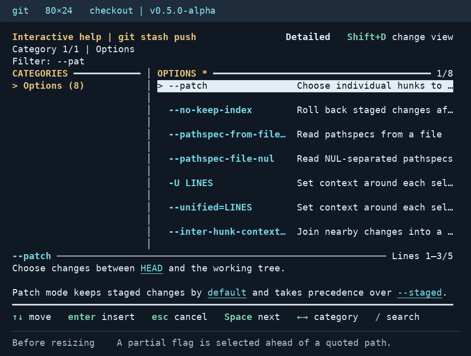
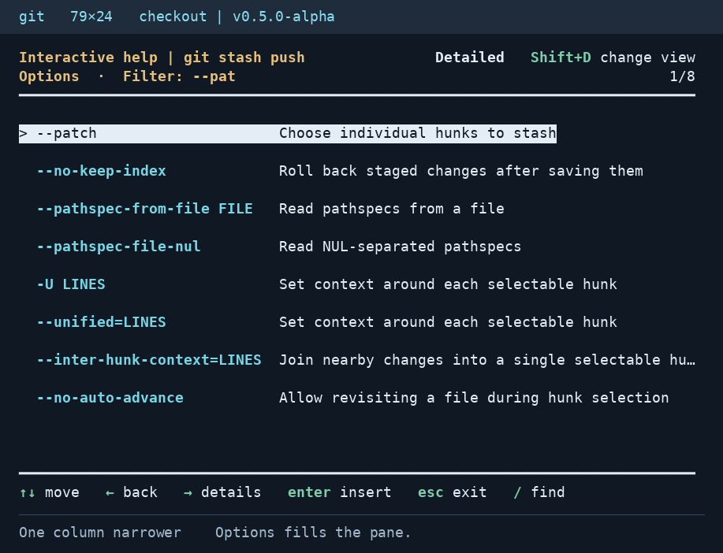
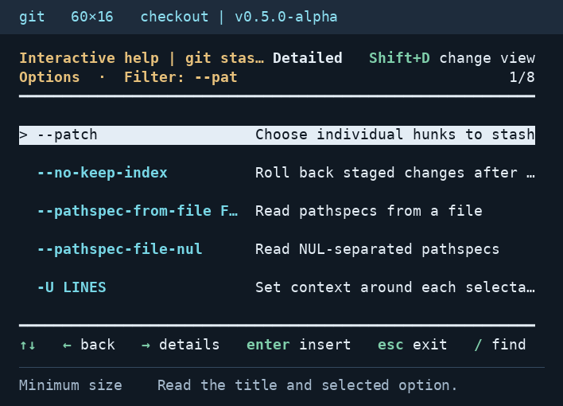
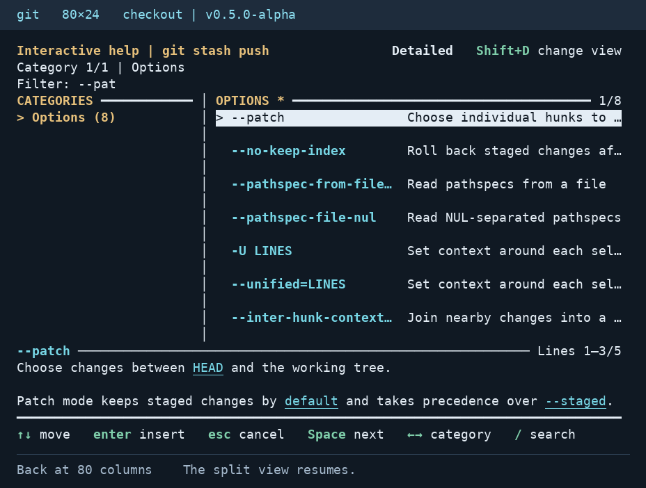
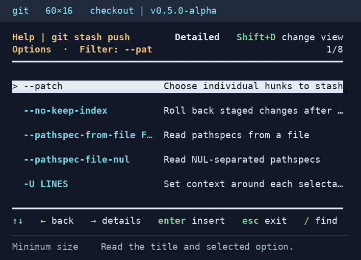

# Terminal resize tests and visual review

The maintainer accepted the compact header and all six resize cases. The review covers command identity, search, Details, animated summaries, minimum dimensions and returning to Bash. [Six-case results and snapshot gallery](terminal-resize-results.md)

## Phase 1 · Review the layout boundary

The four baseline PNGs follow one live Bash/tmux session on Resolute. The pending command was `git stash push --pat▏ 'café.txt'`, with the narrow menu enabled. Alt-H opened the menu, `--patch` was highlighted, and Shift+D selected Detailed. The checkout was based on `35d23aa` with the APT guidance changes. Bash 5.3.9 and Ubuntu’s tmux package `3.6a-2ubuntu0.2` rendered the frames in color. The terminal then changed size three times without further menu input.

| 1 · 80×24 before | 2 · 79×24 after shrinking one column |
| --- | --- |
|  |  |

| 3 · 60×16 minimum | 4 · 80×24 after growing |
| --- | --- |
|  |  |

**Observed.** The menu kept Detailed, the `--pat` filter and `--patch` at 1/8. At 79 columns the Options screen replaced the split view. At 60 columns the command title read `Interactive help | git stas…`. Growing restored the full title and reproduced the original 80×24 cells exactly. Escape returned the exact original line and cursor at offset 20. The existing 60×16 Git regression also expects a complete child-command title in Simple. That failure reproduces on the unmodified `35d23aa` checkout. [Git terminal assertion](../tests/test_git_stash_worktree_menus.py)

**Accepted header.** The maintainer chose to shorten “Interactive help” first. At 60×16, the revised title reads `Help | git stash push`, with `Detailed   Shift+D change view` visible at the right edge. The key retains its separate highlight. The Git regression checks the same command in Simple.

| Before · 60×16 | After · 60×16 |
| --- | --- |
|  |  |

The second live session repeated the same keystrokes and dimensions. At 60×16 only the title row changed. The three other PNGs matched the baseline images byte for byte. Both sessions returned to Bash with the original quoted line and cursor at offset 20. The maintainer accepted the compact title.

The focused group passed 23 checks each on Resolute (Python 3.14) and Noble (Python 3.10 and 3.12), including the formerly failing Git assertion. Tests cover all three levels, split and narrow layouts, wide characters and remapped level keys. The strict numerical gate passed. Phase 4 records the combined full-suite results.

## Phase 2 · Exercise operations already in progress

The following sequences ran in private tmux sessions with Bash. The [capture results](terminal-resize-results.md) include the observed behavior, controls and visual decisions. The procedure can be replayed as follows. Drive the actual key bindings. Record the pre-resize state, first settled destination frame, and return frame when it provides a distinct observation. Reuse earlier frames for shared starting states. Use the default split layout as a control for the 79-column transition, where the narrow layout is opt-in.

| Case | Actions and dimensions | Automated checks | Frames and human decision |
| --- | --- | --- | --- |
| A · Active search | At 80×24 open `apt install --pur▏ 'graphviz'`. Start a search for `asterisk`. Resize to 79×24 partway through typing and finish the query. Exercise Enter to apply and Esc to abandon in separate passes. | Enter applies the entire query and leaves `--purge` reachable. Esc in search restores the previous filter. Cancelling the menu preserves the quoted operand and caret. | Compare the partial query before and after the width change, then the applied match. Is the difference between editing and applied search visible? |
| B · Paged Details | Select rsync `--bwlimit=RATE` in Expanded, partway down its units. Shrink 160×40 → 60×16, page through the last explanation, then grow to 160×40. Include a height-only 80×24 → 80×16 pass. | Preserve the option and level. Compare the reachable text to a newly opened menu at the destination geometry. Check the first and final explanations, unit/meaning pairs and column order. Record the first visible phrase across the resize. Line numbers can change when text wraps. | Capture the reading position before, after and at the final explanation. Decide whether the page should keep the same phrase visible after reflow. |
| C · Moving summary | Highlight the clipped rsync bandwidth summary at 60×16. Widen to 160×24 during the two-second pause. Repeat after motion starts, then shrink to 60×16 again. Repeat the timing logic with scrolling toggled off using `m`. | Motion stops when text fits. Only the highlighted summary moves when clipped. The option label, other rows and filter stay fixed between same-size frames. Use the renderer clock for timing and record one live transition. | Pair the held and moving frames with the first wide frame. Decide whether clipping the same selection again should restart the pause. |
| D · Long option list | Open FFmpeg Codec parameters at 120×30, PageDown, then select the final entry `-trellis`. Shrink to 79×24, use Details, and return to 120×30. | Keep the selected flag and category, with the highlight on-screen. Verify 92/92 at the end, arrow navigation after reflow and access to the last Details line. | Capture the selection near the viewport edge at each size. Check list alignment, separation from the footer and how easily the reader finds the selection again. |
| E · Minimum dimensions | With an option selected at 60×16, cross one limit at a time: 59×16 and 60×15. Grow back after each. Repeat one visit with Esc while undersized. Apply a rapid 80 → 79 → 60 → 80 width change at height 24 in the same session. | Verify the size prompt, recovery at 60×16, cancellation below minimum and the settled final geometry after the burst. Check that a resize alone never inserts a choice or executes the line. | Save each distinct size warning and the recovered menu. Review whether the recovery instruction is readable and the returned selection is obvious. |
| F · Return to Bash | Use a wrapped command with Unicode before the cursor and a quoted operand after it. Resize with help open, then compare Esc, Ctrl-C and Enter on separate runs. Resize again at the prompt and reopen help. | On cancellation compare the exact Readline buffer, cursor, retained history and one visible prompt. On Enter compare the single expected insertion and its boundary. Verify alternate-screen exit and the execution marker. Compare the viewport to a plain Bash resize control. | Save the cursor and surrounding prompt rows before opening and after each distinct exit. Review duplicated rows, stale menu cells and caret placement. |

Existing tests already cover minimum-size recovery, a wrapped pending line, custom bindings, Unicode, polling geometry, Details paging and a live narrow/wide round trip. Extend only the cases those tests leave uncovered. The earlier rsync resize provides an independent three-column to one-column comparison for phase 2B. [Bash and tmux harness](../tests/test_terminal_screen.py) · [Menu levels and animation](../tests/test_menu_levels.py) · [Numerical scrolling and recovery](../tests/test_numerical_presentation.py) · [Prior live resize](audit-history.md#phase-2-terminal-audit)

## Phase 3 · Review the frames and choose development work

For each case, place adjacent full-pane PNGs in a review sheet, at their native aspect ratios. Retain raw cells and dimensions alongside the capture log. Include the case ID, checkout revision and local changes, OS, Bash/tmux versions, command, cursor, layout setting, color mode, keystroke or resize, selected option, filter, level and scroll position. Capture animated transitions with timestamps. Use a single monochrome comparison where color is doing the work of distinguishing focus or sections. Compare stable frames for correctness and use a short burst recording when investigating transient redraws.

Record automated outcomes separately from what the reviewer can see. A tmux capture establishes rendered cells. A terminal-emulator drag and visual check can establish whether intermediate flicker or cursor motion is distracting in that emulator. Include its name and version with that observation.

| Review point | Evidence | Maintainer response | Next action |
| --- | --- | --- | --- |
| Command identity at minimum width | Phase 1 before/after pair above | Keep the compact header | Complete. |
| A, C, D and E | [Original gallery](terminal-resize-results.md) | Keep the search, summary, list and size-warning behavior | Complete. All 36 replayed frames matched the original terminal cells. |
| B · Paged Details | [Reading position and grouped rules](terminal-resize-results.md#b-and-f-follow-up) | Keep Details open at the same phrase and group equivalent value rules across command pages | Complete. The maintainer accepted B as shown. |
| F · Wrapped Bash prompt | [Redraw controls and recovery](terminal-resize-results.md#f-recovery) | Accept the documented Ctrl-L recovery at the Bash prompt | Closed. |

For feedback, record the frame number, what became hard to find, and the desired outcome. Mark the case **keep**, **revise** or **defer**. Put accepted changes and their exact comparison frames in the roadmap. Keep open preferences separate from reproduced defects. Record any architecture decision for explicit approval.

## Phase 4 · Verify the accepted changes together

The combined offline run used the 1,237 tracked files at commit `266e75694170c0c21c356d08d8afbd78d698271d`. The working tree and index matched that commit at freeze. All three targets received the same source archive (SHA-256 `f3f75b0574659d64b4c9a265ad990fd3243e326eb2980cb71a44f60f46204390`). The four runtime and profile hashes in the [B and F capture record](assets/resize-review/bf/terminal-cells.json) matched the archive.

Each target used the [offline fixture loaders](test-selection-plan.md#reproduce-the-paired-offline-baseline) and ran `bash tests/run.sh` once with ordinary, unsharded discovery. Fixture manifest SHA-256 was `f08addd63144ff211587db461169f9f26302e5a969aea6865ec70ff879e19984` for host and `585b29b53ef075b24e12ddad0d32b612f0182e32824f4f300be2800b1babee8c` for both Noble targets.

| Target | Ubuntu | Python | Discovered | Passed | Failed or errored | Skipped | Exit |
| --- | --- | --- | ---: | ---: | ---: | ---: | ---: |
| host | 26.04.1 | 3.14.4 | 2,086 | 2,085 | 0 | 1 | 0 |
| noble310 | 24.04.5 | 3.10.20 | 2,086 | 2,085 | 0 | 1 | 0 |
| noble312 | 24.04.5 | 3.12.3 | 2,086 | 2,085 | 0 | 1 | 0 |

All three transcripts contained the same test IDs and outcomes. The sole skip was `test_functional_matrix.EdgeCaseTests.test_probe_reports_the_windows_limitation`, with the reason “POSIX hosts complete the probe normally”. Numerical preflight and both collection validations passed on every target. This closes Phase 4.

The transcripts, per-target results, source archive and fixture manifests are retained locally under `tests/reports/resize-phase4-266e756/`.

For future resize proposals, identify the operation, expected state, comparison snapshots and maintainer decision before grouping changes for another verification batch. [Project verification procedure](development.md#auditing-command-help)
