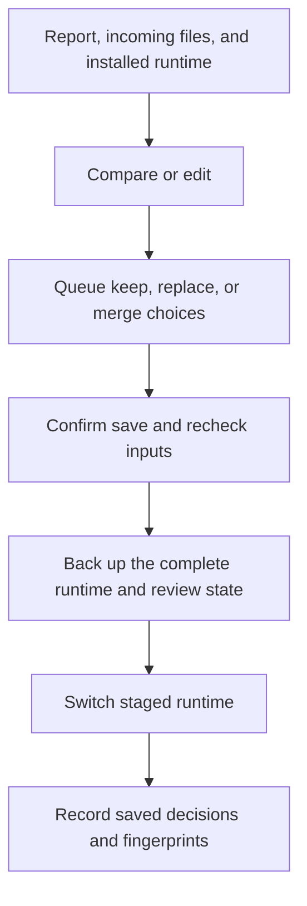

# Reviewing update conflicts

[Project overview](../README.md) · [Installation and updates](installation.md) · [Documentation index](README.md)

The update reviewer compares preserved local files with the incoming distribution
saved by `update.sh`. It supports keeping a local customization, accepting an
incoming file or deletion, and editing a combined version. Choices remain queued
until an explicit save confirmation. No target command or compared script is
executed by comparison or saving.

## Opening a report

The [GitHub release updater](github-updates.md) opens this reviewer automatically
after an update with conflicts when a terminal is available. Deferred or
noninteractive updates print a resume command referencing retained verified source.

Run the command printed by an update that reports conflicts, or supply its exact
report path from the source checkout:

```bash
bash review-update.sh "/absolute/path/cli-interactive-help.update-backup-ID/report.json"
```

`ID` represents the unique suffix printed by the updater; select an actual report,
not a wildcard matching multiple backups. The reviewer requires an interactive
Linux terminal and Python 3.10+. The installed `review-update.sh` also works by
absolute path. If installed installation or review helpers were edited, use the
new source checkout's reviewer so those helpers are not loaded to perform review.

The report must remain in its original sibling backup directory beside the
installation. The installation manifest determines managed ownership. Moved
reports, unrelated destinations, changed incoming files, and reports superseded
by changes to the installed manifest are refused. Run another update and review
its report when the older report no longer matches.

Reports created before versioned update metadata remain supported when their
previous manifest and recorded changes reconstruct the current manifest. These
legacy reports display a warning because they did not record historical incoming
checksums. Their incoming files must be inspected as supplied. If reconstruction
fails, generate a fresh report with `bash update.sh`.

## Comparing and choosing files

The main menu lists 12 conflicts per page. Enter a displayed number to open a
file; `n` and `p` change pages. Status indicates pending, queued, or saved choices.
A saved decision becomes pending again if that file changes afterward. Original
update findings remain in `report.json`; saved decisions are kept separately in
`review-state.json` in the same backup directory.

| Entry control | Behavior |
| --- | --- |
| `d` | Show a unified diff from local content to incoming content |
| `l` / `i` | Read the local or incoming file |
| `m` | Read the queued edited merge |
| `k` | Queue keeping the local file, including an intentional local deletion |
| `r` | Queue the incoming version; an absent incoming file means deletion |
| `g` | Accept or reject changed line blocks through guided terminal editing |
| `e` | Open a retained draft in the configured editor and queue a valid result |
| `x` | Clear the queued choice for this entry |
| `b` | Return to the list without changing the queued choice |

Entry details show the conflict reason, file types, permissions, sizes, and hashes.
Comparison pages contain 20 lines. Enter advances to the next page; `q` returns
to the entry menu. Terminal control characters are escaped and displayed lines
are limited to 500 characters. File bytes are not modified by those display rules.
Text comparison and editing require UTF-8 content up to 512 KiB and 10,000 lines.
Binary files within the byte limit can be kept or replaced as complete files;
their hashes and sizes remain available even when text comparison is unavailable.
Larger files require manual handling or a keep-local choice.

Symlinks, directories, and blocked parent paths cannot be replaced
or merged automatically. Keep them locally or resolve their filesystem arrangement
outside the reviewer, then generate a fresh update report. Links are not followed
to read or replace their targets. Special files such as FIFOs or sockets anywhere
in the runtime prevent opening review and require manual handling first.

## Guided editing without an external editor

Press `g` in an entry to compare individual changed blocks. Each block shows its
local and incoming lines. Adjacent changed lines form one block; unchanged lines
separate blocks. Additions, replacements, deletions, and empty-file existence
changes are represented explicitly. This is a two-file comparison, not an
automatic three-way merge against a pristine historical base.

| Guided control | Behavior |
| --- | --- |
| `a` | Accept the current incoming change and advance |
| `r` | Reject the incoming change, retaining local content, and advance |
| `n` / `p` | Move forward or backward without changing decisions |
| `v` | Preview the combined file; undecided blocks temporarily remain local |
| `d` | Validate and queue the result after every block has a decision |
| `b` | Return to the entry, retaining guided decisions for this session |

Decisions can be revised by navigating back to a block. Original bytes, Unicode,
line endings, and a missing final newline are preserved for selected lines.
Accepting every change selects the complete incoming file, including a deletion;
rejecting every change retains the local file. A missing file is distinct from
a present empty file. Mixed choices are validated like other edited merges.
Invalid JSON or Python syntax leaves the guided decisions available for correction.

Guided editing compares the installed local file with incoming content. It does
not use a previously queued external-editor merge as its base. Queuing a guided
result replaces that entry's previous queued choice. `x` in the entry clears both
the queued choice and guided decisions. Guided decisions are held in memory until
queuing and saving; quitting discards unsaved decisions after confirmation.
After a successful save, guided drafts reset and the final file-level decision
is recorded in the review state. No external editor is launched in guided mode.

Guided saves use the same complete runtime backups, stale-input checks, rollback,
and ownership rules described below. Files remain unchanged until the main-menu
save is confirmed. Binary, oversized, symlinked, or blocked paths cannot be merged
through guided editing.

## Editing a merge with an external editor

Set `VISUAL` or `EDITOR` before opening the reviewer, for example:

```bash
export EDITOR='nano'
```

The editor command is split into executable and arguments without shell
evaluation. Quoting supports executable paths containing spaces; pipes,
redirection, command substitution, and shell aliases are not interpreted. The
configured editor itself is executed and may have its own plugins or side effects.

The first draft starts with local content, falling back to incoming content when
the local file is absent. Reopening an edit starts from its queued merge. Drafts
are retained as `review-draft-<unique-id>.<extension>` inside the update backup,
including when the editor fails, syntax is invalid, or review is cancelled.
Their printed paths allow manual recovery. Drafts are created with owner-only
permissions and are not installed until save is confirmed.

Edited JSON must parse and edited Python must pass syntax parsing. No reviewed
Python code is imported, and no reviewed shell script is sourced to validate a
merge. Syntax checks do not establish schema validity or runtime compatibility.
Shell script merges and other text formats require manual correctness checks.
An invalid edit leaves the previous queued choice intact.

## Saving and ownership

Return to the main menu, press `s`, inspect the queued action summary, and confirm
with `y`. Incoming deletions are identified explicitly in that summary. Press `q`
to quit; queued choices require a discard confirmation. EOF or Ctrl-C cancels
unsaved choices. Previously saved decisions remain applied.

Every save creates a sibling directory named
`<installation-directory>.update-review-backup-<unique-id>` with:

- `previous/`: the complete runtime immediately before that save.
- `decisions.json`: selected decisions and resulting file/manifest fingerprints.
- `review-state.before.json`: the previous review state, or JSON `null` when none existed.

The backup path is printed before switching the runtime. The backup directory is
created with owner-only permissions and is retained until explicitly removed.
Space is required for a complete staged runtime and the retained prior runtime.

An accepted incoming file becomes managed with its incoming content hash, even
when replacing an unmanaged collision. An accepted incoming deletion removes
that file's ownership entry. Keeping local content retains previous ownership;
edited merges that differ from incoming content remain customizations protected
from later automatic replacement and removal. A merge identical to incoming
content adopts its hash. A kept unmanaged file remains unmanaged.

Keeping or merging a customization marks this report as reviewed; it does not
suppress conflict reports from future upgrades. Each new distribution may need
another comparison. External settings and Bash startup files are untouched.
Open a new Bash session after applying runtime changes.



## Stale inputs and recovery

Saving shares the install/update/uninstall lock and checks the runtime, incoming
distribution, original report, and review state before and after staging. Detected
edits or another saved review stop the operation. Close active help menus and avoid
editing runtime files during review. The checks do not lock out unrelated writers.
There is a short interval during switching when the installation path is absent.

Ordinary switch or metadata-write failures restore the previous runtime. A failed
candidate can remain in `failed-runtime/` beside the backup. Caught interruptions
during the switch also attempt rollback. A forced kill, power loss, or failure
during rollback can require manual recovery; the runtime and review-state file
are not one durable filesystem transaction.

After confirming no installation process is active, use the same runtime restore
procedure described in [update recovery](installation.md#update-recovery). When
restoring a review backup, also restore `review-state.before.json` to the original
report directory as `review-state.json`; if its contents are JSON `null`, remove
the current review-state file instead. Preserve any newer runtime or state files
separately before replacing them. The original report and incoming directory are
not rewritten by the reviewer.

Exit status is `0` for normal exit, `130` for EOF/Ctrl-C cancellation, `1` for
validation or filesystem failure, and `2` for invalid command-line arguments.
Entry-level comparison and editor errors return to the entry menu. Save errors
exit the reviewer so stale choices cannot be applied accidentally.

## Validation

```bash
python3 -m unittest discover -s tests -p 'test_update_review.py' -v
python3 -m unittest discover -s tests -p 'test_guided_merge.py' -v
bash tests/run.sh
```

Tests cover file and deletion choices, unmanaged collisions, manual merges,
ownership after uninstall, persisted and stale decisions, legacy reports,
malformed paths and metadata, symlinks, binary and oversized content, editor
failures, terminal escaping, concurrent edits, locks, rollback, and interruption.
A real Bash terminal test compares and resolves a conflict, saves it, and inserts
an option through the reviewed installation without executing the pending command.

Guided-change tests cover mixed acceptance and rejection, navigation and preview,
retained decisions, invalid merge recovery, missing versus empty files, Unicode,
line endings, 200 deterministic generated merges, backups, and stale inputs.
A separate real Bash terminal workflow selects individual changes without an
external editor, saves the merged installation, and inserts an option without
executing the pending command.
